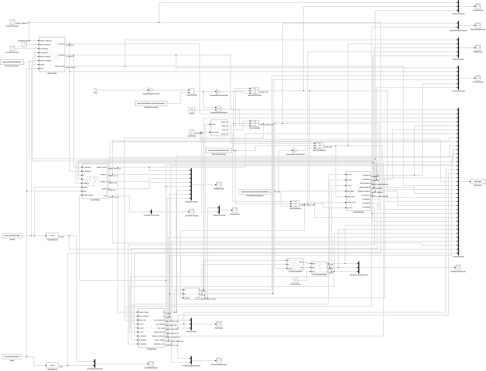

# 共同实验与整机装配：搭建步骤

四个装配子系统为FeedbackStage、MotionStage、CurrentStage、VoltageStage。保留对象真值和控制反馈。run_motor_case通过SimulationInput覆盖一轮实验，保存实际参数、输入、完整数据和通道名。

1. 根层将Electrical的电磁转矩接Mechanical，将机械电角速度反馈给电气方程；用逆Park/逆Clarke由dq真值构造三相电流。

2. FeedbackStage先采样延迟，再Clarke/Park。控制器读取采样反馈，分析同时保留id/iq真值。

3. MotionStage在1ms执行位置P、速度PI和速度边界；CurrentStage在100µs执行双轴PI与前馈。

4. VoltageStage依次做圆限制、反变换、死区补偿、SVPWM、执行保持/延迟、平均逆变器与死区误差，再用真实转子角投影为Plant电压。

5. UseMechanical=0时，ImposedElectricalSpeed与Clock生成一致速度和角度，表示外部原动机维持转速；不能将未采用的自由机械响应当作该工况真值。

6. UseInverter=0时理想dq限幅电压直接进Plant；逆变器诊断支路仍计算，但其三相电压不是该理想模式实际施加量。UseTiming=0仍保留采样保持。

7. 最终限制残差返回PI。ToWorkspace与Scope接相同来源；52列逐项登记。模式在实验开始前选择，不支持无扰运行中切换。

8. 共同场景含理想/平均/含时序电流环、额外延迟、反转、参数变化、限压恢复、FF开启时禁能/复位；加载速度/位置、FF开关和死区对照保存在各功能模块结果中。

搭建操作：使用Library Browser或双击画布查找上述基础块；参数填结构字段表达式。先更新图检查维度/采样周期，再运行本模块测试。修改库源时先在Library编辑器解锁，保存源库后重跑测试；不要无意断开测试实例的库链接。

[参数与Scope](../parameter/README.md) · [运行](USAGE.md) · [模块](../README.md)
