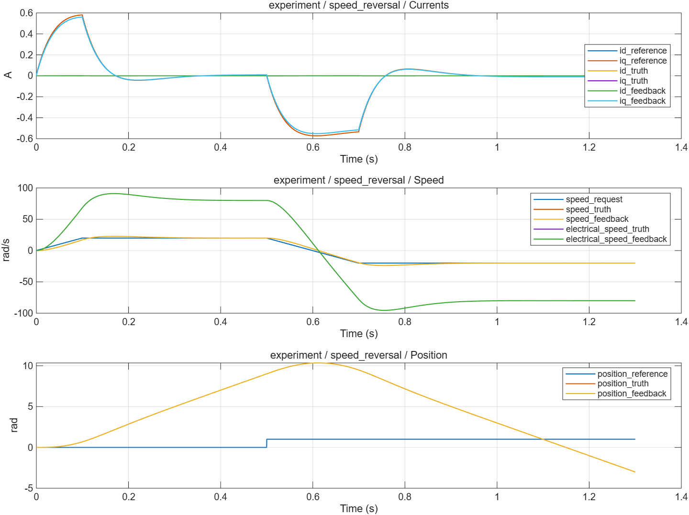

# 共同实验与整机装配：波形分析

- 模型文件：`src/MotorExperiment.slx`；系统对照使用`../experiment/src/MotorExperiment.slx`。
- 参数文件：`parameter/experiment_parameters.m`；每个case另保存实际跨模块parameters。
- 采样周期：电流/默认记录100µs，外环1ms；桥臂0.1µs；能量工况记录5µs。
- 求解器/步长：普通模型ode4/5µs；收敛工况2.5µs；桥臂FixedStepDiscrete/0.1µs。
- 工况：9项，见下表和实际断言脚本。
- 数据文件：`waveform_analysis/results.mat`、`waveform_analysis/metrics.json`。

## 结果

| 工况 | 结论 | 部分指标（键名含单位） |
|---|---|---|
| ideal_current | 通过 | final_current_error_A=2.065015e-13；current_iae_A_s=0.0006514203；tail_current_rms_A=0.1129753 |
| average_current | 通过 | final_current_error_A=2.087219e-13；current_iae_A_s=0.0006514203；tail_current_rms_A=0.1129753 |
| timed_current | 通过 | final_current_error_A=1.754152e-13；current_iae_A_s=0.0009441535；tail_current_rms_A=0.1390174 |
| extra_delay | 通过 | final_current_error_A=1.572076e-13；current_iae_A_s=0.001947094；tail_current_rms_A=0.1751916 |
| speed_reversal | 通过 | final_speed_error_rad_s=0.0003724115；final_current_error_A=5.019403e-7；current_iae_A_s=0.006866971；tail_current_rms_A=0.000002813609 |
| parameter_change | 通过 | final_speed_error_rad_s=0.001986784；final_current_error_A=0.000002015242；current_iae_A_s=0.005664808；tail_current_rms_A=0.000002062546 |
| voltage_limit_recovery | 通过 | final_current_error_A=4.440892e-16；current_iae_A_s=1.347466；tail_current_rms_A=0.000008087046 |
| disable_with_feedforward | 通过 | request_voltage_V=0 |
| reset_with_feedforward | 通过 | request_voltage_V=0 |

不适用于当前模式的指标以JSON null记录，例如电流模式不评价速度/位置跟踪。IAE为误差绝对值时间积分。tail_current_rms_A窗口起止在metrics中；短工况可能覆盖全程，不自动表示稳态。

## 波形说明

四个装配子系统为FeedbackStage、MotionStage、CurrentStage、VoltageStage。保留对象真值和控制反馈。run_motor_case通过SimulationInput覆盖一轮实验，保存实际参数、输入、完整数据和通道名。

[SVG图](summary.svg) · [完整指标](metrics.json) · `results.mat`（运行验证后生成）

## 范围与复现

double MIL、理想同步反馈和简化功率级。没有完整启停监督器、门极保护和实际ADC/PWM资源绑定。MTPA/弱磁、算法替换和目标验证仍在步骤15–18。

验证依据为解析解、能量关系、边界/精确时序断言和同工况开关对照，没有运行原始chensha/MBD或官方工具箱块做逐点等价验证。当前为double MIL，不代表single、C2000构建、PIL或实机已经验证。

[验证脚本](run_experiment_validation.m) · [运行方法](../build_process/USAGE.md) · [Scope表](../parameter/README.md)
