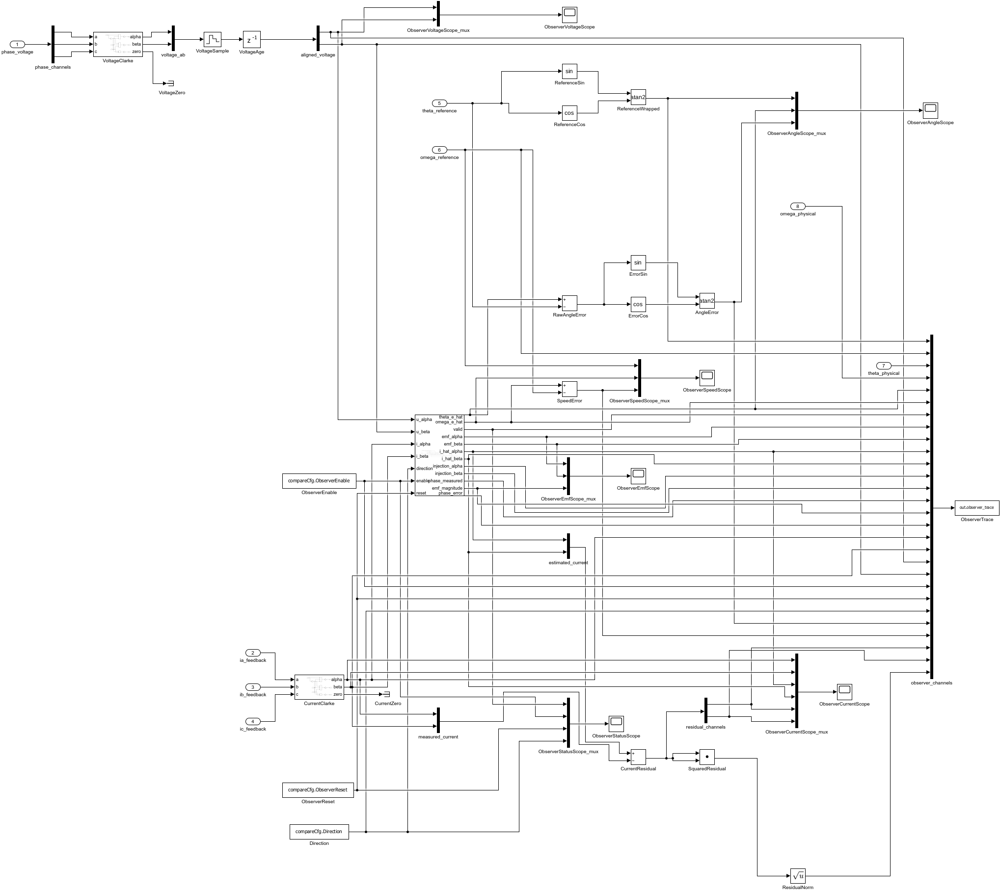

# 搭建、运行与调参

## 各部分的作用

1. 把现有[MotorExperiment](../../experiment/src/MotorExperiment.slx)另存为SensorObserverCompare，保留PMSM、机械对象、Sensor采样反馈、电流/速度环、PWM执行与原52列记录。共用库继续链接，原文件不改写。
2. 根层仅新增ObserverMonitor输入分支。该子系统没有Outport，因此估算角度不会回到Park、电流环或速度环；Plant真值只进入误差和年龄核对。
3. VoltageStage输出8是最终作用的三相端电压，包含执行延迟及启用时的死区模型。监测分支先Clarke到alpha/beta，再50µs采样并延迟FeedbackTicks拍。没有使用PI限制前请求替代实际电压。
4. FeedbackStage输出7/8/9为已采样并按FeedbackTicks延迟的三相电流，Clarke得到同年龄i_alpha/i_beta。SMO用i_hat[k]与i[k]比较，u[k]用于预测下一状态；经过上述共同延迟后，它们对应同一过去时间区间。
5. SMO为[SlidingModeObserver库块](../../../../lib/观测器/滑模/README.md)，只消费u_alpha/u_beta、i_alpha/i_beta、Direction、ObserverEnable和ObserverReset。Direction是该工况已知的运行方向配置，未用Plant角度在线推算。基础SMO的正反方向和零低速限制仍适用。
6. theta_reference和omega_reference来自与电流同一反馈帧。角误差为atan2(sin(theta_hat-theta_reference),cos(...))；速度误差保留符号。theta_physical/omega_physical是当前Plant状态，只记录用于验证年龄，不送入估算器。
7. 保存observer_trace的28列及原trace的52列，日志周期均50µs。监测Scope见[参数页](../parameter/README.md#scope-通道)。模型加载时不依赖base workspace同名变量。



## 直接运行

```matlab
addpath('F:\Study\AI\AiCoding\CodingKit\modules\matlab\simulink\model\app_models\Sensor\observer_compare\build_process');
open_system('F:\Study\AI\AiCoding\CodingKit\modules\matlab\simulink\model\app_models\Sensor\observer_compare\src\SensorObserverCompare.slx');
out = sim('SensorObserverCompare');
```

首次使用open_system，加载回调自动执行初始化。模型已加载时可执行initialize_observer_compare('SensorObserverCompare')重置默认值。通常直接打开SLX点击Run即可。默认机械速度从0到40rad/s，0.35s施加0.1N·m负载，运行0.8s。进入ObserverMonitor查看Angle、Speed、Current、EMF、Status和Voltage六组Scope。

## 单次参数覆盖

```matlab
p = observer_compare_parameters;
p.experimentCfg.SpeedReference = -40;
p.experimentCfg.LoadTorque = -0.1;
p.compareCfg.Direction = -1;
in = Simulink.SimulationInput('SensorObserverCompare');
names = fieldnames(p);
for k = 1:numel(names)
    in = in.setVariable(names{k},p.(names{k}),'Workspace','SensorObserverCompare');
end
out = sim(in);
t = out.observer_trace.time;
x = out.observer_trace.signals.values; % N-by-28，列定义在parameter/README.md
plot(t,x(:,24)); ylabel('electrical angle error (rad)');
```

改Rs观测误差时只改p.smoCfg.Rs并调用refresh_smo_parameters，不改Plant的Rs；否则比较的是两者一起改变。修改电机配置时，电流/速度增益不会自动随SimulationInput任意字段变化，应在参数函数中明确重新设计。修改控制Ts时要同步timingCfg、smoCfg、pllCfg、日志周期及PWM周期，并检查Plant步长整除关系。基础SMO只用于Ld=Lq。

## 批量验证与重建

```matlab
module = fileparts(which('SensorObserverCompare.slx'));
addpath(fullfile(module,'..','waveform_analysis'));
report = run_observer_compare_validation;
```

参数覆盖不保存为SLX默认值。Scope显示最后一例；分析指定案例应加载results.mat中的records。数据包含每例全部参数、两个trace和误差/年龄指标。可传入案例名列表做局部诊断；完整验收应调用无参入口运行全部案例。

重建请复制本模块完整目录到独立位置，只在该副本删除本模块生成的SLX后调用build_observer_compare；脚本拒绝覆盖已有模型。调用前确保MotorExperiment没有未保存改动。原库与原Sensor基线继续共享，不在新App中维护算法副本。

[模块入口](../README.md)
