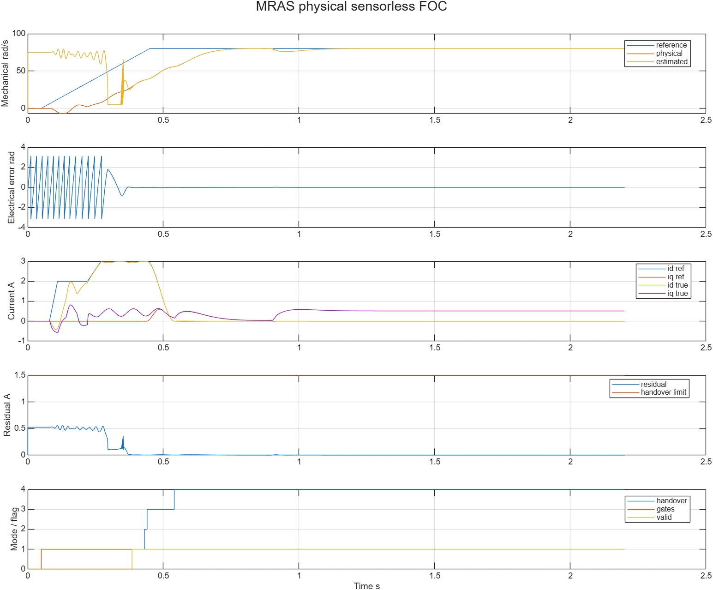
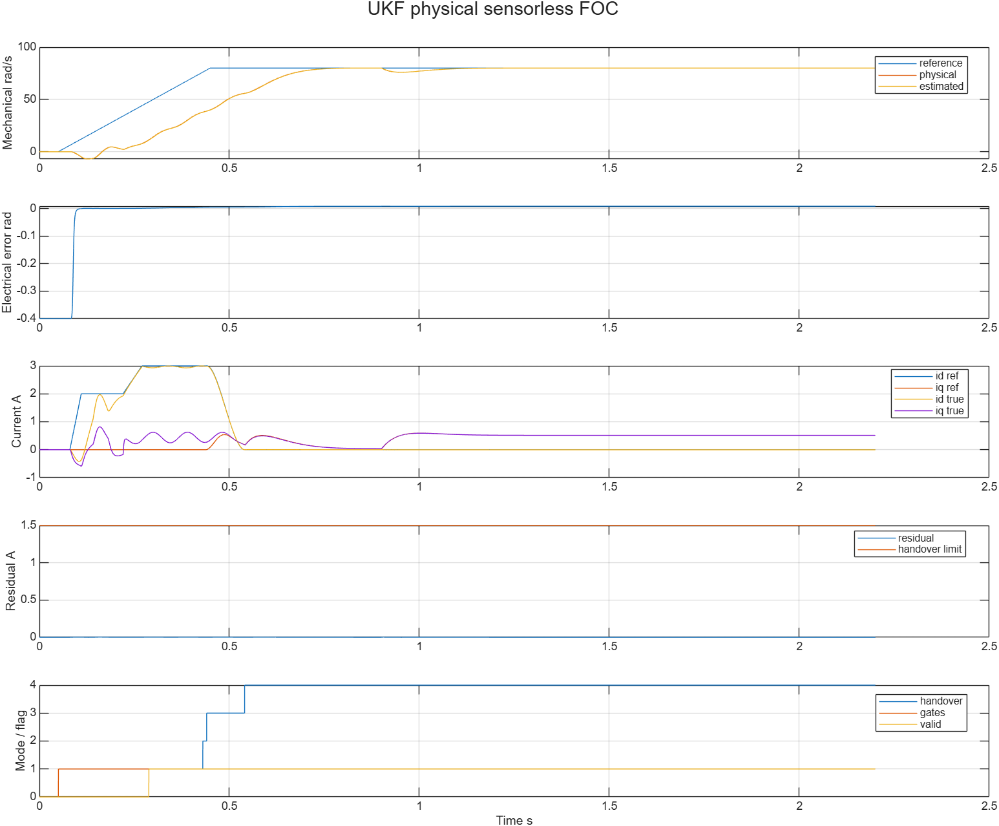
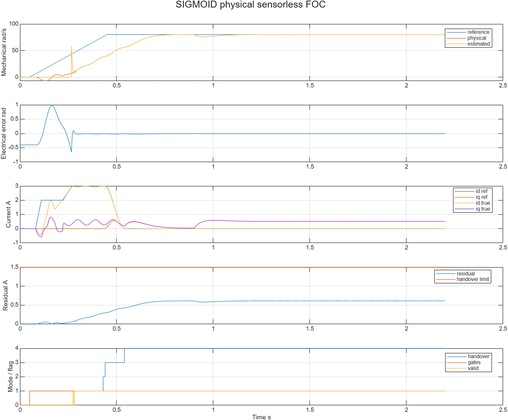
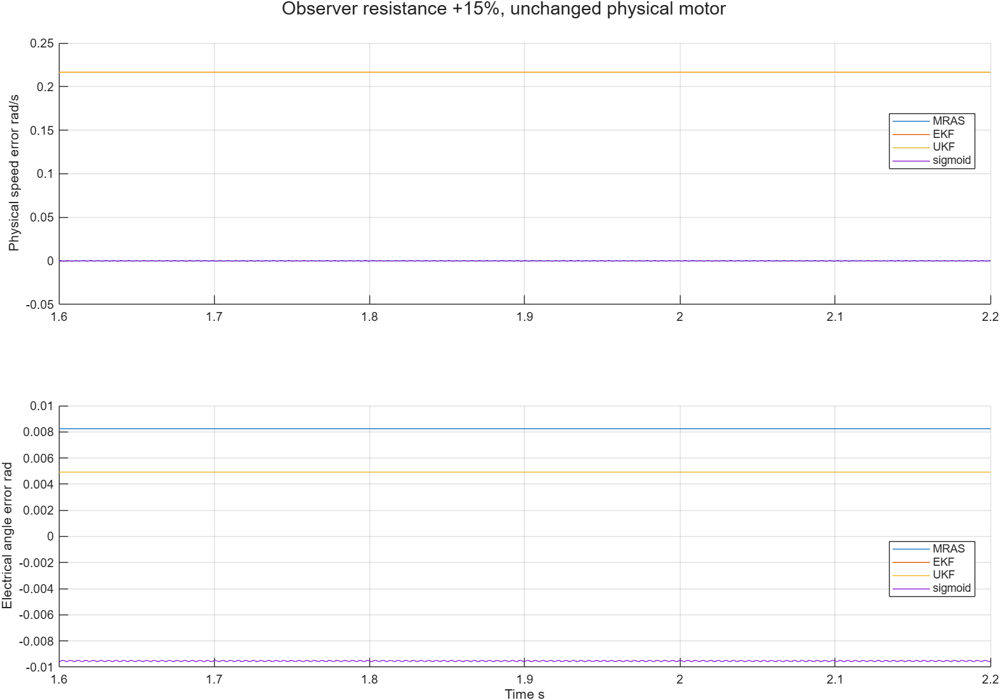
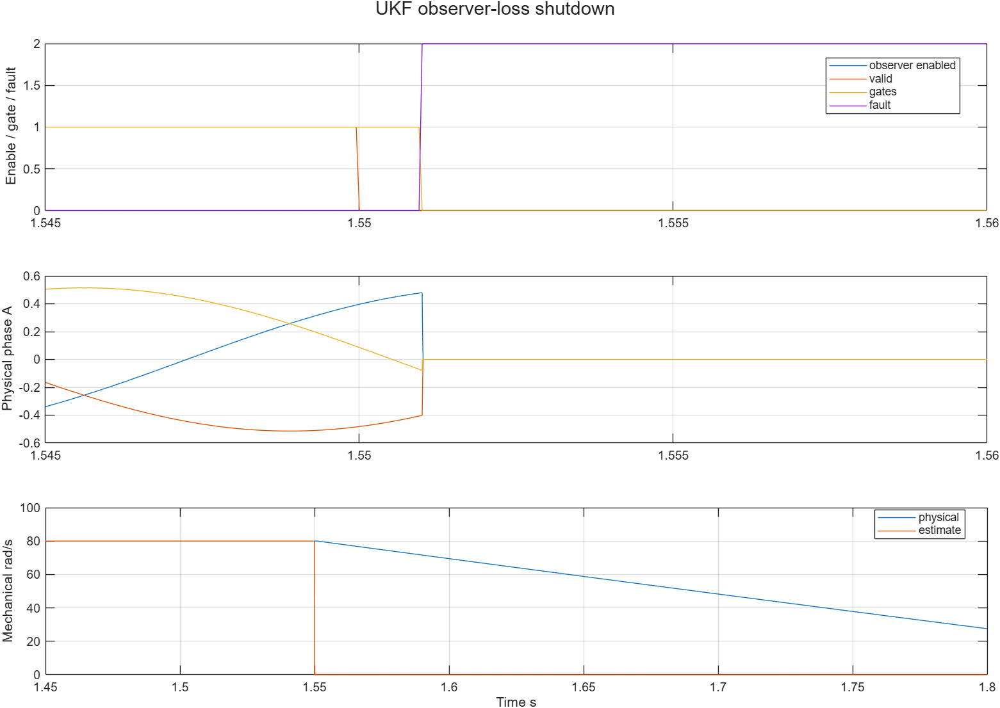

# 扩展观测器实际闭环分析

| 字段 | 本次内容 |
|---|---|
| 模型文件 | src/MrasSensorlessFOC.slx、EkfSensorlessFOC.slx、UkfSensorlessFOC.slx、SigmoidSensorlessFOC.slx |
| 参数文件 | parameter/extension_foc_parameters.m、extension_foc_cases.m、extension_foc_validation_parameters.m |
| 采样周期 | 物理5μs；电流/观测50μs；速度PI1ms |
| 求解器/步长 | FixedStepDiscrete / 5μs |
| 工况 | 每算法10项：正反转、2.6电角rad初始位置、36V、观测Rs+15%、失锁、旋转复位、正反带速拒绝、观测禁用启动 |
| 数据文件 | waveform_analysis/{mras,ekf,ukf,sigmoid}/*.mat与results.json；同目录metadata/native JSON和图 |

## 默认接管

以下是实际物理对象和已声明尾段0.3s的结果；不是独立合成输入的lib测试。

| 算法 | AUTO时刻s | 实际末段机械速度rad/s | 角误差RMS电角rad | 速度误差RMS机械rad/s | 物理电流矢量峰值A |
|---|---|---|---|---|---|
| mras | 0.54015 | 80.000000028 | 0.008235134 | 4.54131859e-08 | 3.012143021 |
| ekf | 0.54015 | 80.000769909 | 0.008223790 | 0.000769908523 | 3.012143021 |
| ukf | 0.54015 | 80.000612506 | 0.008222241 | 0.000612506143 | 3.012143021 |
| sigmoid | 0.54015 | 80.000000688 | 0.009605884 | 0.000256240098 | 3.012143021 |

四模型接管时刻相同，主要受共用启动、ready、持续资格和混合序列限制，不能据此对观测器收敛速度排名。物理峰值主要出现在共用启动过程。默认工况没有额外注入测量噪声，EKF/UKF的MeasurementStd是估计器R假设，不是已经施加到电流采样的噪声。

## 观测电阻偏差

真实电机仍Rs=0.5Ω，仅观测模型提高15%。

| 算法 | 速度误差RMS机械rad/s | 角误差RMS电角rad | valid比例 | AUTO比例 |
|---|---|---|---|---|
| mras | 4.54117955e-08 | 0.008235134 | 1 | 1 |
| ekf | 0.2165539 | 0.004919951 | 1 | 1 |
| ukf | 0.216396736 | 0.004918370 | 1 | 1 |
| sigmoid | 0.000259252407 | 0.009531812 | 1 | 1 |

EKF/UKF实际速度约有0.216rad/s偏差，仍满足预先设置的3rad/s验收界。valid和小协方差表示当前模型/噪声假设下的资格，不能单独保证实际速度无偏。这一组不足以给算法作普遍优劣结论；其余噪声、动态和失配边界仍按所属lib独立结果解释。

## 关断、拒绝与物理状态

| 算法 | 失锁关断延迟s | 旋转复位关断延迟s | 10项最大实际电流矢量A | 末速度变化的机械方程界 | 结论 |
|---|---|---|---|---|---|
| mras | 0.001 | 0 | 3.089150678 | 全部满足 | 10/10通过 |
| ekf | 0.001 | 0 | 3.089150678 | 全部满足 | 10/10通过 |
| ukf | 0.001 | 0 | 3.089150678 | 全部满足 | 10/10通过 |
| sigmoid | 0.001 | 0 | 3.089150678 | 全部满足 | 10/10通过 |

±80rad/s初速时实际端电压高于启动门槛，四算法均保持关断、相电流为0，转子自然滑行；观测器禁用时不计观察拍数、不允许启动。旋转中reset当拍撤门极，再启动必须重新满足低端电压观察；当前1.8s窗口内保持关断。

失锁在1ms后由Handover锁存退出。图中估速变0是观测器禁能输出，物理速度继续滑行。相电流在关断二极管通路中快速衰减，15ms宽图上近似竖直；5μs记录逐点核对当前电流等于前一步物理next_phase_current，差0，且Root Plant没有reset/enable清状态端口。不能将此图的快速续流误读为软件直接把电流/转速清零。

各算法对应的mras_observer_loss、ekf_observer_loss、sigmoid_observer_loss图同目录保存。关断二极管和能量离散的基础检查在[永磁同步电机](../../../../lib/永磁同步电机/README.md)维护，不从平均0V旧App推断高阻行为。

## 数据、结构与复现

40项均保存实际参数、输入及六组完整数据；20项正常跟踪、8项退出、12项明确拒绝。不把四份默认试跑、80ms冒烟或同数据复查重复计为额外场景。所有跟踪工况检查真实电流、电压可行性、包角误差/速度、持续valid/AUTO、参考物理矢量混合、积分坐标修正和混合期间物理电压步变；退出工况检查失锁时序、故障锁存、关断和状态推进。

原生编译确认Scope30/32/32/30、每份20个已解析库链接；真实角度只供物理坐标换算/离线评分。根图真实角度输出接Terminator，控制器不消费转子真角/真速。整理前后六组默认数据逐点差0。只复制14份M到空src后重建四模型，六组默认数据也逐点差0；四模型正式路径默认重放的六组数据也逐点差0，[extension_verification.json](extension_verification.json)保存源文件、数据与原生检查的校验值。

本批为双精度合成SPMSM平均物理桥MIL。没有把它记为single、主机SIL、C2000或实机结果；电压/电流测量故障、硬件ADC/PWM时序和任意带速接管不属于这40项。运行时无缝更换观测器的状态转换尚未实现。当前SPMSM对照关闭MTPA/FW，凸极弱磁使用兄弟模块，不把本批结果外推为IPMSM观测能力。

[40项入口](run_extension_foc_validation.m) · [分析函数](analyze_extension_foc.m) · [波形重建](export_extension_foc_plots.m) · [运行](../build_process/EXTENSION_USAGE.md) · [全部参数/Scope](../parameter/EXTENSION_PARAMETERS.md)
