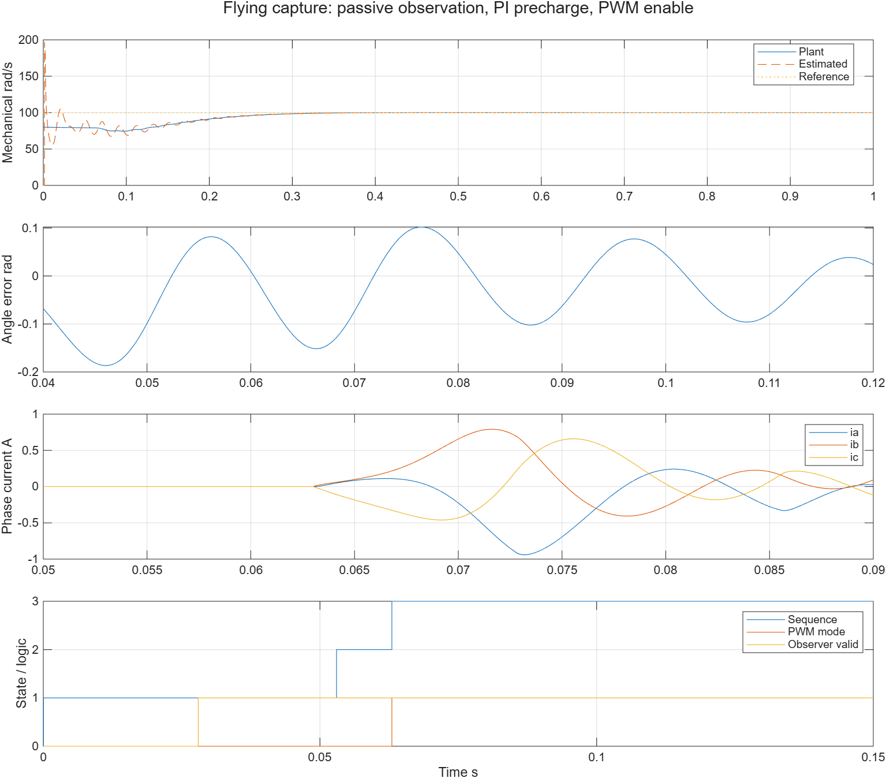
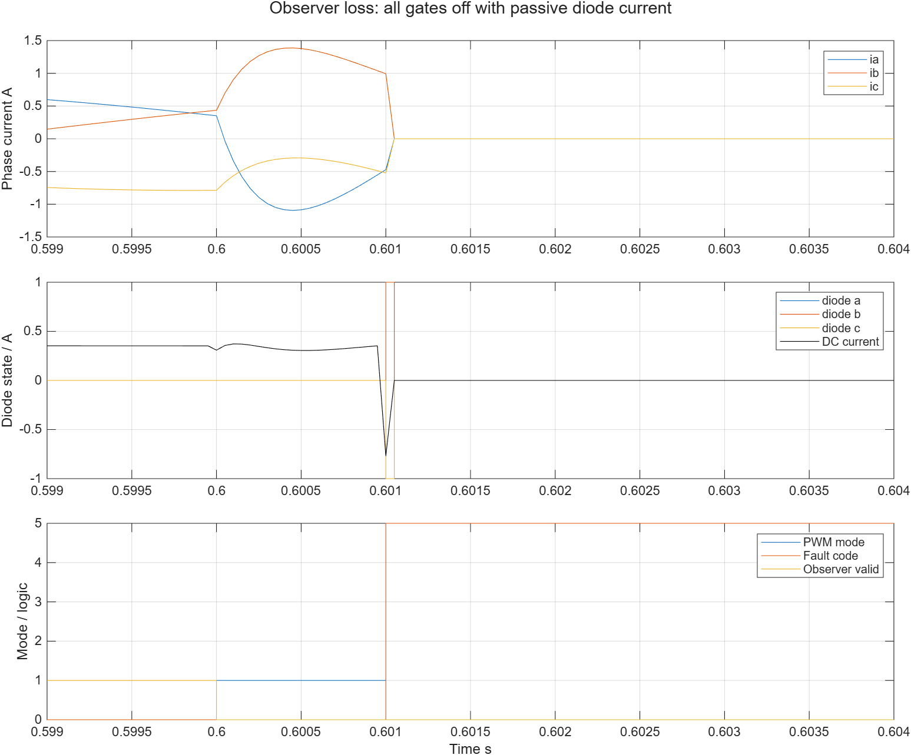
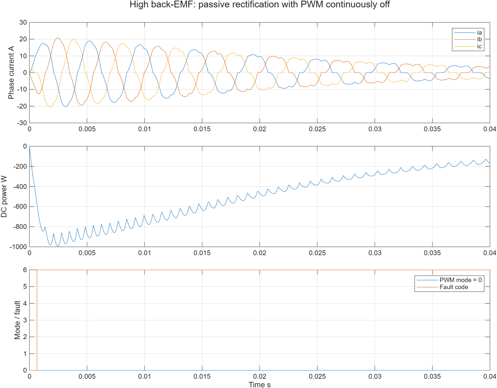

# SPMSM带速捕获物理闭环分析

| 记录字段 | 内容 |
|---|---|
| 模型文件 | [src/FlyingFluxFOC.slx](../src/FlyingFluxFOC.slx)，链接PMSMBridgePlant与FluxObserver |
| 参数文件 | [parameter/flying_foc_parameters.m](../parameter/flying_foc_parameters.m)及刷新函数；各MAT保存实际p |
| 采样周期 | 电流、观测、监督与日志50 μs；物理对象默认5 μs |
| 求解器/步长 | FixedStepDiscrete / 5 μs；半步工况2.5 μs；电气反向Euler、机械前向Euler |
| 工况 | 13项物理MIL：正反转、初角、负载、36 V、旋转中复位/禁能、失锁、三类拒绝、高速被动整流和半步 |
| 数据文件 | `waveform_analysis/flying_*.mat`、[flying_results.json](flying_results.json)、[flying_logic_checks.json](flying_logic_checks.json)、[flying_verification.json](flying_verification.json) |

## 捕获与运行

默认电机初始80机械rad/s，目标100机械rad/s；不知道转子初角或方向，估算器只取得理想采样电压/电流。PWM在0.063 s接通，前5 ms相电流峰值约0.4167 A，接通时PI请求与被跟踪端电压dq相差约0.01724 V。全过程相电流峰值约0.9409 A，最后0.2 s控制角误差RMS约0.008974电角rad，最后0.1 s平均速度约99.99997 rad/s。

反转−80→−100 rad/s在0.06375 s接通，前5 ms峰值约0.4434 A，全程峰值约0.8968 A。初角2.7机械rad、0.15 N·m负载及36 V母线工况均完成闭环；各自指标保存在JSON。这里改变的是整次运行的母线，不是运行中突变母线。

准备期间电流参考等于测量电流，PI积分跟踪端电压；速度积分取消比例项。接通后保持同一估算坐标，再限斜率建立电流参考。结果支持此组参数下的接管效果，不作为所有电机、测量偏置或风速变化下的保证。

## 复位、禁能与失锁

旋转中复位、禁能再使能均记录两次接通和一次关断；复位时实际转速仍大于30 rad/s，随后重新观察并接管，没有清零Plant电流、转速或转角。

观测器在0.6 s禁能，连续失效1 ms后退出，桥模式变为0；相电流经二极管衰减，未把0V执行当成高阻。下图展示关断附近的原始50 μs记录，不能据此测量实际半导体开关时间。该工况0.35 s开始的恒定正负载转矩在退出后仍继续作用，因此长时间末端转速可转为负值；这来自外部恒转矩负载，不是控制器执行了反向驱动。

## 明确拒绝及被动回馈

初始−80 rad/s但目标+100时故障2，PWM从未开启；静止转子超时故障1，PWM从未开启；初始180 rad/s时端电压超过本实例捕获余量，故障3，PWM从未开启。以上是预期拒绝，不计为成功捕获。

400 rad/s初始转速下，反电势通过关断桥的二极管整流，PWM始终0仍出现约20.7147 A相电流峰值；dq电流模监测触发故障6。日志按50 μs积分得到约22.8756 J回到理想母线。此项检验关断物理路径，不表示软件关PWM能阻止全部电流或回馈。刚性母线吸收能量，没有模拟电容过压。

## 数值与结构核对

13项均检查有限值、三相KCL、电机方程残差、占空比限制及运行/桥模式关系。8组纯M检查另外验证准备期间方向、电压和电流条件突变的拒绝、失效累计、复位、非有限输入，以及非零电流误差下的PI跟踪恒等式和Kaw配置约束。

物理步长减半后捕获为0.06295 s，全程相电流峰值约0.9436 A，稳态角RMS约0.009474 rad；这是该工况下的分辨率核对，不宣称整个闭环按某阶精度收敛。所有比较使用相同控制周期及物理参数。

原生模型检查另核对真实角/速度仅进入日志/Scope、已完成电压延迟、共享库链接、三份内嵌源码、三组日志顺序和七组Scope实际源。正式路径默认输出与独立当前M源重建结果逐点核对，证据及哈希见[flying_verification.json](flying_verification.json)。

当前限SPMSM、理想平均PWM、理想端电压采样和双精度MIL；无静止位置识别、无自动反向制动/起动流程、无母线电容与开关纹波，尚未执行本App的SIL/C2000/实机验证。旧三份启动App保留自身的平均电压对象，其失锁后0V制动限制仍见[原分析](OBSERVER_ANALYSIS.md)。
