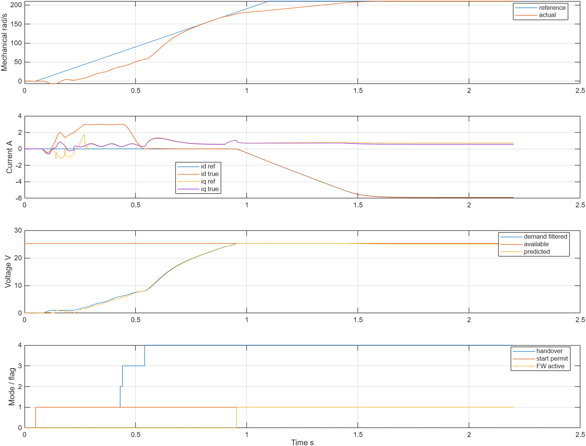
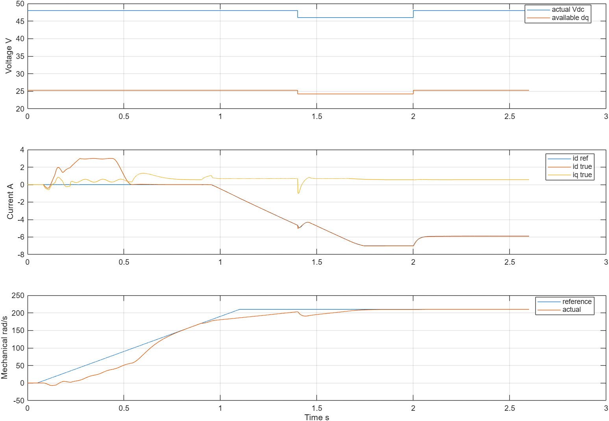
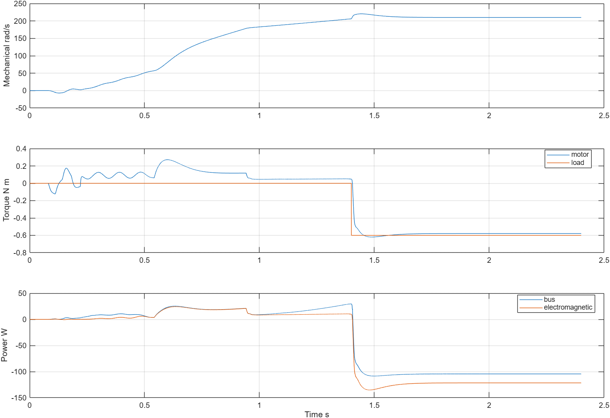
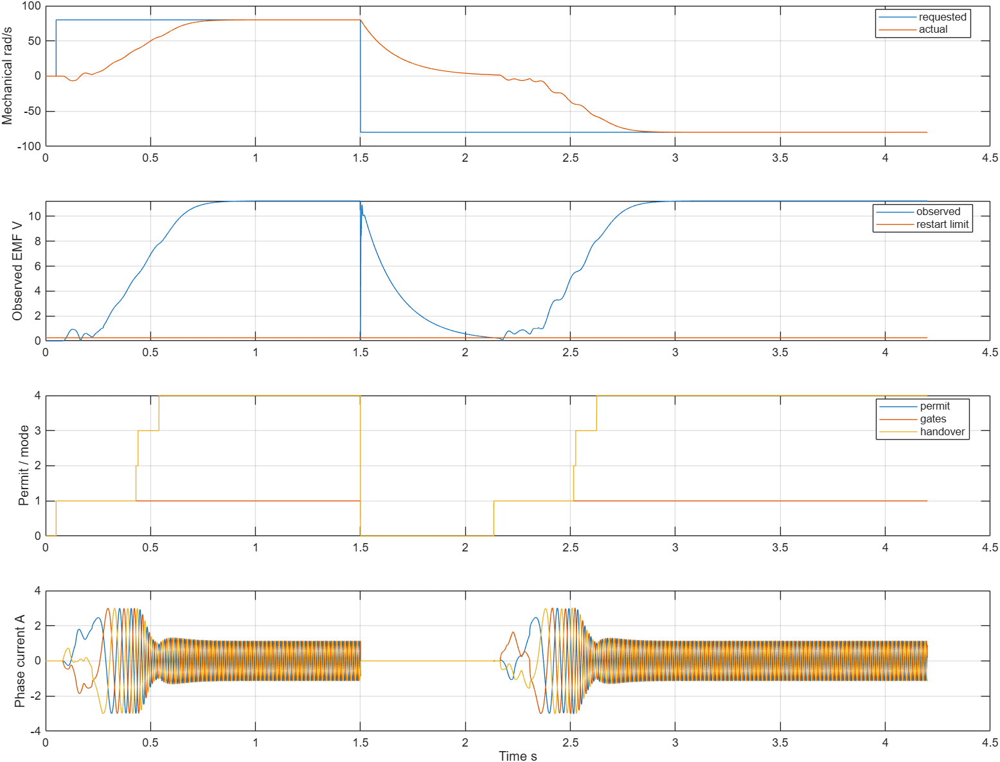
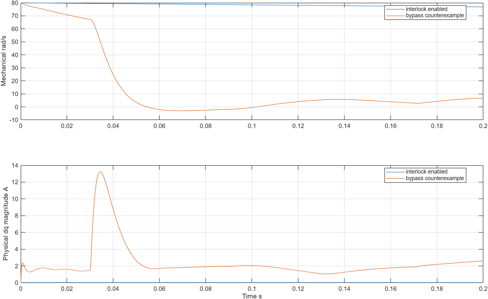

# 弱磁App波形分析

| 字段 | 本次内容 |
|---|---|
| 模型文件 | src/SensorlessFieldWeakeningFOC.slx |
| 参数文件 | parameter/sensorless_fw_parameters.m、sensorless_fw_case_definitions.m、sensorless_fw_edge_cases.m、sensorless_fw_validation_parameters.m |
| 采样周期 | 物理5μs；电流/观测50μs；速度/弱磁1ms |
| 求解器/步长 | FixedStepDiscrete / 5μs |
| 工况 | 7项高速/四象限/母线/不可达参考；9项启动、旋转复位/禁能/方向事件、失锁和反例 |
| 数据文件 | waveform_analysis/guarded_core/*.mat、waveform_analysis/edges/*.mat；同目录JSON及本页图 |

## 核心物理结果

以下均使用实际物理对象，末0.3s统计，不将分配参考当作真实电流。

| 工况 | 末段机械速度rad/s | 角误差RMS电角rad | 实际dq峰值A | 末段真实id A | 母线功率W | 结论 |
|---|---|---|---|---|---|
| forward_high_speed | 209.999033 | 0.0259716 | 5.942672 | -5.909827 | 51.423037 | 通过 |
| reverse_high_speed | -209.999033 | 0.0259716 | 5.942672 | -5.909827 | 51.423037 | 通过 |
| forward_regeneration | 210.000065 | 0.0249813 | 5.763765 | -3.556117 | -106.878511 | 通过 |
| reverse_regeneration | -210.000065 | 0.0249813 | 5.763709 | -3.556117 | -106.878511 | 通过 |
| bus_drop_recovery | 210.002743 | 0.0259760 | 7.054541 | -5.910627 | 51.424551 | 通过 |
| unreachable_high_reference | 219.034093 | 0.0274512 | 7.064826 | -7.017980 | 63.356638 | 通过 |
| weakening_disabled_counterexample | 178.501667 | 0.0214209 | 3.010352 | -0.014022 | 21.272586 | 预期反例 |

默认210rad/s高于关闭弱磁时的约178.502rad/s。弱磁给出负d并在物理对象中形成约−5.910A，电流圆仍为8A参考矢量限。260rad/s参考受电压/d下界限制，实际约219.034rad/s；这一项按“应受限、保持观测和边界”验收，不以未跟踪参考冒充性能达标。

正反向回馈均在1.4s施加反向外负载驱动机械轴，母线功率约−106.879W。母线48→46→48工况实际电流峰值7.055A、最终恢复约210.003rad/s；真实母线由物理对象、分配器、调制链共用。

## 启动与事件结果

| 工况 | 关键证据 | 结论 |
|---|---|---|
| moving_forward_refused | 物理dq峰值0.000000A，末速76.863154rad/s | 通过 |
| moving_reverse_refused | 物理dq峰值0.000000A，末速-76.863154rad/s | 通过 |
| observer_disabled_start | 物理dq峰值0.000000A，末速0.000000rad/s | 通过 |
| rotating_reset_release | 物理dq峰值5.762748A，末速82.759375rad/s，关断延迟0s | 通过 |
| rotating_disable_reenable | 物理dq峰值5.762748A，末速82.759375rad/s，关断延迟0s | 通过 |
| rotating_direction_change | 物理dq峰值5.762748A，末速82.759375rad/s，关断延迟0s | 通过 |
| direction_stop_then_restart | 物理dq峰值3.021631A，末速-80.000000rad/s，事件后关断12697个控制拍 | 通过 |
| observer_loss_exit | 物理dq峰值5.765340A，末速82.989189rad/s，关断延迟0.001s | 通过 |
| moving_alignment_bypass_counterexample | 物理dq峰值13.225555A，末速6.672640rad/s | 预期盲目对齐反例 |

80rad/s正反初速工况默认不对齐、不注入电流，转子自然滑行；观测器禁用时也不获得许可。运行中reset、disable/re-enable、方向改变均当拍撤门极，当前电流继续物理续流，没有被复位清零。失锁在1ms后关断并锁存故障。旋转中允许再次对齐的绕过反例出现13.2256A，超过正常9A物理验收界；该反例只用于说明为何需要互锁，不能记为正常电流控制通过。

方向停止再启动使用b_rot=0.003N·m·s/rad、零负载和±80rad/s参考，给自然滑行留出4.2s窗口；最终−80rad/s，重建AUTO，角误差RMS约0.008775rad。没有给物理转速/角度强制赋值。

## 判据修订与原始证据

最初边界分析错误要求加载滑行在2.1s结束时仍>100rad/s，导致4项分析失败；实际事件前约209rad/s、末段约83rad/s，符合负载/阻尼减速。原始`edges/edge_results.json`和对应MAT保留。`edge_reanalysis_results.json`重用同一组仿真数据，改为：事件前速度满足已旋转的场景前提、事件相邻物理拍速度连续，并由最大电流转矩、负载与黏性项给出每拍机械速度变化上界。没有修改控制参数、误差阈值、电流界或原始波形。

当前9项均通过；`reused_saved_simulations=true`明确表示重分析，没有把它记成另9次仿真。复跑脚本默认重新仿真时也使用同一修正判据。

## 结构与复现

原生编译确认29组Scope、20个已解析Library Links，真实角度只接根图Terminator，控制/观测没有真值角度反馈。布局前后plant/observer/controller/allocation/actuation/guard六组完整数据逐点差0；互锁绕过时相对原未加互锁模型的五组数据也逐点差0，这一结果只证明绕过的等价性。

验证入口：[核心](run_sensorless_fw_validation.m)、[边界](run_sensorless_fw_edges.m)、[分析](analyze_sensorless_fw_case.m)、[绘图](export_sensorless_fw_plots.m)。图由保留MAT重建，不能代替数值验收；参数和实际Scope通道见[参数页](../parameter/README.md)。[fw_verification.json](fw_verification.json)确认只凭M独立构建和正式路径默认重放的六组完整数据均逐点差0；原始重建数据保存在`fresh_default.mat`（运行验证后生成），现有359份M/SLX字节保持不变。

全部结果属于本合成电机MIL，不包括single、SIL、C2000构建/PIL或实机测量；有限母线电容、MTPV、退磁边界和任意带速接管也不在此App实现中。
