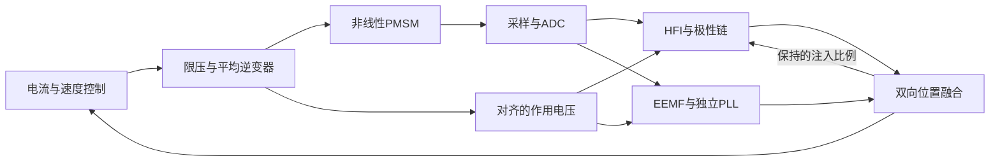

# HFI与EEMF并行的物理闭环组合

主要参考书为《永磁同步电机无位置传感器控制》5.9节，图5.49(a)、5.50及式(5.67)–(5.68)，印刷144–145/PDF173–174页。使用独立HFI与基波跟踪器的位置融合；原极性启动对应8.2节。样机注入幅频和转速不直接照搬。

[build_hfi_hybrid.m](build_hfi_hybrid.m)从已验证的SensorlessHFIFOC复制装配，新增模型名SensorlessHFIHybrid，保留旧模型。共用的HFI、探针、极性、EEMF、PLL、Fusion、CurrentPI、Profile和调制算法继续通过lib链接维护。

1. 先建立新的本地App与测试参数入口，组合原控制器、电机和观测器参数；不在SLX另存一份可调默认值。
2. 原HFI位置链增加injection_scale输入，将极性阶段的HFI许可乘Fusion比例后送Axis。双脉冲本身仍由极性状态机管理，不随普通高速撤除逻辑重复触发。
3. EEMF消费与HFI相同的采样电流、对齐实际电压。电机存在Ld/Lq差异，因此调用IPMSM EEMF，不以单L的基础SMO替代。
4. 两路完整角度、带符号速度及各自在线valid进入HybridFusion。基波故障Gate只做AND撤销资格。真实角度和真实速度只连接评价及Scope。
5. 用融合角、omega_base和最终valid连接原控制器与Supervisor。高速停HFI时Position.valid会撤销，整机依据Fusion.valid继续控制。
6. 保留原电流PI的显式坐标跟踪。Controller由实际相邻融合角与上一基准速度计算额外角修正，转移积分/P/FF历史；速度环和解耦仍使用物理转速估计。
7. EEMF方向经独立UnitDelay保持，本拍方向不直接依赖本拍EEMF输出；下一状态从融合估速更新，过零保持，复位恢复配置先验。没有对象真实速度输入。
8. Fusion的注入比例本身来自保持状态，避免“注入→HFI资格→注入”代数环；接管前后分别记录实际电流、转矩、最终电压、PI状态和两路资格。

首版物理装配关闭基波独立带速取得资格，先走探针、HFI及磁极极性启动。带速捕获、无位置弱磁、single/SIL和C2000目标由后续工况继续补齐。此整机含连续物理对象，是MIL模型；部署时选择离散控制/观测部分，并用目标采样/PWM接口替换物理对象支路。

本模型共12份日志和15组Scope，定义见[参数页](../parameter/HYBRID_PARAMETERS.md)。批量操作只后台加载模型，运行结束关闭；交互时只打开当前要看的模型/Scope。
