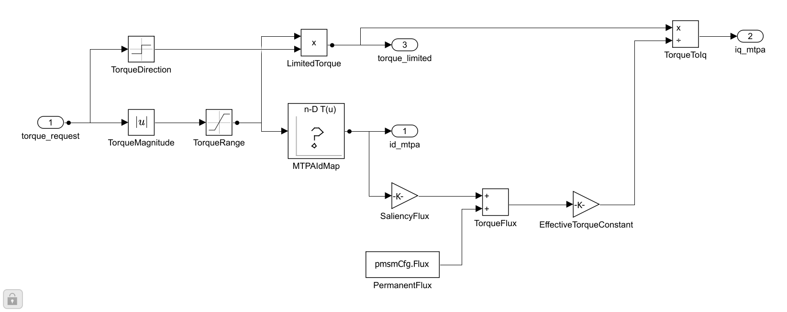
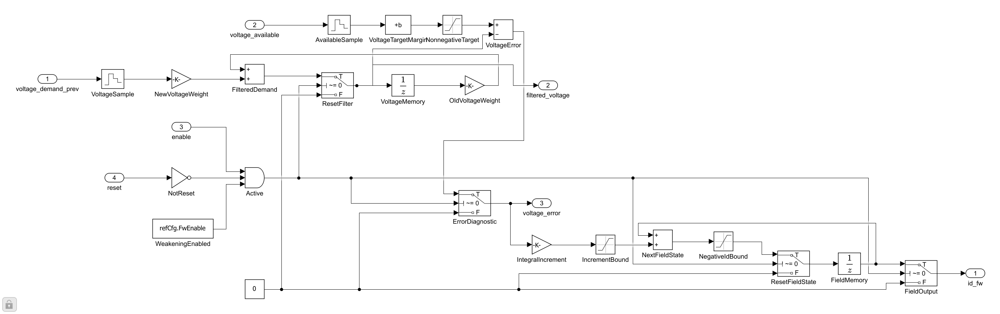
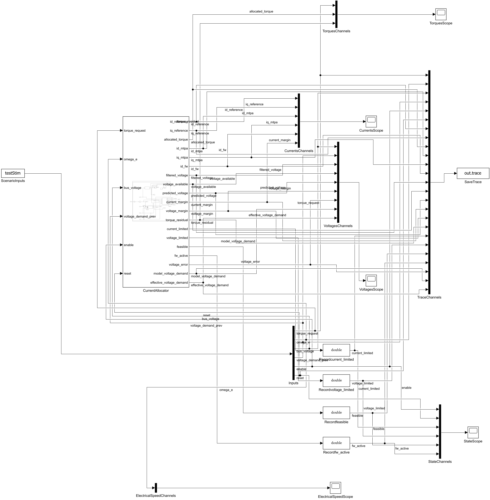

# 先 MTPA，再弱磁的搭建过程

模型：[CurrentReference.slx](../src/CurrentReference.slx)、[组件测试](../src/CurrentReferenceTest.slx)、[整机测试](../../../app_models/Sensor/mtpa_fw/src/MTPAFWMotor.slx)。环境MATLAB/Simulink R2026a Update 3。过程模型未另存副本，源SLX和以下记录共同保存实现。

## 1. 固定输入、约束和坐标

先复用math与PMSM的峰值dq、d轴磁链对齐约定。Allocator输入依次为Trequest、带符号we、Vdc、上一拍限幅前总电压模长、enable、reset。输出顺序见[参数页](../parameter/README.md)。电流边界8A、负id边界−7A为教学设定；先声明边界，再计算候选。

## 2. 建MTPA子系统

新建Library CurrentReference，建立MTPA普通子系统。放置Abs、Saturation、Sign、Product、1-D Lookup Table、Gain、Sum、Divide和三个Outport。基础块即可观察每个中间量。

Abs取转矩幅值，Saturation上限设refCfg.MaxTorque；Sign恢复转矩方向。Lookup断点用refCfg.TorqueGrid，表值用refCfg.IdTable，线性插值。Ld/Lq/Flux/极对数进入增益和求和链，按转矩公式重算iq，而不是把两张表独立插值。Tlimited单独输出供核对。

表由[refresh_mtpa_tables.m](../parameter/refresh_mtpa_tables.m)生成，使用电流幅值参数化；没有使用运行时优化器或MATLAB Function黑盒。初步先关闭弱磁，在we=0的正负转矩扫描中与id=0及独立fminbnd优化对照。

## 3. 建FieldWeakening子系统

放两个Zero-Order Hold按refCfg.FwTs采样电压需求和可用电压。AvailableSample后接Bias减refCfg.FwVoltageMargin，再接Saturation将目标夹到非负。

滤波用两条Gain和Sum实现alpha·旧滤波值+(1−alpha)·新需求；Unit Delay VoltageMemory记忆，IC=0，SampleTime=refCfg.FwTs。Active由enable AND NOT reset AND FwEnable产生。ResetFilter的Switch在Active为假时写0，滤波诊断也立即为0。

VoltageError用Sum(+-)实现Utarget−Uf。IntegralIncrement增益为refCfg.FwKi*refCfg.FwTs；IncrementBound限制到±refCfg.IdSlew*refCfg.FwTs。NextFieldState把增量加到FieldMemory当前状态；NegativeIdBound夹到[refCfg.IdMin,0]。ResetFieldState在禁能/复位时给FieldMemory写0。FieldMemory使用Unit Delay，IC=0，1ms周期；FieldOutput输出当前状态，禁能时旁路为0。

这就是弱磁积分、限斜率、边界抗继续积分和复位的具体实现。完整离散方程在[DESIGN.md](DESIGN.md)。

## 4. 建CurrentLimits子系统

输入T、选定id、we、Uavail及控制状态。先按电流圆算iq上下界，再按含Rs的稳态电压二次式算根区间；将两区间与转矩方向求交。MinMax/Switch组合实现夹限，Relational Operator/Logic计算可行标志。

判别式开方前夹到非负，实际可行性仍检查原判别式≥0；这样不可达时保持有限数值，但不会伪装成可行。交集为空时选择iq=0和feasible=false；id保留负id候选，便于弱磁继续进入。

分别输出参考电流、分配转矩、限制标志、预测电压、两种裕量和转矩残差。另一路CurrentOnlyLower/Upper只夹电流圆，计算voltage_for_torque，供弱磁判断未满足转矩的电压需求。

## 5. 组合Allocator并避免弱磁不进入

连接MTPA和FieldWeakening，MinMax选择更负的id，进入CurrentLimits。Vdc乘refCfg.VoltageFactor得到Uavail。EffectiveVoltageDemand取max(Uprev,voltage_for_torque)送滤波器。

最初仅用Uprev，整机在约179.5rad/s停住：投影先把iq降低，实际请求电压被压回边界，弱磁积分器缺少继续进入的信息。补充受电流圆限制的模型电压需求后，弱磁进入并达到高速给定。这一分支仍使用反馈电角速度和参数，不接对象真值。

零转矩高速复查又显示同一目标/约束边界会渐近贴边，因此将弱磁调节目标另留0.2V裕量，保持Allocator硬约束本身不变，并加强零转矩工况的末点可行断言。

## 6. 建组件测试台

From Workspace读testStim六列，Demux拆开送Allocator；Mux按25列保存到To Workspace变量trace。逻辑标志转double后记录。建立Currents、Torques、Voltages、ElectricalSpeed、State五组Scope，并按实际连接登记[model_channels.json](model_channels.json)。

求解器FixedStepDiscrete，步长currentCfg.Ts=100µs，默认0.25s。默认外部电压28V是独立施加的测试激励，不等于同工况稳态预测值；整机模型使用真实控制链产生的上一拍信号。

## 7. 接入整机与转矩PI

以已有MotorExperiment装配为基础另建MTPAFWMotor，保留原库链接。新TorqueStage复用位置P、限速/斜率，新增TorquePI使速度环输出N·m。转矩命令通过Allocator转成id/iq；allocated_torque−torque_request反馈速度积分器。

速度/位置反馈和转矩残差进入外环前使用Rate Transition，OutPortSampleTime=refCfg.SpeedTs。CurrentStage的PI+FF向量接Dot Product与Sqrt得到模长，再经100µs Unit Delay成为Uprev，IC=0。连接Allocator输出至电流环及Scope，不能继续保留旧id=0常数或iq命令连线。

继承旧52列数据顺序，前两列改为实际分配id/iq，再追加22列形成74列；新增四组Scope，原十一组保留。

## 8. 保存、重开与验证

库结构变化后保存Library和两个测试模型，关闭后重开测试模型，确认库链接已刷新；只保存库时，已加载的嵌套库链接可能仍持有旧结构。实际测试检查过新增VoltageTargetMargin块是否存在，避免只测到旧缓存。

执行结构检查、25项断言、独立MTPA优化、可行点电压约束、参考电流圆与弱磁斜率核对，保存参数、输入、原始trace及指标。数据图和结论见[波形分析](../waveform_analysis/ANALYSIS.md)。
