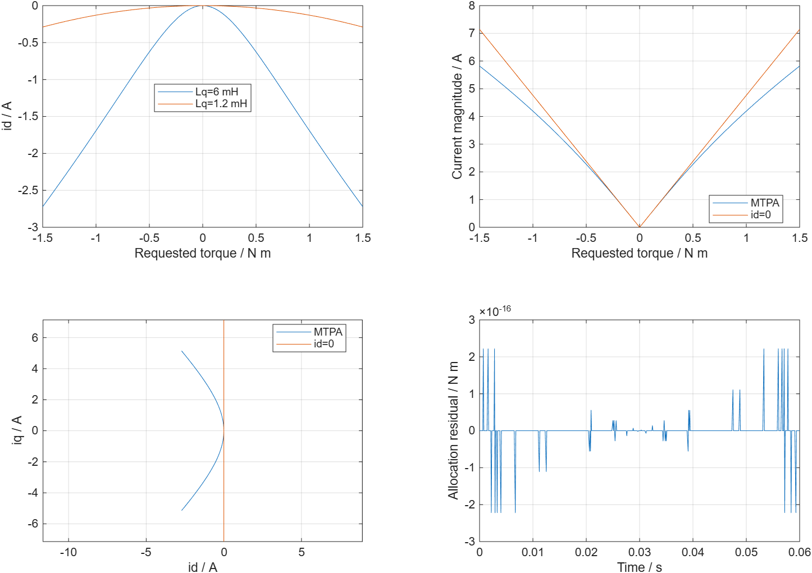
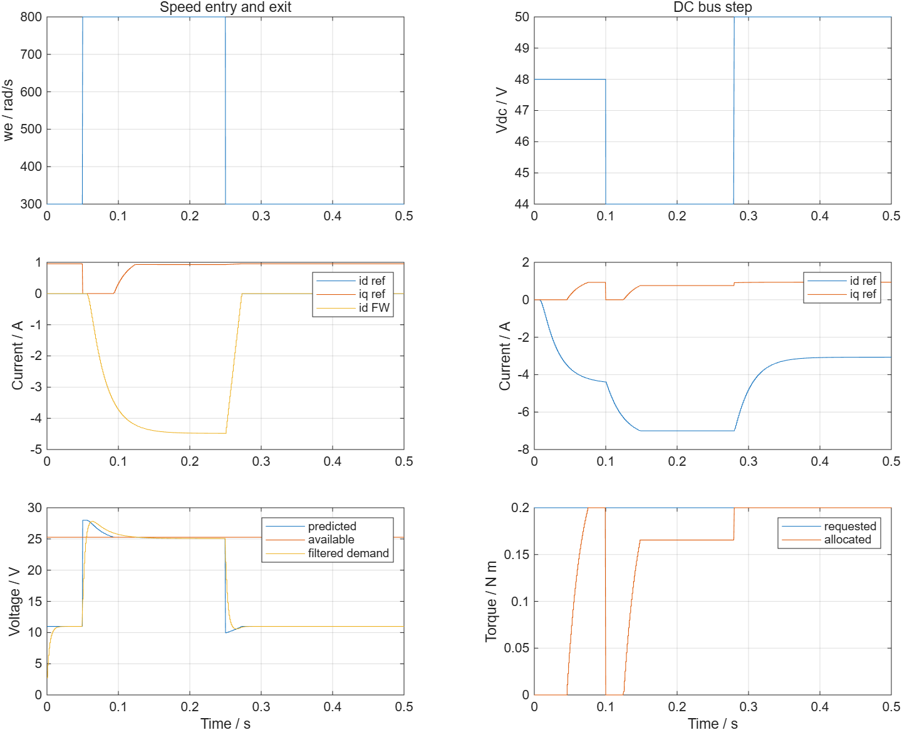
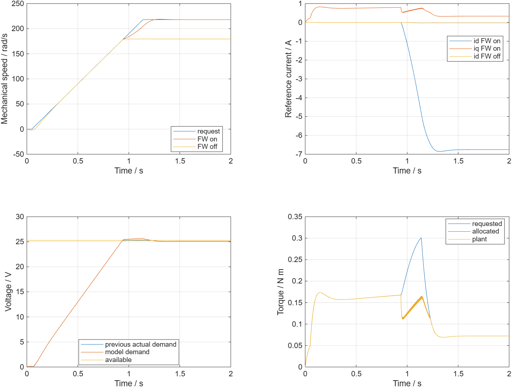
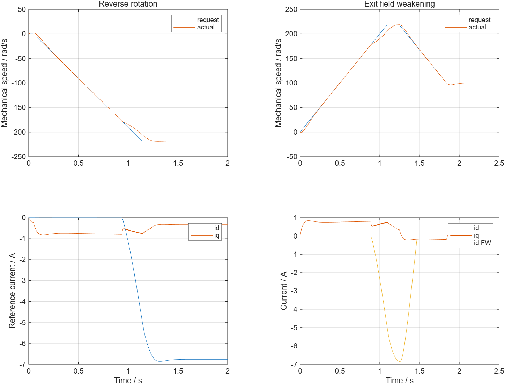
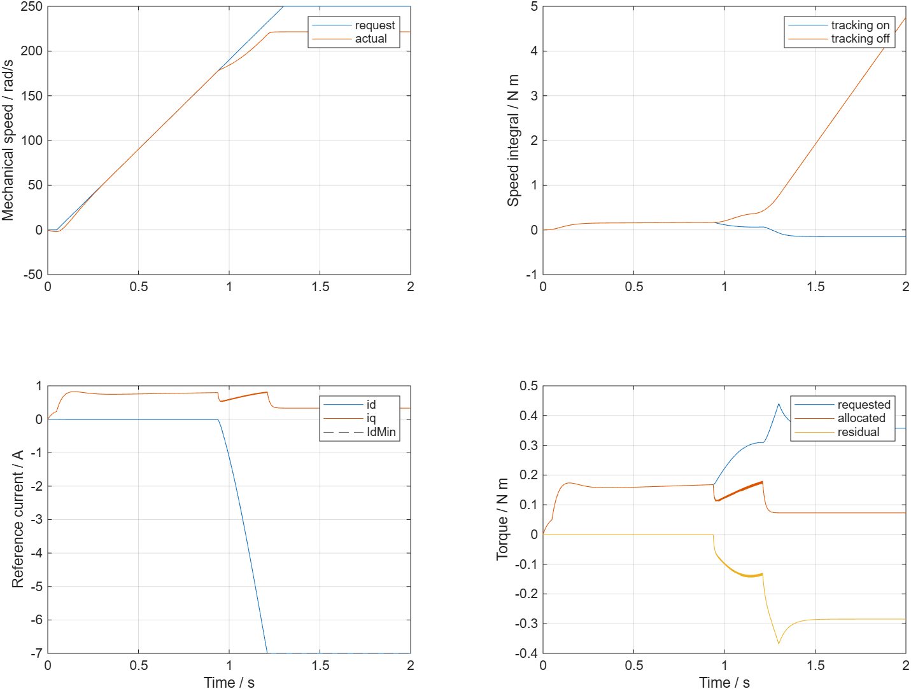

# MTPA 与弱磁波形分析

| 字段 | 内容 |
|---|---|
| 模型文件 | [src/CurrentReference.slx](../src/CurrentReference.slx)、[src/CurrentReferenceTest.slx](../src/CurrentReferenceTest.slx)、[src/MTPAFWMotor.slx](../../../app_models/Sensor/mtpa_fw/src/MTPAFWMotor.slx) |
| 参数文件 | [parameter/mtpa_fw_parameters.m](../parameter/mtpa_fw_parameters.m)、[parameter/refresh_mtpa_tables.m](../parameter/refresh_mtpa_tables.m)、[parameter/reference_case_parameters.m](../parameter/reference_case_parameters.m)；其余引用原模块参数 |
| 采样周期 | 组件/Allocator/电流/trace 100µs；弱磁状态与转矩PI 1ms |
| 求解器/步长 | 组件FixedStepDiscrete/100µs；整机ode4/5µs |
| 工况 | 下列7项MTPA、11项弱磁组件、7项整机，共25项；另5项非法参数拒绝检查 |
| 数据文件 | `results.mat`（运行验证后生成）、[waveform_analysis/metrics.json](metrics.json) |

字段中的路径按模块目录标识；超链接从本分析页解析。环境MATLAB R2026a，double MIL，数据时间2026-11-08 20:22:52 +0000。结果由[run_mtpa_fw_validation.m](run_mtpa_fw_validation.m)执行实际SLX并断言，图由[export_mtpa_fw_plots.m](export_mtpa_fw_plots.m)读取同一results.mat生成；不是公式脚本代替模型仿真。

## 1. MTPA：效果取决于凸极性

| 工况键 | 检查内容 |
|---|---|
| original_bipolar | 原Ld=1mH/Lq=1.2mH，−1.5到1.5N·m；独立标量优化核对 |
| salient_mtpa | Lq改6mH的教学对照，保持同一转矩扫描 |
| salient_id_zero | 同一强凸极性电机关闭MTPA，比较相同转矩下电流 |
| spm_limit | Lq=Ld，id应自然为0 |
| tiny_saliency | Lq−Ld=1e−12H，检查连续退化、有限数值 |
| negative_id_bound | 强凸极性，IdMin=−1A，核对受限最小电流 |
| high_torque_low_speed | 0电角速度、±100N·m请求：参考模长≤8A，不能仅因大请求触发弱磁 |

对31个转矩样点，以fminbnd直接最小化id²+[T/(1.5p(Flux+(Ld−Lq)id))]²，搜索[IdMin,0]，并比较模型参考电流模长。最大差在原/强凸极性/受限三组分别约5.872e-11 / 4.732e-10 / 9.213e-9 A，阈值2e−4A。这是独立优化目标的核对，不只是正反公式互相比较。

在1.5N·m端点，原参数MTPA电流约7.136934A，id=0约7.142857A，改进很小。强凸极性对照MTPA约5.818889A，相对id=0的7.142857A降低约18.54%。|T|>1N·m区间的平均电流比约0.846075。本结果描述定子电流模长，不代表含铁耗/逆变器损耗的整机效率最优。

[SVG](mtpa_curves.svg)。低转矩和弱凸极性时，曲线接近id=0属于预期；不能把强凸极性教学对照的收益套给原电机。

## 2. 弱磁组件：进入、退出、四象限和不可行状态

| 工况键 | 输入/检查 |
|---|---|
| entry_exit | T=0.2N·m，we从300到800再回300rad/s；进入负id并最终退出 |
| bus_step | we=800rad/s，Vdc从48降44再升50V；限制期间降低分配转矩，恢复后满足请求 |
| quadrant_w1_t1 / quadrant_w1_tm1 | we=+800，T=±0.2；电动/回馈分别计算含Rs边界 |
| quadrant_wm1_t1 / quadrant_wm1_tm1 | we=−800，T=±0.2；保持速度和转矩符号 |
| zero_torque | we=800、T=0，iq=0但仍需负id降低反电势；末点必须feasible=true |
| infeasible_speed | we=1400、T=0.2，id触及−7A仍不可行，发布false和零iq |
| disable_reset | 禁能/复位窗口中id/iq、弱磁输出与滤波诊断清零，重新使能可重复进入 |
| voltage_feedback_branch | we=500，外施Uprev=28V短脉冲；实际需求分支也能触发弱磁，脉冲结束后退出 |
| zero_bus_infeasible | Vdc=0时数值有限且标不可行；本组件不承担整机停机监督 |

每条参考均检查电流圆和负id边界；弱磁状态在相邻有效1ms拍间变化≤0.2A。含Rs电压不等式仅在feasible=true的点断言，容差1e−8V；记录的约−3.6e−15V最小裕量属于浮点舍入。

[SVG](fw_component.svg)。进入高转速或母线降低的瞬间，id尚未到位，预测电压可能超过可用值；这段feasible=false，iq置0或受限，不能把曲线越界当作已保证可行。它也说明高速突变需要上层参考管理，不能把一个参考分配器当成完整运行监督。

零转矩工况在不留调节裕量时会渐近贴住电压边界，因此最终默认Utarget=max(0,Uavail−0.2V)，末点已可行。电压约束半径仍是Vdc×0.95×(1−2MinDuty)/sqrt(3)，与调节目标区分。

## 3. 整机闭环：弱磁开关的同工况对照

48V、速度给定218rad/s、负载0.05N·m、J=5e−4kg·m²、B=1e−4N·m·s/rad。速度请求经过200rad/s²斜率限制。以下为记录末点，非全工况性能保证。

| 工况 | 末点机械速度 rad/s | 末点id A | 末点iq A | 末点可行 |
|---|---|---|---|---|
| fw_off | 179.497567 | -0.026578 | 0.323641 | true |
| fw_on | 218.000001 | -6.754244 | 0.331424 | true |
| reverse_rotation | -218.000001 | -6.754244 | -0.331424 | true |
| exit_weakening | 100.000056 | -0.000467 | 0.285739 | true |
| bus_42V | 190.000000 | -6.695591 | 0.226595 | true |
| unattainable_aw_on | 221.537372 | -7.000000 | 0.332714 | true |
| unattainable_aw_off | 221.537372 | -7.000000 | 0.332714 | true |

fw_on相对fw_off的末点速度提高约38.502rad/s。fw_on末点速度绝对误差约1.300e-6rad/s，末0.1s dq合成电流误差RMS约2.584e-8A；理想参数、平均逆变器与无测量噪声使误差很小，不是实机可达到的精度声明。fw_on全程参考模长峰值约6.860509A，实际电流模长峰值约6.860721A；两者分别记录。

[SVG](motor_fw_compare.svg)。约0.9s附近电压需求到边界，负id开始建立；外环请求转矩在动态限制期间高于分配值，之后恢复。不能把Tallocated直接当作Plant转矩，图中两者单独画出。

reverse_rotation使用−218rad/s、负负载方向；exit_weakening先给218，再在1.25s改100rad/s；bus_42V使用42V、190rad/s与0.03N·m。分别核对方向、退出后id_fw归零和较低母线下跟踪。

[SVG](motor_reverse_exit.svg)。退出后id参考可留下很小的负MTPA值，不要求总id严格为0；应看id_fw是否回0。

## 4. 不可达请求与速度PI抗饱和

250rad/s给定超过本夹具在IdMin边界和电压约束下的可达速度；最终约221.537rad/s，id=−7A。此时“整机速度请求不可达”不等于“当前已分配电流不可行”：末点feasible=true，表示分配器降低转矩后的电流满足约束。

相同工况下，SpeedKaw=20时速度PI积分末值约-0.152190N·m；关闭回算为4.759272N·m。负积分用于抵消持续的比例误差项，是回算的正常结果；积分绝对值明显小于关闭回算时，但这里没有宣称误差能消失。

[SVG](motor_unattainable_aw.svg)。

## 5. 结果范围与复现

三组共25项通过，另5项拒绝：Lq<Ld、IdMin低于电流边界、CurrentMax=0、MTPA开关不为0/1、负弱磁裕量。两测试模型结构无悬空端口/线；20组Scope实际源块及通道顺序与JSON索引核对通过。

当前不包含非线性磁链/磁饱和、MTPV、实机退磁界限、single、生成C、SIL/PIL或C2000执行时间。原06–14装配与库文件没有本次算法更改；25项是新模块测试数量，不将此前45项当作本轮重跑。

复现见[USAGE.md](../build_process/USAGE.md)，全部Scope和25/74列数据见[parameter/README.md](../parameter/README.md)。参数、输入、通道名随每个r对象保存在results.mat。

## 6. 工程文件与工具检查

8个新增MATLAB文件的Code Analyzer为0提示；组件默认GUI运行得到2501×25有限数据。模块目录、README固定栏目、SLX位置及MANIFEST统计检查通过。20组Scope源块/顺序与实际连线一致；Markdown本地链接0错误，扫描器跳过model/lib及model/app_models两份已有非UTF-8 README，读取确认其中无链接。DocSync、依赖治理、governance lint、Plan路径检查和git diff --check通过。

仓库Full检查：70通过、1失败、4项按profile跳过。失败为HEALTH-001（doctor perf）：lifecycle status、doctor、Smoke verify报告现有visio-mcp/ppt-mcp同名未托管项、runtime Skill漂移，且相应命令超过延迟预算。它不属于上述25项MIL。原始平台报告位于仓库test-results/aicoding-global-test-20261108-212354/report.md及logs/HEALTH-001.stdout.txt；本次未调整工具安装或放宽门禁。
