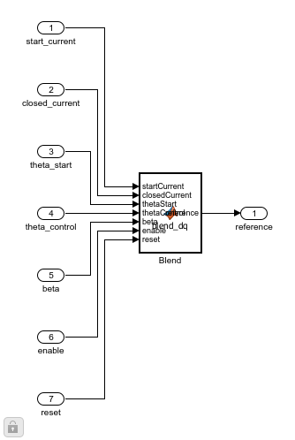
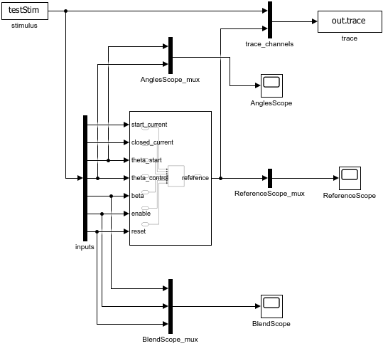

# 同坐标电流参考混合

ClarkePark库新增BlendDQ。启动器的d/q电流参考属于theta_start软件场坐标，闭环参考属于theta_control坐标。直接对两组数字线性插值会混合不同方向的电流，应先把启动参考转到控制坐标。

## 实现步骤

1. 在既有math库新增BlendDQ子系统，原四个变换不改动。它有7个输入、1个两元素输出，无积分器和延迟状态。
2. MATLAB Function使用 [blend_dq.m](../src/blend_dq.m)：令delta=theta_start-theta_control，R(delta)=[cos,-sin;sin,cos]，beta夹到[0,1]，输出(1-beta)*R(delta)*start_current+beta*closed_current。
3. enable低或reset高时同拍输出0。该块只混合参考，不生成启动/捕获资格，不限电流幅值；调用方应给出已经受限的两组输入。凸组合的输出范数不大于两输入范数的加权和。
4. 测试台FromWorkspace包含9列标量，经Demux恢复两个电流向量及5个标量端口，库输出和原输入共记11列。3个Scope分别观察控制坐标电流、坐标角和权重/使能/复位。
5. 用两次独立物理坐标变换验证：把实际输出按theta_control旋到alpha/beta；把两组输入分别按自己的角旋到alpha/beta后加权。比较物理向量，避免只用同一delta公式重复实现作为预期值。





## 运行与调参

打开 [FrameBlendTest.slx](../src/FrameBlendTest.slx)，回调加载 [blend_test_parameters.m](../parameter/blend_test_parameters.m)。直接Run运行13行显式样例；每行一个50µs采样点，这些阶跃是代数案例，不代表电流动态响应。参数、列顺序和Scope见 [参数说明](../parameter/FRAME_BLEND.md)。

```matlab
addpath('F:\Study\AI\AiCoding\CodingKit\modules\matlab\simulink\model\lib\math\waveform_analysis');
report = run_frame_blend_validation;
```

批量入口有两个场景：13个显式向量和固定局部随机种子42的500个向量。SimulationInput只覆盖本轮参数。结果中的records.<case>.trace为N×11；原始ToWorkspace的列向量记录可能是11×1×N，脚本明确转换后再核对输入逐点一致。

编辑模型工作区blendTestCfg和testStim可以单次测试，或直接修改本模块参数函数后重新加载模型。输入时间为整数索引乘Ts；修改行数后同时更新Duration和时间，不能只改StopTime。

[build_frame_blend.m](build_frame_blend.m)先保存到明确指定的隔离输出目录，再新增库块；已存在BlendDQ时刷新源函数并重建候选测试台。拒绝覆盖已有候选文件或使用未保存的库。完成数值/连接验证后才将两份SLX放回src。改变函数端口需要同步修改连接，脚本不自动推测新接口。

[模块入口](../README.md)
