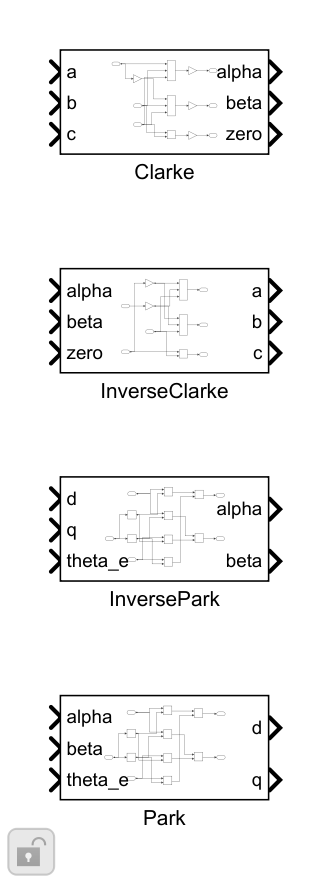
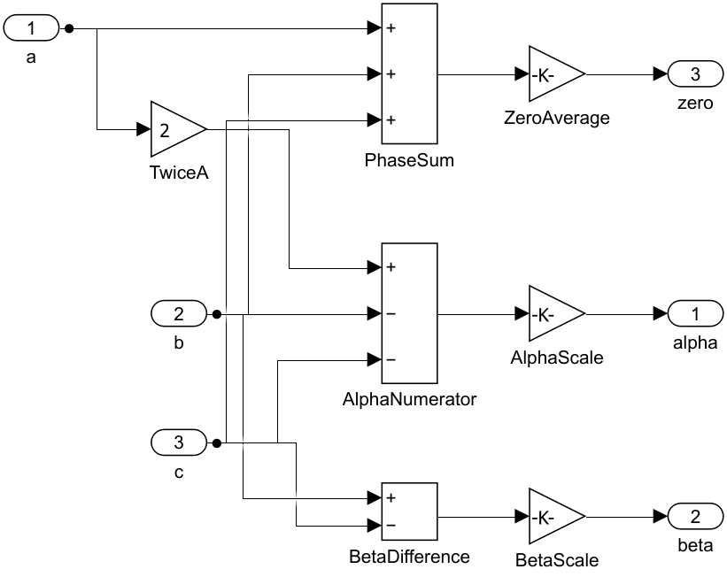
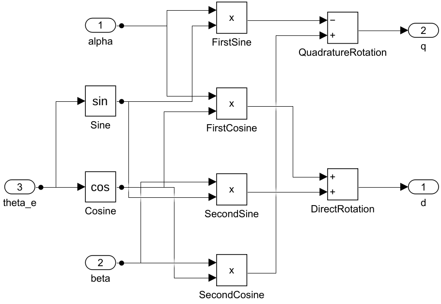
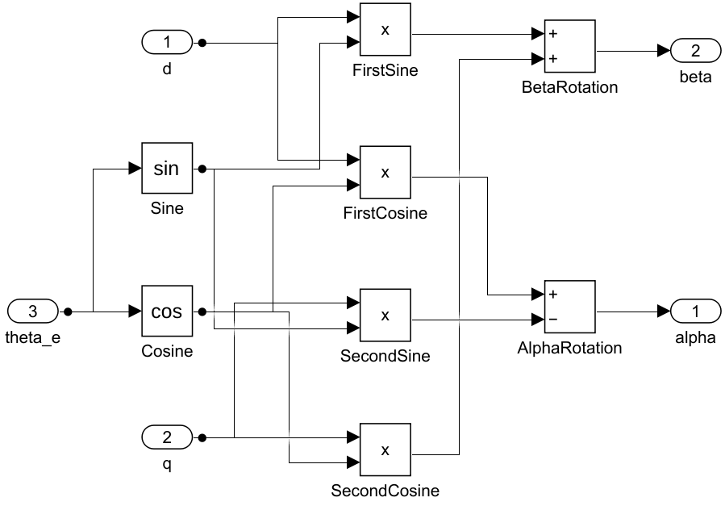
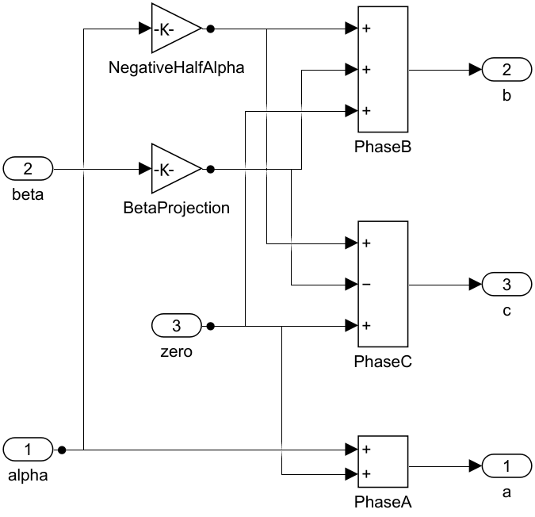
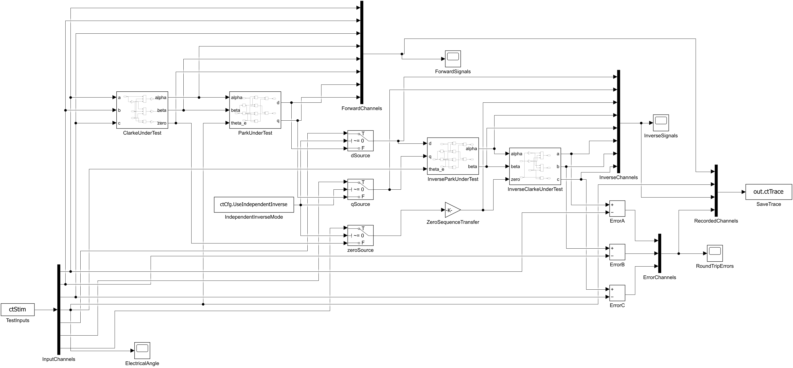

# Clarke/Park 与反变换搭建记录

日期：2026-11-08。环境：MATLAB/Simulink R2026a Update 3。源文件为 src/ClarkePark.slx 与 src/ClarkeParkTest.slx，以下路径相对于 math 模块。

## 1. 先固定坐标约定

采用工程已有的幅值不变、相峰值和 d 轴对齐约定。正相序输入取 a=I*cos(phase)、b=I*cos(phase−2π/3)、c=I*cos(phase+2π/3)。α 沿 a 轴，β 超前 α 轴 π/2，θ 是从 α 到 d 的电角度。

由此，θ=phase 时 d=I、q=0；θ 比实际相位超前 δ 时，d=I*cosδ、q=−I*sinδ。先确定这些可手算结果，才能排查相序和 q 轴符号。公式全文见 [DESIGN.md](DESIGN.md)，参考核对见 [REFERENCE_REVIEW.md](../ref/REFERENCE_REVIEW.md)。

## 2. 建一个库，四个独立子系统

新建 Library ClarkePark，添加 Clarke、Park、InversePark、InverseClarke 四个普通子系统。各自标量端口顺序见 [参数说明](../parameter/README.md)。Inport 数值类型设为 double，采样时间继承；四个函数没有记忆状态。

Library 是 Simulink 的复用形式，文件仍放在 model/lib/math/src。测试模型通过库链接调用；修改算法时修改源库中的块，再保存并运行验证。

## 3. 搭 Clarke

| 分支 | 标准块与设置 | 连接 |
|---|---|---|
| α | Gain=2；Sum 的 Inputs=+--；Gain=1/3 | a 先乘 2，与 b/c 做差，再除以 3 |
| β | Sum 的 Inputs=+-；Gain=1/sqrt(3) | b−c 再缩放 |
| zero | Sum 的 Inputs=+++；Gain=1/3 | 三相求和取平均 |

没有采用 α=a 的两相简式，因为它需要 a+b+c=0。完整三输入形式能表达一般三相量，也便于验证零序的去向。

## 4. 搭 Park

θ 分别进入两个 Trigonometry 块，Operator 设为 sin、cos，输入是 rad。四个 Product 块计算 α*cos、α*sin、β*cos、β*sin；DirectRotation 的 Sum=++ 得到 d，QuadratureRotation 的 Sum=−+ 得到 q。

核心是 q 的负号：q=−α*sinθ+β*cosθ。例如 α=1、β=0、θ=π/2，应得到 d≈0、q=−1。该值已作为独立手算锚点写入验证，不仅检查正反串联是否回到起点。

## 5. 搭 InversePark

同样计算 sinθ/cosθ。四个 Product 计算 d*cos、d*sin、q*cos、q*sin；AlphaRotation 的 Sum=+-，BetaRotation 的 Sum=++。

它是上述旋转的逆矩阵：α=d*cosθ−q*sinθ，β=d*sinθ+q*cosθ。使用与正向变换一致的 θ；把正向 q 的符号随意复制到反向会得到错误结果。

## 6. 搭 InverseClarke

Gain NegativeHalfAlpha=−1/2，BetaProjection=√3/2。三个 Sum 分别构造 α+zero、−α/2+√3*β/2+zero、−α/2−√3*β/2+zero。

零序作为独立输入，不经过 Park。若把它丢弃，只能恢复原输入减去其三相平均值；这在三线制零和输入时成立，含共模输入时会丢信息。验证同时覆盖两类输入。

## 7. 搭独立测试模型

TestInputs 是 From Workspace，VariableName=ctStim，SampleTime=ctCfg.Ts，Interpolate=off，末尾保持最终值。输入采用 time=[] 的结构，由 InputChannels 拆成 a/b/c/θ/d_cmd/q_cmd/zero_cmd 七路。按样本读取，避免切换边界受时间戳舍入影响。

主链为 Clarke→Park→InversePark→InverseClarke。dSource/qSource/zeroSource 三个 Switch 的中间控制输入是 ctCfg.UseIndependentInverse：0 时选正向计算结果，1 时选独立命令。零序在选择后经过 ZeroSequenceTransfer，其增益默认 1；测试时置 0 观察信息丢失。选择开关属于实验装配，不在四个复用块内部。

四组 Scope 分别显示正向电流、反向电流、三相差值、电角度；电角度单独放一组，避免与 A 共用纵轴。RecordedChannels 按 8+1+8+3 拼成 20 列，SaveTrace 采用 Structure With Time 写入 ctTrace。完整通道表在 [parameter/README.md](../parameter/README.md)。

## 8. 设置运行入口与验证

求解器 FixedStepDiscrete，FixedStep=ctCfg.Ts，StopTime=ctCfg.Duration。默认 Ts=0.0001 s、Duration=0.1 s。加载回调调用 initialize_clarke_park_test，设置模型工作区 ctCfg/ctStim，不要求在 base workspace 预先运行参数脚本。

Scope 通过公开 ScopeConfiguration 属性开启图例、自动缩放和轴标签，电流组纵轴 A，角度组 rad。图例名称可能为向量元素名称，应按已记录的元素顺序识别。

当前没有 Simulink Test，采用 SimulationInput 与断言。13 项工况覆盖解析矩阵、基向量、旋转方向、角度误差、零序、随机逐拍数据和独立反变换。10 项完整往返最大误差约 3.55e-15 A；另外的丢零序工况按预期误差判定。结果在 [ANALYSIS.md](../waveform_analysis/ANALYSIS.md)。

运行方法见 [USAGE.md](USAGE.md)。四个子系统与测试模型均完成端口/连接检查；库根的四个块是待复用接口，根部没有额外测试接线。未进行 C2000 代码生成、single 或执行耗时验证。
