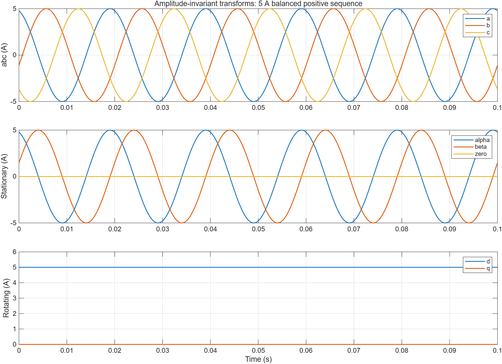
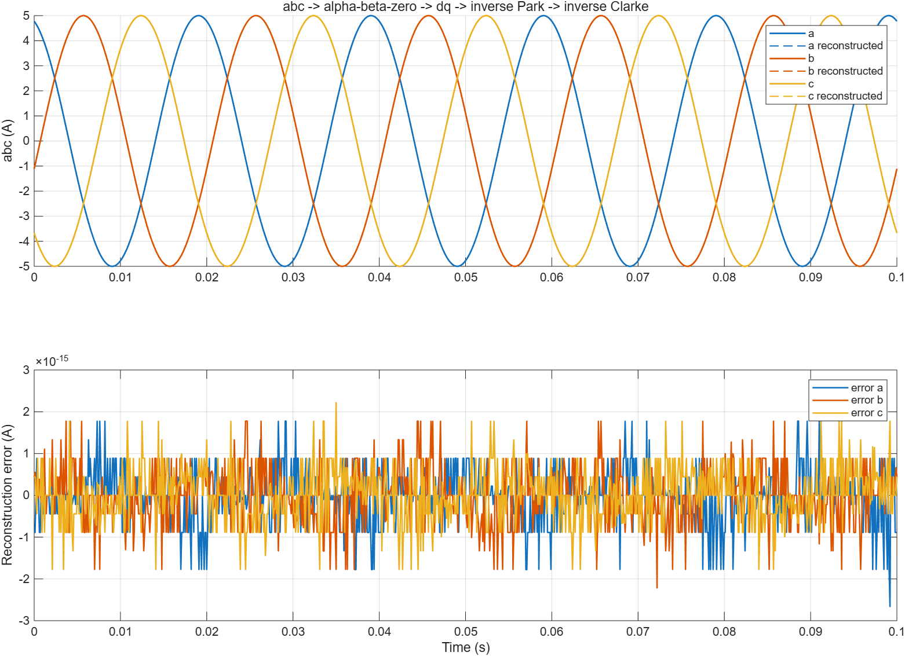
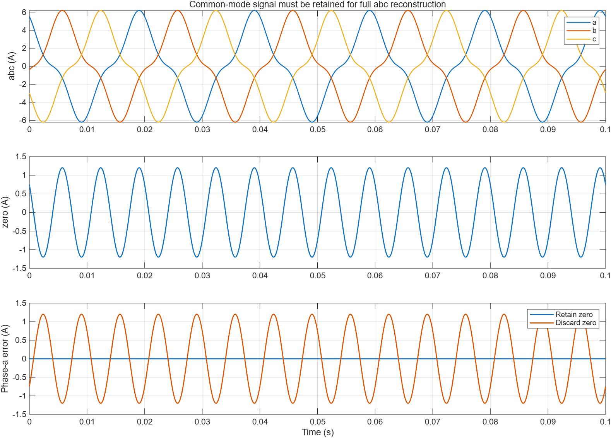
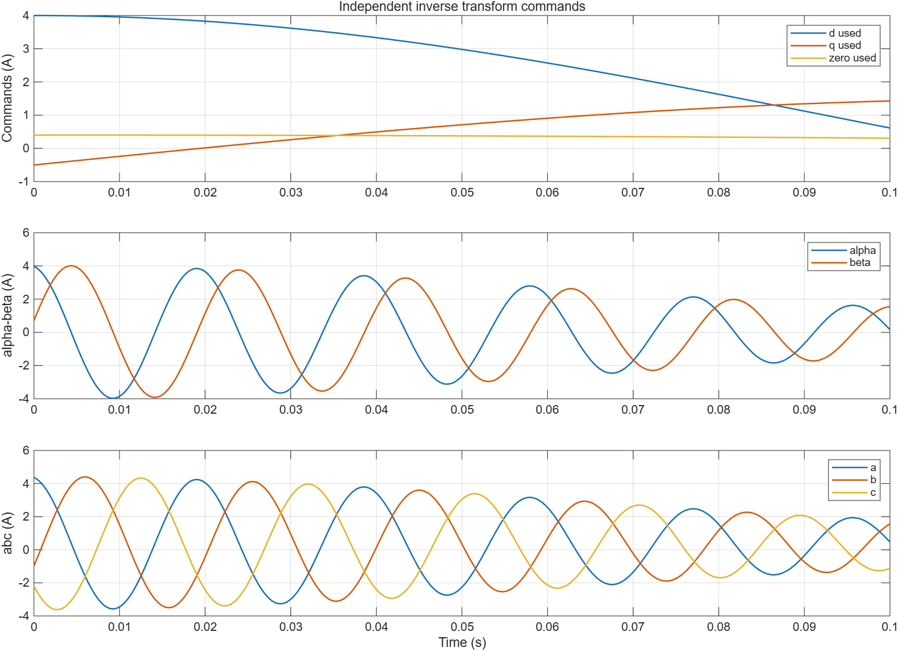
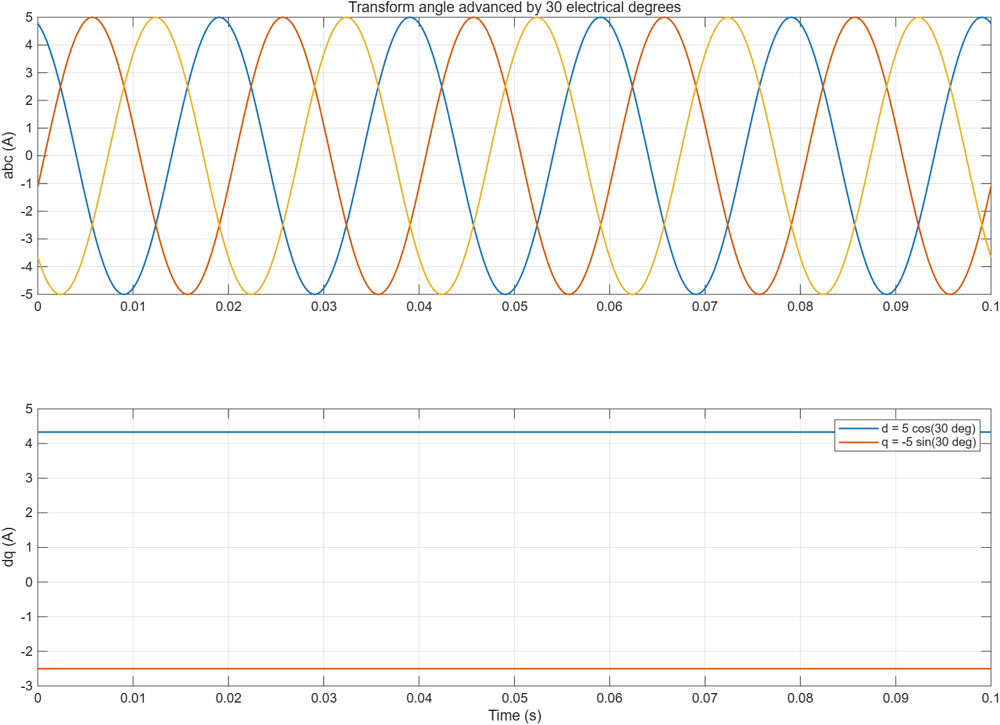

# Clarke/Park 与反变换 MIL 分析

| 字段 | 内容 |
|---|---|
| 模型文件 | `src/ClarkePark.slx`、`src/ClarkeParkTest.slx` |
| 参数文件 | `parameter/clarke_park_parameters.m`；逐工况配置与实际输入在 results.mat 的 cases 中 |
| 采样周期 | 0.0001 s |
| 求解器/步长 | FixedStepDiscrete / 0.0001 s，Normal 仿真 |
| 工况 | 下表 13 项；默认平衡输入峰值 5 A、电频率 50 Hz、初角 0.3 rad、时长 0.1 s；基向量/随机工况用各自输入长度 |
| 数据文件 | `waveform_analysis/results.mat`、`waveform_analysis/metrics.json` |

以上路径相对于 math 模块。环境为 R2026a Update 3，double；幅值/重建误差容差为 1e-12 A，平方和关系容差为 1e-10 A²。来源是实际保存的模型仿真，参考计算采用解析公式和手算锚点。

## 工况与结果

| cases 字段 | 检查内容 | 结果 |
|---|---|---|
| balanced_d | 平衡正相序、同步角度、幅值不变 | d=5 A、q≈0，完整重建通过 |
| balanced_q | 三相相位相对角度超前 π/2 | d≈0、q=+5 A，正 q 符号通过 |
| angle_offset | θ 超前实际相位 π/6 | d≈4.330127 A、q≈−2.5 A，通过 |
| reverse_rotation | 负电频率、负角度 | 同步坐标仍为 d=5、q≈0，通过 |
| pure_zero | a=b=c=1.25 A | αβ/dq≈0、zero=1.25，重建通过 |
| mixed_zero | 平衡量叠加 1.2*cos(3*phase) 共模 | 零序被分离并保留，完整重建通过 |
| dropped_zero | 与 mixed_zero 相同输入，零序传递增益为 0 | 各相误差等于 −zero，预期信息损失通过；不要求重建误差为零 |
| clarke_basis | 三个相轴单位基向量，θ=0 | Clarke 固定系数与零序平均值通过 |
| park_quarter_turn | α=1、β=0、θ=π/2 | d≈0、q=−1，通过 |
| random_abc | 局部种子 2026，256 拍独立随机三相与 ±20π 角度 | 每拍解析矩阵与重建通过，未观察到整拍延迟 |
| unbalanced_harmonics | 幅值不平衡、DC 偏置及五次分量 | 一般三输入分解与重建通过 |
| independent_inverse | 独立且变化的 d/q/zero 命令 | 反 Park/反 Clarke 分别与解析式一致；不要求等于原 abc |
| inverse_axis_anchors | θ=0/π/2、d/q 单位基向量并加入零序 | 独立反变换的方向与符号通过 |

13 项通过。其中 10 项是完整往返工况，最大重建误差约 3.55e-15 A；全部解析对照最大误差约 2.31e-14 A。平方和关系最大误差约 9.17e-14 A²。丢零序演示的误差峰值约 1.20 A，其“误差=−zero”关系的数值误差约 2.44e-15 A。

## 先看平衡同步变换

abc 三相峰值为 5 A；αβ 是正交的 5 A 正弦量，zero≈0；同步旋转后 d=5、q≈0。这里的幅值是相峰值，没有额外换算为 RMS。

原始与重建的 abc 重合。下面的误差轴显示舍入误差数量级，应与容差比较。仅有往返检查仍可能掩盖成对符号错误，所以另做了轴向锚点和独立解析比较。

## 再看零序与独立反变换

共模同时加在三相上，被保存在 zero 中；丢弃后每个重建相都少了相同的分量。三线制零和电流可采用 zero=0，一般三相量需要保留它。这个演示验证可逆性的边界。

反变换也接受独立 dq0 命令，不依赖前向输出；这为后续将 dq 电压命令转为 αβ 或 abc 提供可单独复用的积木。

角度超前 30° 后，d/q 变为 5*cos30° 和 −5*sin30°。因此角度单位、零位、方向与相序应先明确，再讨论环路增益。

当前没有运行原始 demo 或官方工具箱块作为数值对照；single、代码生成、C2000 执行时间及实机接入均未验证。本模块也没有电机或闭环动态，默认 Ts 只用于此数学测试。
