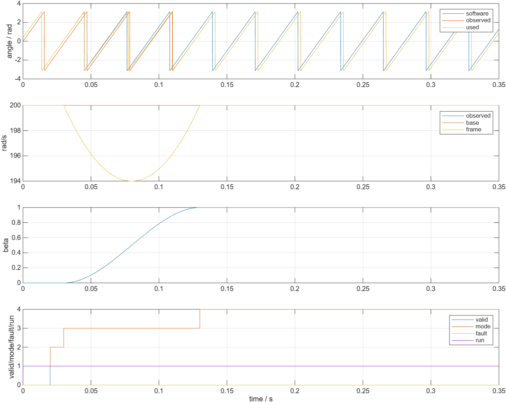
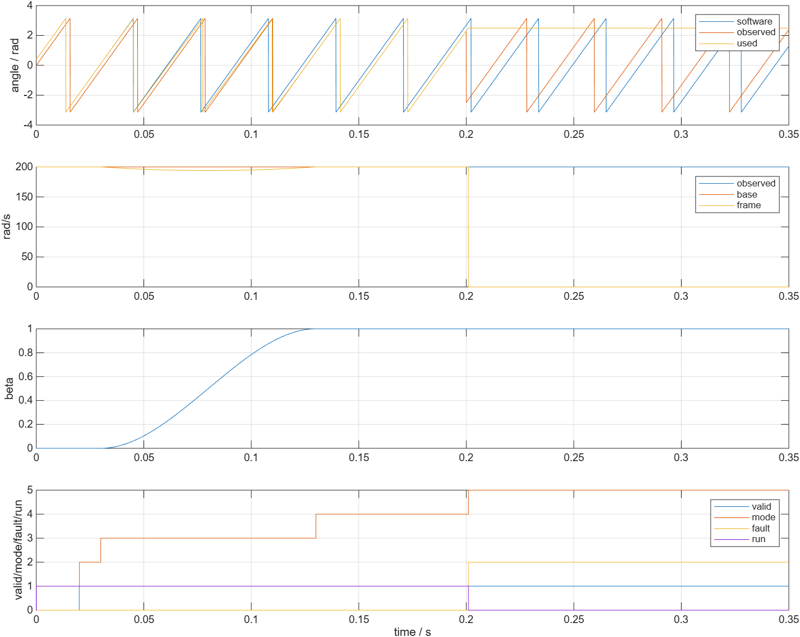
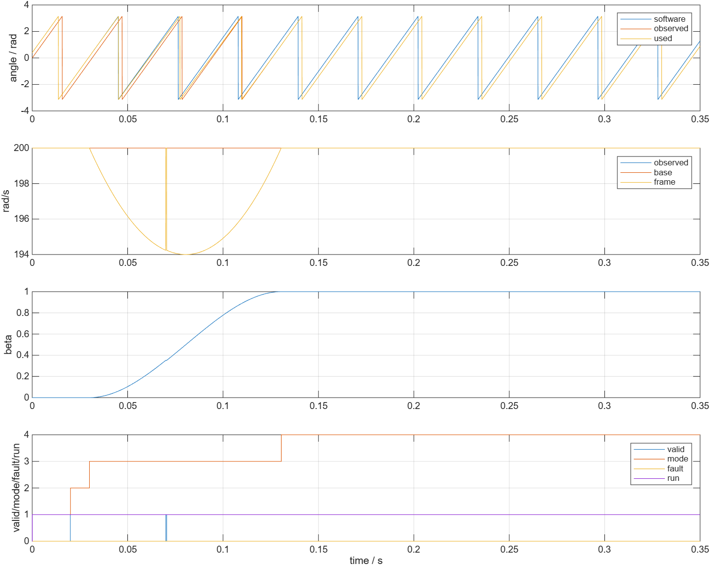

# 捕获与切换独立验证

- 模型文件：src/SensorlessHandover.slx；src/SensorlessHandoverTest.slx
- 参数文件：parameter/handover_parameters.m；parameter/refresh_handover_parameters.m
- 采样周期：50e-6 s
- 求解器/步长：FixedStepDiscrete，50e-6 s
- 工况：正反向、跨±π、零电流捕获及关闭、角度/速度/残差/低速拒绝、资格中断、短/长丢失、相位突跳、混合暂停、复位、禁能、启动失败、全关闭和相位噪声，共19项
- 数据文件：waveform_analysis/results.mat；waveform_analysis/metrics.json

19/19通过，库内部和测试台结构检查healthy。输入为独立合成相位及状态标志，没有电机Plant。每组记录保存实际配置、11列输入、时间、22列trace和指标；记录输入与请求输入逐点一致。

普通工况在0.02 s给出有效观测，200个连续合格样本后于0.03 s开始混合；2000个健康样本完成beta过渡，于0.13005 s进入AUTO。首拍控制角与软件角相同；包角混合与解析表达式误差小于1e-10 rad。恒速工况的角度逐拍增量与omega_frame相符，误差小于1e-7 rad/s。

beta使用r²(3-2r)，起止斜率为0。0.07–0.0705 s失效时过渡计数暂停，恢复后继续，AUTO时间顺延0.5 ms到0.13055 s。资格在0.025–0.027 s中断时重计，混合推迟到0.037 s。

0.2 s起持续失效时在0.201 s退出；相位突然增加1.5 rad而valid保持1时，同样由相位创新检查拒绝，短时沿预测相位前进，没有把突跳直接送到控制角。随后即使valid恢复，故障也保持，需禁能或复位。短时0.5 ms丢失可以恢复，不触发1 ms失效退出。

测试事件按整数采样点生成。初版浮点colon时间在0.2 s附近略小于比较常数，导致实际故障信号晚一拍；核对记录确认计数器仍按实际失效起点持续1 ms。现改为sample*Ts及整数事件索引，并增加输入逐点一致检查，未放宽失效持续时间标准。

当前验证不包含电流参考坐标旋转、PI积分/比例/前馈状态跟踪或真实电机响应；这些随App接入后检查。run=0表示输出了退出指令，不能据此声称逆变器实际关断、自由续流或故障后电流受控。
