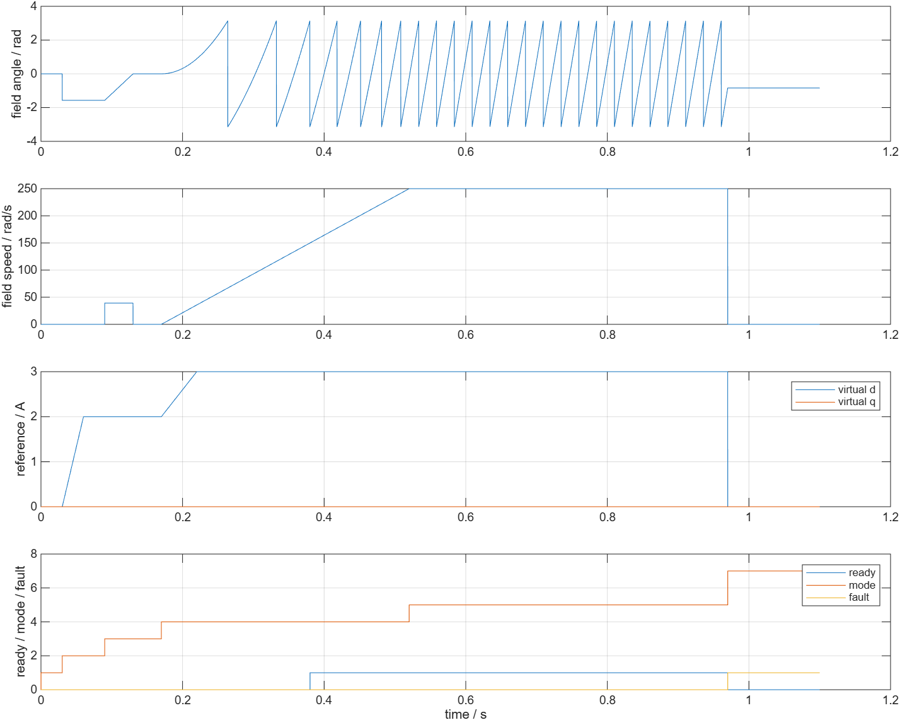
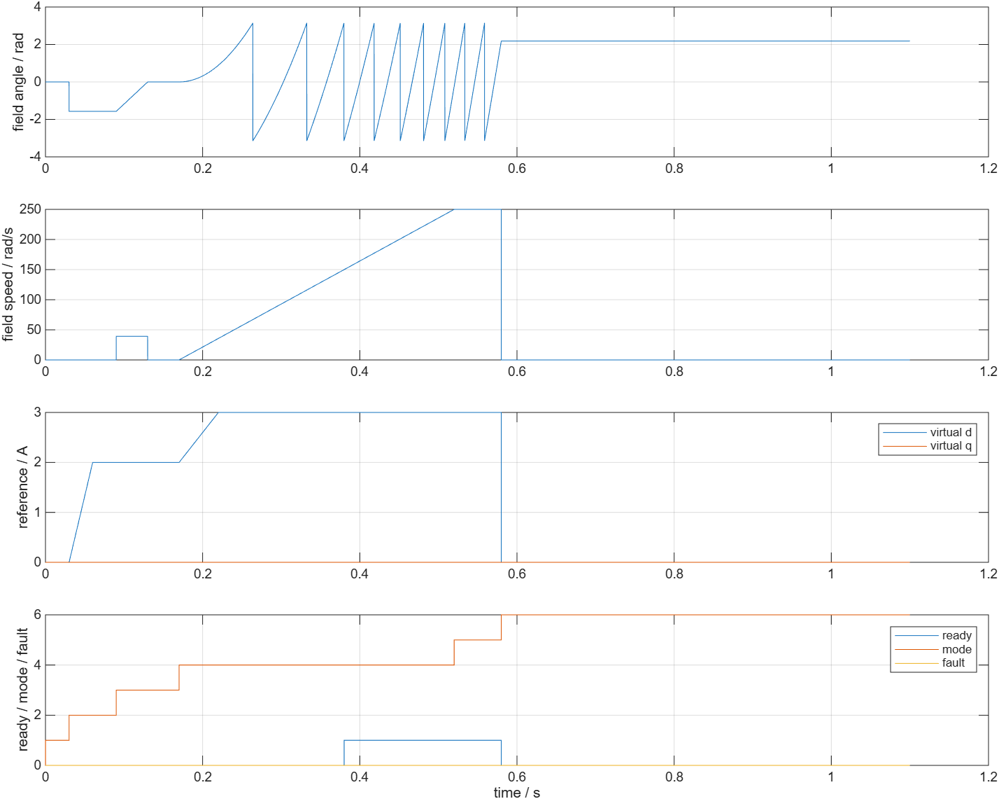
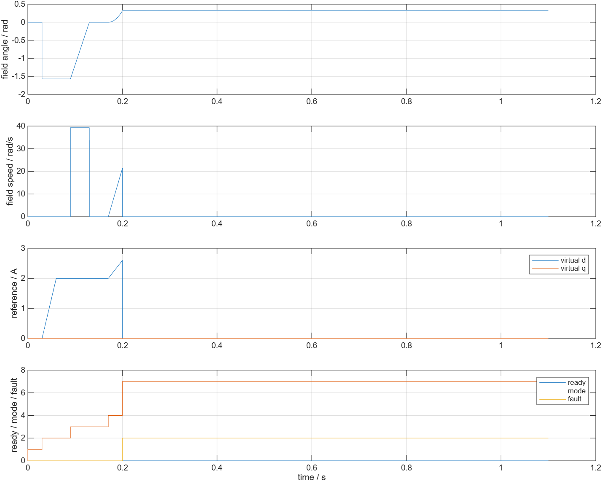

# 启动序列独立验证

- 模型文件：src/SensorlessStartup.slx；src/SensorlessStartupTest.slx
- 参数文件：parameter/startup_parameters.m；parameter/refresh_startup_parameters.m
- 采样周期：默认50e-6 s；参数覆盖工况100e-6 s
- 求解器/步长：FixedStepDiscrete，使用本次配置Ts
- 工况：正/反向超时、正常/带速窗口接管、复位、禁能、非法方向、全关闭、故障锁存、周期/速度/电流覆盖，共10项
- 数据文件：waveform_analysis/results.mat；waveform_analysis/metrics.json

R2026b下10/10通过，库内部和测试台结构检查healthy。保存各工况实际配置、输入、时间、12列trace和指标。输入事件按整数采样点生成，记录输入与请求输入逐点一致。

默认0.17005 s进入I-f爬升，ready在软件速度达到150电角rad/s后置1；0.52005 s进入端点等待。I-f累计0.8 s仍未接管，则0.97005 s输出超时故障。100µs覆盖工况对应0.9701 s；没有放宽采样点级别的时序标准。

默认I-f电流请求峰值3 A、速度请求峰值250电角rad/s，反向工况速度带负号。覆盖配置为3.5 A、300电角rad/s。角度包到[-π,π]，爬升角度与前向欧拉累加的离散运动学一致，误差小于1e-10 rad。

0.58 s接管后进入模式6、启动电流请求归零；0.015 s的带速窗口接管没有发出对齐电流。0.2 s非法方向立即进入故障2，此后方向恢复也不清故障；超时后acquired或非法方向都不能改变首个故障。禁能/复位在当拍把输出及状态复位，随后能重新走启动序列。

本测试没有电机、逆变器和电流环，图中电流是请求，角度是软件电流矢量方向。实际起转、负载能力、捕获电流/转矩跳变、SIL和目标验证均待后续App完成。
