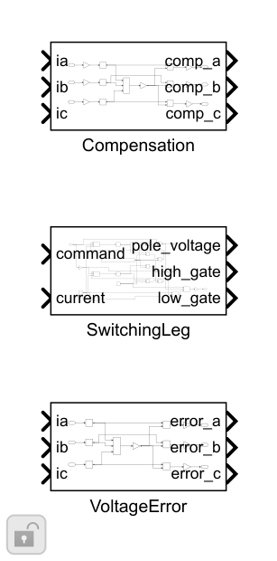
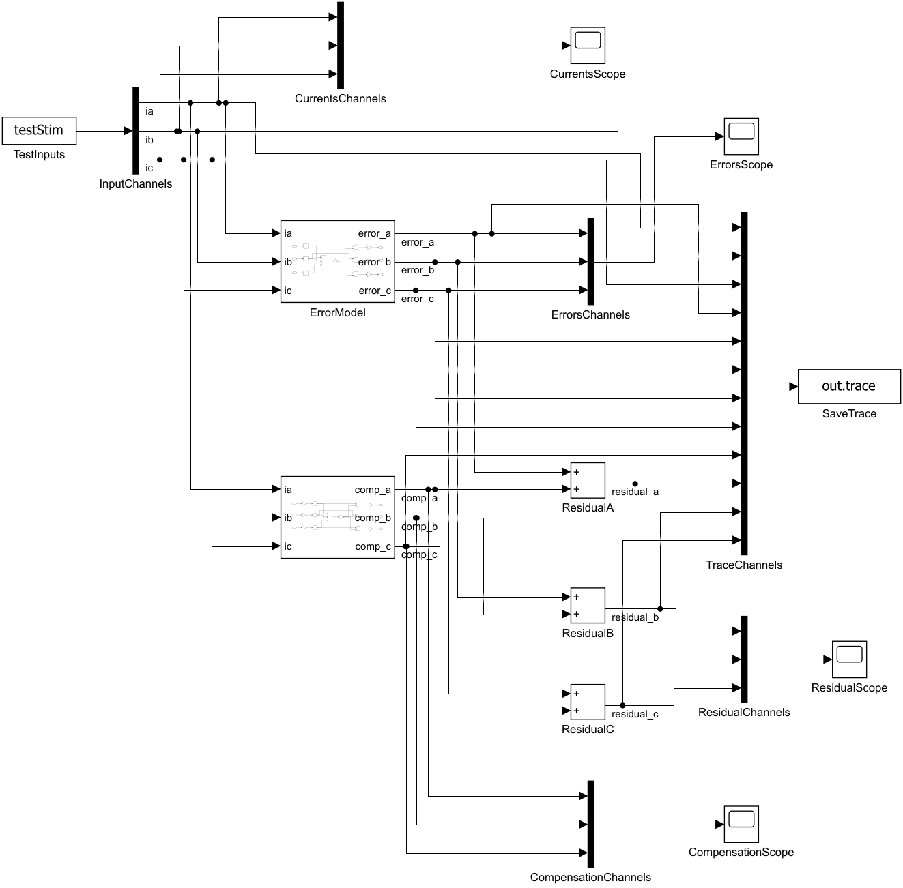
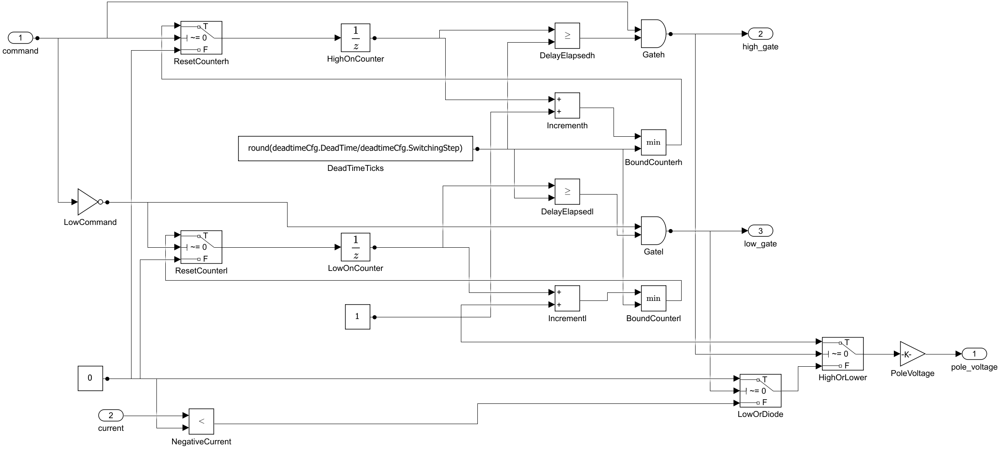

# 死区误差、补偿与桥臂开关校验：搭建步骤

平均误差使用硬电流符号，补偿使用有界平滑符号，并去掉三相共同分量。补偿加在SVPWM前，最终duty继续钳位。短时桥臂以计数器实现开通延迟、立即关断，死区按电流方向选择理想二极管续流。

1. E=Vdc·DeadTime/PwmTs+DeviceDrop。对浮动中性点的误差为−E·(sign(i_phase)−三相sign均值)，三相和为0。

2. 补偿极性=sat(i/CurrentBlend,−1,1)，减三相均值后乘正E及补偿开关/比例。平滑区宽度会影响过零附近残余误差。

3. 整机真实电流进入误差模型，反馈电流进入补偿。先加补偿、调制、最终duty钳位；执行后平均相电压再加物理误差。

4. 回算估计由当前命令duty重建电压，再扣除已注入补偿，返回dq。实际延迟和未建准死区作为对象扰动，不混进当前限幅残差。

5. SwitchingLeg高低侧各有UnitDelay计数器，命令持续有效才累加，关断立即清零；计数达到N=round(DeadTime/SwitchingStep)才允许开通，短脉冲不会提前开通。

6. 高侧开时极点=Vdc，低侧开时=0；都关时，正电流续流至低端、负电流至高端。恰为0时模型选低端。

7. 使用10kHz/50%命令、±3A电流、2µs死区、0.1µs步长核对周期均值；再测零死区、短脉冲、电流过零支路和无上下管直通。

搭建操作：使用Library Browser或双击画布查找上述基础块；参数填结构字段表达式。先更新图检查维度/采样周期，再运行本模块测试。修改库源时先在Library编辑器解锁，保存源库后重跑测试；不要无意断开测试实例的库链接。

[参数与Scope](../parameter/README.md) · [运行](USAGE.md) · [模块](../README.md)
