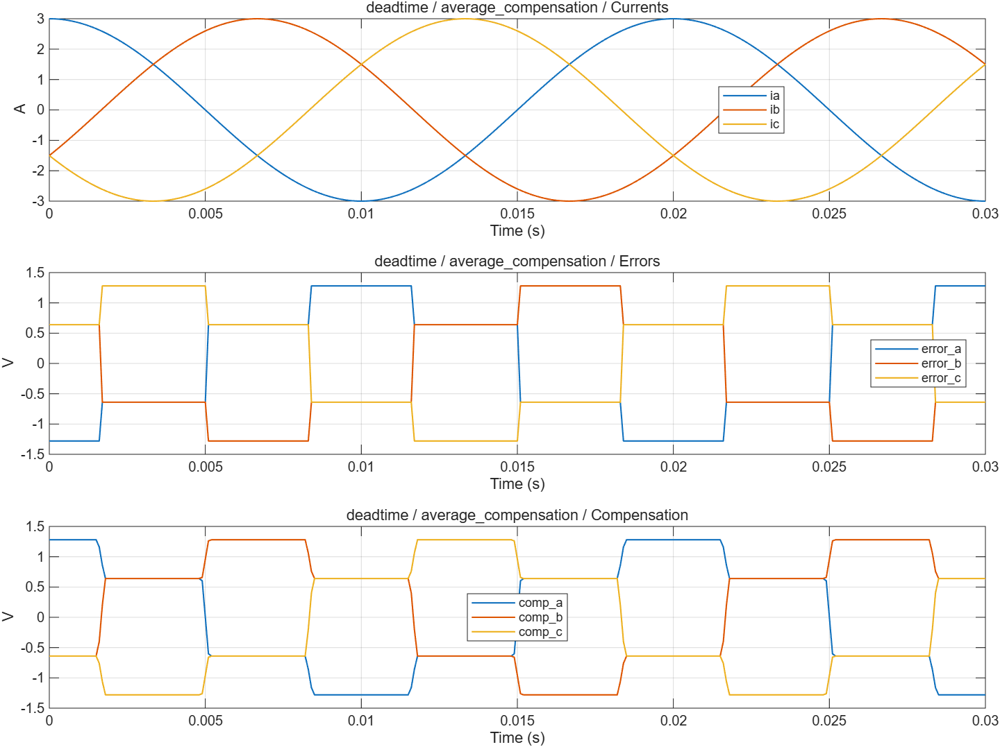
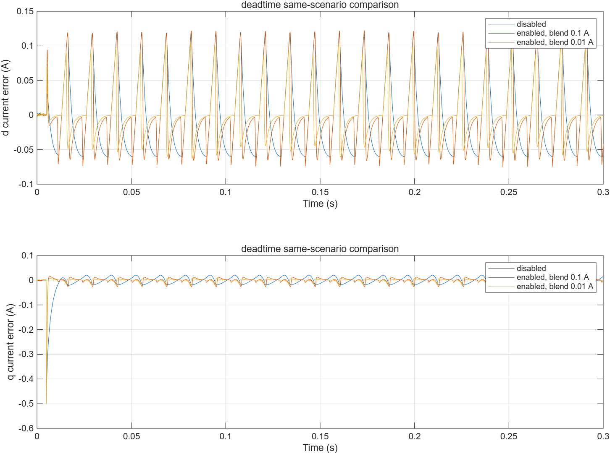
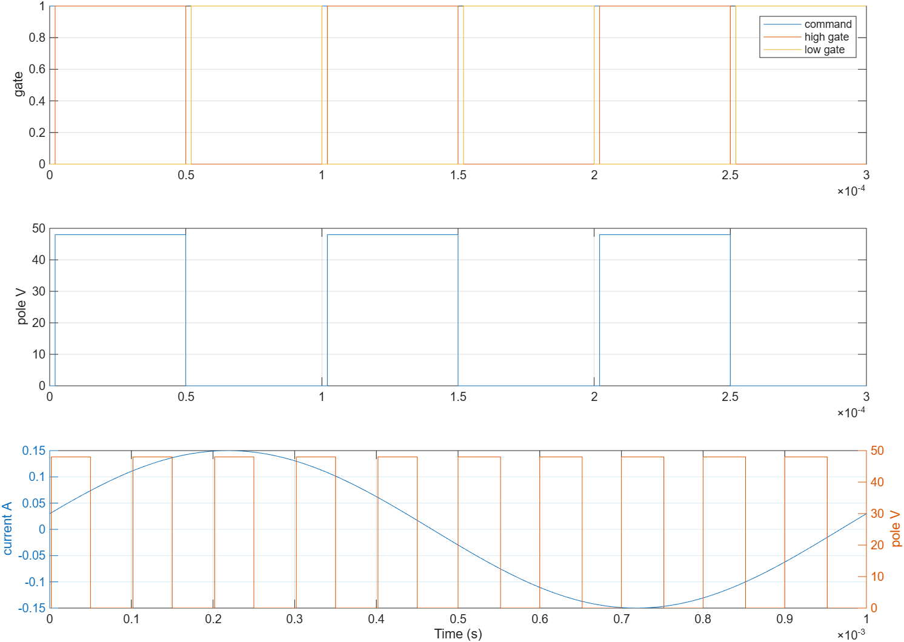

# 死区误差、补偿与桥臂开关校验：波形分析

- 模型文件：`src/DeadtimeTest.slx`、`src/Deadtime.slx`；系统对照使用`../experiment/src/MotorExperiment.slx`。
- 参数文件：`parameter/deadtime_parameters.m`；每个case另保存实际跨模块parameters。
- 采样周期：电流/默认记录100µs，外环1ms；桥臂0.1µs；能量工况记录5µs。
- 求解器/步长：普通模型ode4/5µs；收敛工况2.5µs；桥臂FixedStepDiscrete/0.1µs。
- 工况：10项，见下表和实际断言脚本。
- 数据文件：`waveform_analysis/results.mat`、`waveform_analysis/metrics.json`。

## 结果

| 工况 | 结论 | 部分指标（键名含单位） |
|---|---|---|
| average_compensation | 通过 | away_zero_residual_V=0 |
| disabled | 通过 | disabled_voltage_V=0 |
| loop_comp_off | 通过 | final_current_error_A=0.04411276；current_iae_A_s=0.01866482；tail_current_rms_A=0.05763822 |
| loop_comp_on | 通过 | final_current_error_A=0.04177434；current_iae_A_s=0.01333238；tail_current_rms_A=0.04980557 |
| loop_comp_narrow_blend | 通过 | final_current_error_A=0.0007487258；current_iae_A_s=0.007184566；tail_current_rms_A=0.03180119 |
| switching_positive | 通过 | mean_pole_voltage_V=23.04；mean_voltage_error_V=0；shoot_through_count=0 |
| switching_negative | 通过 | mean_pole_voltage_V=24.96；mean_voltage_error_V=0；shoot_through_count=0 |
| switching_zero_deadtime | 通过 | pole_error_V=0 |
| switching_short_pulse | 通过 | high_gate_count=0 |
| switching_zero_crossing | 通过 | diode_selection_error_V=0；shoot_through_count=0 |

不适用于当前模式的指标以JSON null记录，例如电流模式不评价速度/位置跟踪。IAE为误差绝对值时间积分。tail_current_rms_A窗口起止在metrics中；短工况可能覆盖全程，不自动表示稳态。

## 波形说明

平均误差使用硬电流符号，补偿使用有界平滑符号，并去掉三相共同分量。补偿加在SVPWM前，最终duty继续钳位。短时桥臂以计数器实现开通延迟、立即关断，死区按电流方向选择理想二极管续流。

[SVG图](summary.svg) · [完整指标](metrics.json) · `results.mat`（运行验证后生成）

0.5A给定、80rad/s电角速度、0.2–0.3s窗口：补偿关RMS=0.0576382A，CurrentBlend=0.1A时为0.0498056A，0.01A时为0.0318012A。窄平滑区在该理想采样工况更好，真实噪声和换流可能改变选择。

这里的RMS是sqrt(mean(ed²+eq²))的dq合成误差。相同窗口的d轴误差绝对峰值分别约0.119563A、0.122105A、0.100425A；0.1A平滑区虽然降低合成RMS，却略增d轴峰值，不能只凭一个RMS指标选择补偿参数。

[对照SVG](comparison.svg)

[桥臂SVG](switching.svg)

50%duty均值：正电流23.04V、负电流24.96V，对照24V±0.96V；同时检查无直通、零死区、短脉冲和过零二极管选择。过零电流是外部施加量，不是真实器件零电流换流精度证明。

## 范围与复现

桥臂电流由外部施加；没有器件结电容、反向恢复及真实零电流换流。开关测试核对假设下的符号、计数和均值，不证明真实过零精度。实际板卡需标定死区、压降和过零平滑区。

验证依据为解析解、能量关系、边界/精确时序断言和同工况开关对照，没有运行原始chensha/MBD或官方工具箱块做逐点等价验证。当前为double MIL，不代表single、C2000构建、PIL或实机已经验证。

[验证脚本](run_deadtime_validation.m) · [运行方法](../build_process/USAGE.md) · [Scope表](../parameter/README.md)
