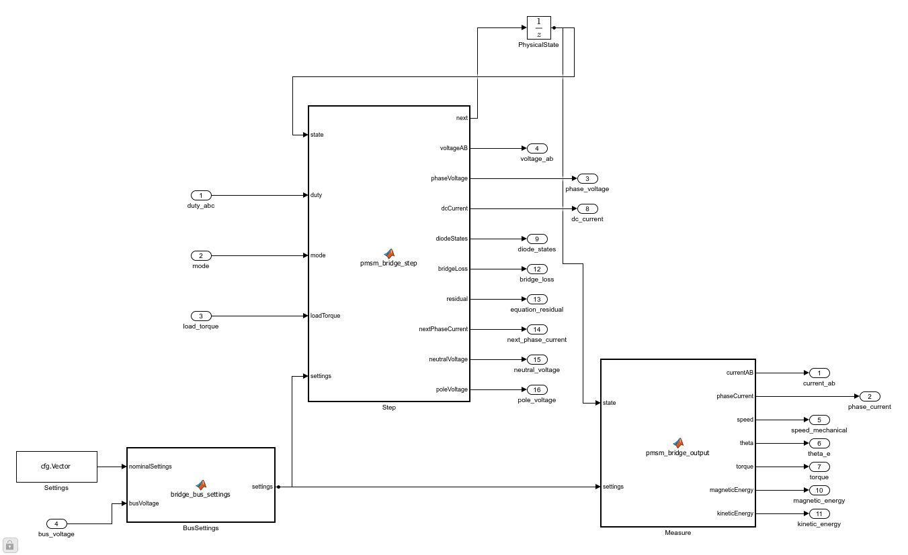
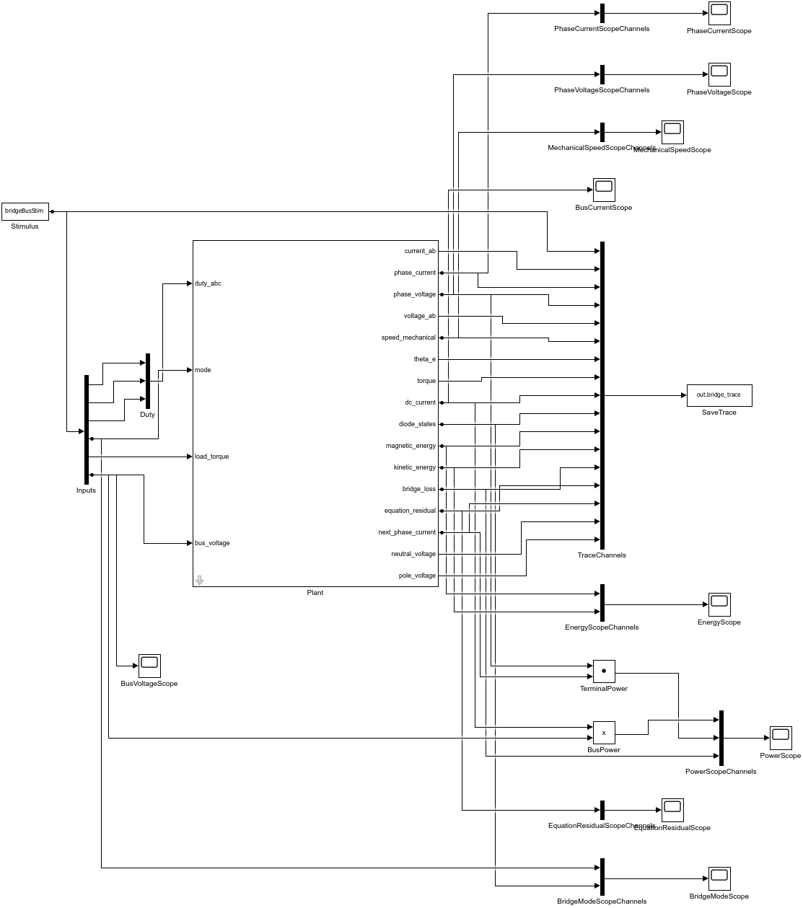

# 运行时母线桥模型搭建过程

模型文件：src/PMSMBridgeBusPlant.slx、src/PMSMBridgeBusPlantTest.slx
参数文件：parameter/bridge_bus_test_parameters.m、parameter/pmsm_bridge_parameters.m
采样周期：5μs，减半检查2.5μs
求解器/步长：FixedStepDiscrete / bridgeCfg.Ts
工况：PWM母线跌落/恢复、恒压对照、关断整流、主动短路、非法母线拒绝
数据文件：waveform_analysis/bus_results.json、waveform_analysis/bus_pwm_steps.mat

原桥将Vdc放在固定参数向量中，无法直接组合运行中的母线变化。本次在同一功能模块内增加一组库/Test，原三组对象和已有App继续使用原模型。

1. 读取原库和Test的端口、连接与构建M文件。库另存为之前，检查并卸载本次加载、没有未保存修改的引用Test；不覆盖原SLX。
2. 将库另存为`PMSMBridgeBusPlant`，导出命名为`BridgeBusMotor`。前三个输入、16个输出和`PhysicalState`均保留。
3. 增加第四个Inport `bus_voltage`以及MATLAB Function `BusSettings`，内嵌[src/bridge_bus_settings.m](../src/bridge_bus_settings.m)。先检查正有限输入，再替换17项配置向量的第9项Vdc。
4. Step和Measure原先读取Settings，改为读取BusSettings输出。Step/Measure内嵌代码逐字核对原计算M源，不另维护电机或二极管方程。
5. Test链接新库，输入由5列扩成6列；Vdc接第四输入，日志由33列扩成34列。原BusPower固定Gain改为Product，计算本拍实际Vdc乘dc_current。
6. 增加BusVoltageScope和BusCurrentScope，保留原七组Scope。增大新函数块的端口显示空间，再对新生成的库内部和测试台执行布局及连接检查。
7. 通过本地参数初始化、10项检查、原生源码/链接/Scope核对；再从当前M源在新目录重建，并与默认34列轨迹逐点比较。

构建入口：[build_pmsm_bridge_bus.m](build_pmsm_bridge_bus.m)。所有结构/参数/连线使用model_edit，函数代码通过公开MATLABFunctionConfiguration.FunctionScript写入。更改计算M文件需要重建SLX；更改parameter中的默认值只需重新初始化或使用运行器覆盖。

母线输入不经过低通、不隐含电容，也不重置电流。外部规定的母线若跳变，电压边界当拍改变，物理电流在后续状态更新中演化。对于全关断，仍求解二极管续流/整流，不能把电压请求置零当成开路。

[参数/Scope](../parameter/BRIDGE_BUS_PARAMETERS.md) · [运行](BRIDGE_BUS_USAGE.md) · [公式](../docs/公式推导.md)
