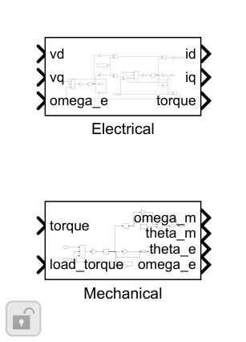
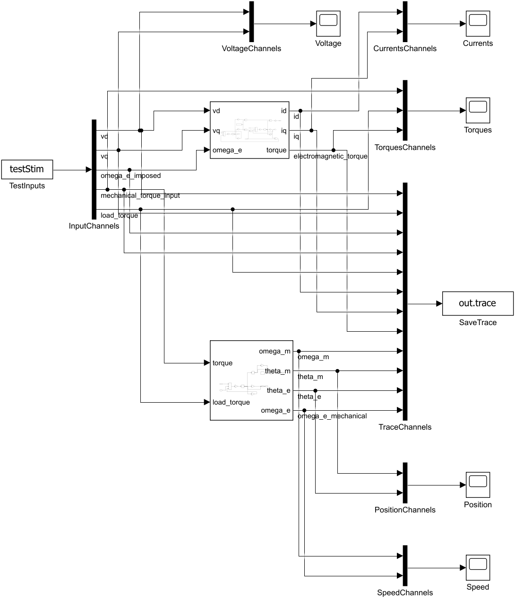
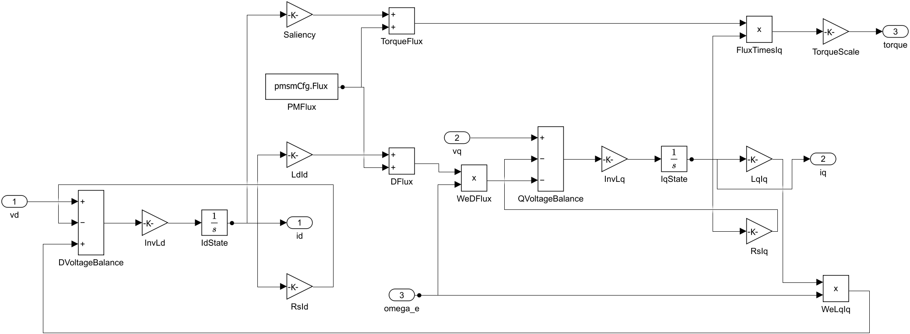

# PMSM 数学电机与刚性负载：搭建步骤

电气部分保存 id、iq；机械部分保存机械速度和位置。整机将电磁转矩与电角速度闭合。独立测试台分别驱动两部分，便于对照解析解；测试输入第4列是独立机械转矩，不会自动改成电气部分的转矩。

1. Electrical 放置 IdState、IqState 两个 Integrator，初值为 pmsmCfg.Id0、Iq0。电压平衡经 1/Ld、1/Lq Gain 进入积分器；这里不乘控制周期。

2. d 轴电压平衡为 vd−Rs·id+omega_e·Lq·iq，q 轴为 vq−Rs·iq−omega_e·(Ld·id+Flux)。用 Gain、Product、Sum 逐项搭建，注意耦合项符号。

3. 转矩为 Te=1.5·p·[Flux+(Ld−Lq)·id]·iq，保留 Ld≠Lq 的磁阻转矩。系数1.5对应幅值不变、相峰值约定。

4. Mechanical 计算 Te−Tl−B·omega_m，经 1/J 积分得到速度，再积分得到机械位置。电角速度=p·omega_m，电角度=mod(p·theta_m,2π)；机械位置保持展开。

5. 独立测试将 vd/vq/we 送 Electrical，Te_external/Tl 送 Mechanical；MotorExperiment 则用实际电磁转矩驱动机械部分，并反馈电角速度。

6. 采用 ode4、5µs固定步长，对照零速RL、恒速平衡、正负机械响应以及电能/铜耗/磁储能。

搭建操作：使用Library Browser或双击画布查找上述基础块；参数填结构字段表达式。先更新图检查维度/采样周期，再运行本模块测试。修改库源时先在Library编辑器解锁，保存源库后重跑测试；不要无意断开测试实例的库链接。

[参数与Scope](../parameter/README.md) · [运行](USAGE.md) · [模块](../README.md)
