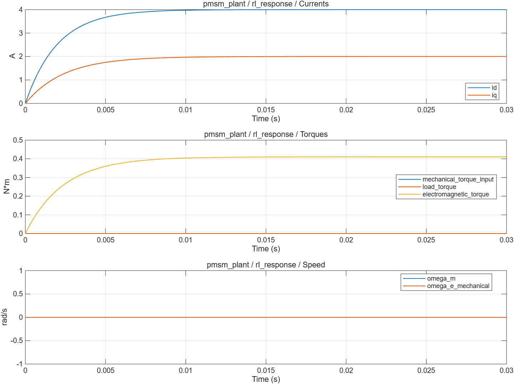

# PMSM 数学电机与刚性负载：波形分析

- 模型文件：`src/PMSMPlantTest.slx`、`src/PMSMPlant.slx`；系统对照使用`../experiment/src/MotorExperiment.slx`。
- 参数文件：`parameter/pmsm_parameters.m`；每个case另保存实际跨模块parameters。
- 采样周期：电流/默认记录100µs，外环1ms；桥臂0.1µs；能量工况记录5µs。
- 求解器/步长：普通模型ode4/5µs；收敛工况2.5µs；桥臂FixedStepDiscrete/0.1µs。
- 工况：5项，见下表和实际断言脚本。
- 数据文件：`waveform_analysis/results.mat`、`waveform_analysis/metrics.json`。

## 结果

| 工况 | 结论 | 部分指标（键名含单位） |
|---|---|---|
| rl_response | 通过 | analytic_error_A=4.796163e-13 |
| salient_equilibrium | 通过 | equilibrium_error_A=0；torque_error_Nm=0 |
| mechanical_positive | 通过 | speed_error_rad_s=5.018208e-14；position_error_rad=2.21068e-13 |
| mechanical_negative | 通过 | speed_error_rad_s=5.018208e-14；position_error_rad=2.21068e-13 |
| energy_balance | 通过 | energy_balance_error_J=1.510417e-8 |

不适用于当前模式的指标以JSON null记录，例如电流模式不评价速度/位置跟踪。IAE为误差绝对值时间积分。tail_current_rms_A窗口起止在metrics中；短工况可能覆盖全程，不自动表示稳态。

## 波形说明

电气部分保存 id、iq；机械部分保存机械速度和位置。整机将电磁转矩与电角速度闭合。独立测试台分别驱动两部分，便于对照解析解；测试输入第4列是独立机械转矩，不会自动改成电气部分的转矩。

[SVG图](summary.svg) · [完整指标](metrics.json) · `results.mat`（运行验证后生成）

RL响应与独立指数解析解对照；能量检验按输入电能减铜耗等于磁储能变化。机械正负工况均检查速度和展开位置，避免只验证电流而漏掉机械符号。

## 范围与复现

线性磁路、恒定R/L/磁链、单惯量与黏性阻尼；不含磁饱和、铁耗、齿槽、弹性轴和温度模型。参数是自定义仿真夹具，没有实际电机辨识来源。

验证依据为解析解、能量关系、边界/精确时序断言和同工况开关对照，没有运行原始chensha/MBD或官方工具箱块做逐点等价验证。当前为double MIL，不代表single、C2000构建、PIL或实机已经验证。

[验证脚本](run_pmsm_plant_validation.m) · [运行方法](../build_process/USAGE.md) · [Scope表](../parameter/README.md)
