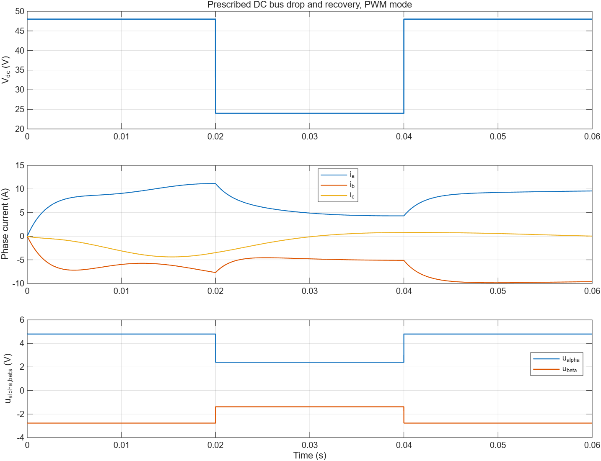
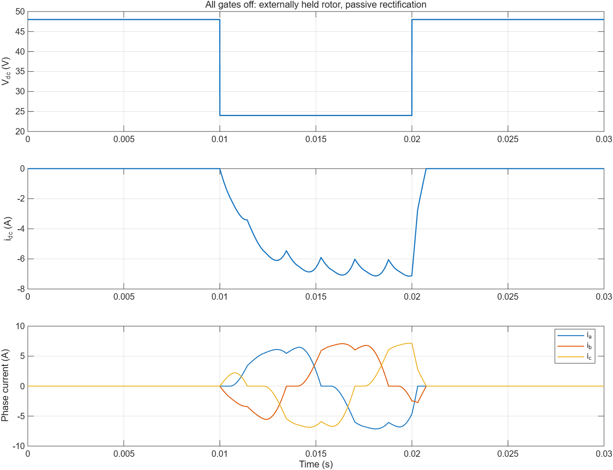
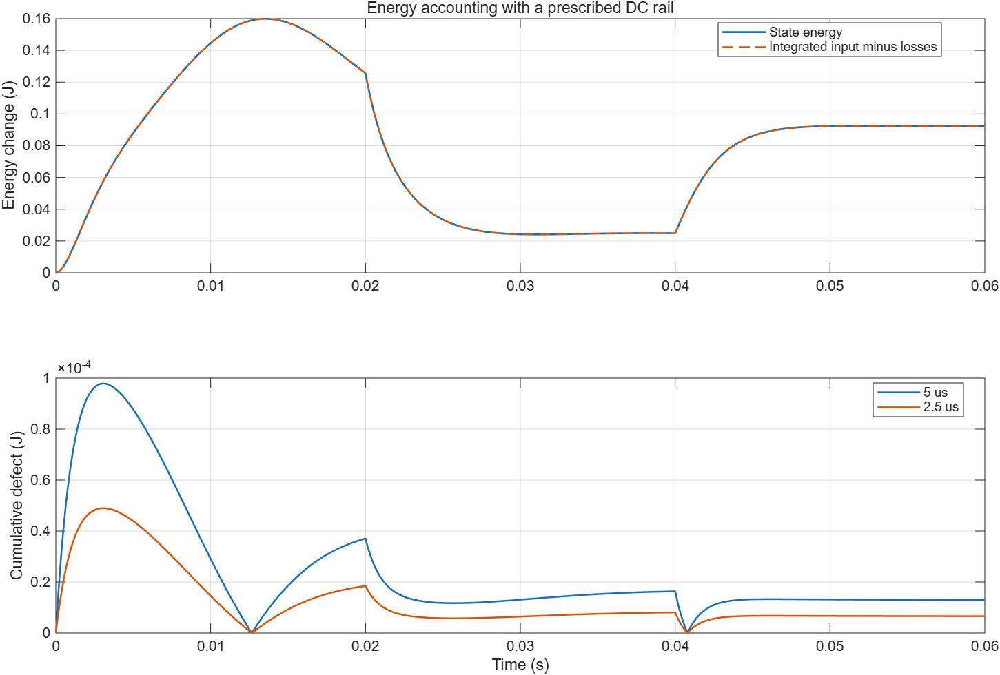

# 运行时母线桥模型波形分析

模型文件：src/PMSMBridgeBusPlant.slx、src/PMSMBridgeBusPlantTest.slx
参数文件：parameter/bridge_bus_test_parameters.m、parameter/pmsm_bridge_parameters.m
采样周期：默认5μs；能量收敛另用2.5μs
求解器/步长：FixedStepDiscrete / bridgeCfg.Ts
工况：PWM母线48→24→48V、恒48/36V、外部维持150rad/s全关断、主动短路、4项非法输入
数据文件：waveform_analysis/bus_results.json、bus_pwm_steps.mat、constant_48V.mat、constant_36V.mat、bus_off_rectification.mat、bus_active_short.mat、bus_energy_refinement.mat（均位于waveform_analysis）

[run_bridge_bus_validation.m](run_bridge_bus_validation.m)的10项检查通过：6项正常工况/数值检查、4项预期输入拒绝。它们是桥/电机对象证据，不计入301项观测器/启动库MIL，也不证明无位置弱磁App已经闭环。

| 检查 | 实际结果 |
|---|---|
| 平均PWM母线跌落/恢复 | 静止坐标电压与独立占空比公式最大差1.78e-15V；相电流峰值11.1577A。该Test为开环物理对象，没有电流PI限流 |
| 恒定48V | 与原桥相同配置对照336,028个物理输出数值，最大差0 |
| 恒定36V | 与原桥相同配置对照336,028个物理输出数值，最大差0 |
| 全关断母线跌落/恢复 | 母线降低后被动整流，相电流峰值7.14554A，累计回馈1.47861J；外部轴源保持150机械rad/s |
| 主动短路 | 母线功率与端电压为0，变母线/恒母线的物理轨迹最大差0；机械/电流状态仍变化 |
| 能量步长减半 | 终点累计能量缺陷由1.29247e-5J降至6.57496e-6J，比值0.508712 |
| 0、−24、NaN、Inf母线 | 4项均由BusSettings的正有限值断言拒绝，未作为正常工况通过 |

电流连续性逐拍核对当前phase_current等于上一拍next_phase_current；母线切换不复位电流。区间功率按实际Vdc乘idc，并与相电压·下一拍电流及桥损耗核对。不能把当前电流直接替代隐式区间电流来声称精确功率平衡。

## 母线变化与PWM响应

在0.02s降到24V、0.04s恢复48V，占空比保持不变，所以静止坐标电压按比例变化。相电流保持状态连续，通过电感与转子运动逐步响应。

## 关断整流

全程mode=0。48V时开路所需相电压跨度可容纳；24V时二极管形成回馈通路。恢复48V后，原电流经二极管衰减，未当拍清零。该例机械速度由外部轴源保持，回馈能量来自外部机械做功，不能据此推断自由滑行速度变化。

## 能量与离散误差

积分使用实际母线功率，扣除桥损耗、铜耗、黏性损耗和外负载做功。模型的后向电气更新/显式机械更新存在离散误差；步长减半检查一阶趋势，没有把有限步长轨迹称为全过程精确能量守恒。

九组Scope、34列数据及输入/过程参数见[参数页](../parameter/BRIDGE_BUS_PARAMETERS.md)。[bus_verification.json](bus_verification.json)记录当前M重建、正式路径重放、原生链接/源码和旧文件哈希核对；[bus_native_inventory.json](bus_native_inventory.json)记录4输入/16输出及真实Scope来源。

本次仅加入运行时母线输入。仍无直流母线电容、纹波、反向恢复、器件开关波形或实测磁链图；后续弱磁App须把同一个母线信号同时接给物理对象和电流分配器，并重新完成闭环验证。
