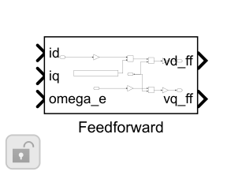
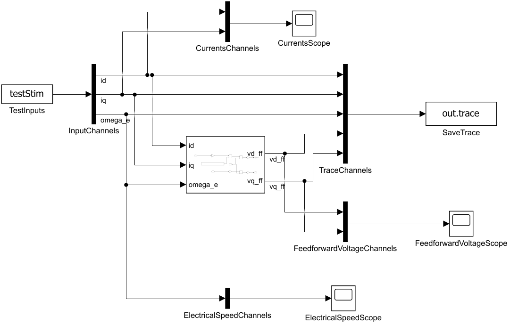

# dq 解耦与反电势前馈：搭建步骤

与本项目Park方向一致：vd_ff=−omega_e·Lq·iq，vq_ff=omega_e·(Ld·id+Flux)。使用同帧反馈，在共同电压限制前只相加一次。整机控制禁能/复位时同时清零PI与前馈请求。

1. q电流乘−Lq再乘电角速度，得到d轴补偿。d电流乘Ld加永磁磁链，再乘电角速度，得到q轴补偿。

2. ParameterScale同时缩放前馈所用Ld/Lq/Flux，不修改Plant参数，用于模型失配对照。

3. Enable=0使独立前馈输出严格为0。整机另用enable AND NOT reset门控前馈。

4. CurrentStage中 v_request=vPI+vFF；VoltageStage返回同拍r=v_feasible−v_request，不把FF当作PI独自产生的电压。

5. FeedforwardTest验证正负电角速度下的公式和开关。整机强制we=500rad/s，保持对象、PI、输入一致，比较FF开关下的电流误差积分。

6. ParameterScale=0.8检查失配；正常未饱和前馈时，限制残差应接近数值零。

搭建操作：使用Library Browser或双击画布查找上述基础块；参数填结构字段表达式。先更新图检查维度/采样周期，再运行本模块测试。修改库源时先在Library编辑器解锁，保存源库后重跑测试；不要无意断开测试实例的库链接。

[参数与Scope](../parameter/README.md) · [运行](USAGE.md) · [模块](../README.md)
