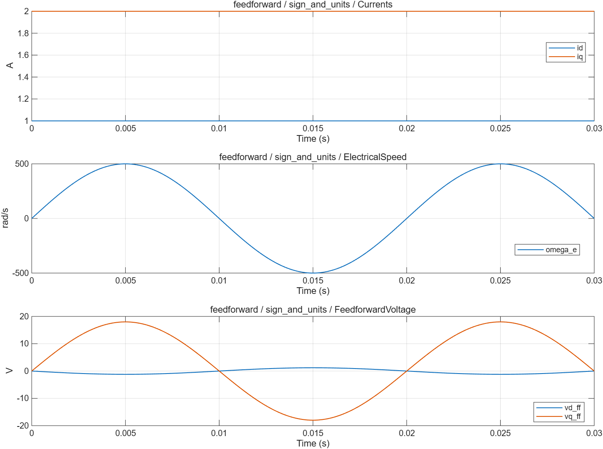
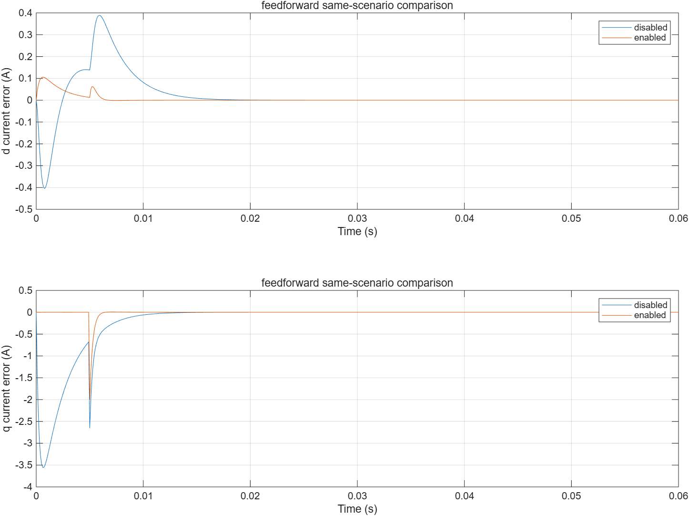

# dq 解耦与反电势前馈：波形分析

- 模型文件：`src/FeedforwardTest.slx`、`src/DQFeedforward.slx`；系统对照使用`../experiment/src/MotorExperiment.slx`。
- 参数文件：`parameter/feedforward_parameters.m`；每个case另保存实际跨模块parameters。
- 采样周期：电流/默认记录100µs，外环1ms；桥臂0.1µs；能量工况记录5µs。
- 求解器/步长：普通模型ode4/5µs；收敛工况2.5µs；桥臂FixedStepDiscrete/0.1µs。
- 工况：5项，见下表和实际断言脚本。
- 数据文件：`waveform_analysis/results.mat`、`waveform_analysis/metrics.json`。

## 结果

| 工况 | 结论 | 部分指标（键名含单位） |
|---|---|---|
| sign_and_units | 通过 | formula_error_V=0 |
| disabled | 通过 | disabled_voltage_V=0 |
| loop_ff_off | 通过 | final_current_error_A=1.097472e-11；current_iae_A_s=0.01388814；tail_current_rms_A=0.6549273 |
| loop_ff_on | 通过 | final_current_error_A=1.029843e-12；current_iae_A_s=0.0009641011；tail_current_rms_A=0.1142928 |
| parameter_mismatch | 通过 | final_current_error_A=4.68936e-12；current_iae_A_s=0.003289889；tail_current_rms_A=0.1774289 |

不适用于当前模式的指标以JSON null记录，例如电流模式不评价速度/位置跟踪。IAE为误差绝对值时间积分。tail_current_rms_A窗口起止在metrics中；短工况可能覆盖全程，不自动表示稳态。

## 波形说明

与本项目Park方向一致：vd_ff=−omega_e·Lq·iq，vq_ff=omega_e·(Ld·id+Flux)。使用同帧反馈，在共同电压限制前只相加一次。整机控制禁能/复位时同时清零PI与前馈请求。

[SVG图](summary.svg) · [完整指标](metrics.json) · `results.mat`（运行验证后生成）

同一500rad/s电角速度工况，前馈关/开的电流IAE约0.0138881与0.000964101 A·s。参数缩放0.8时积分补偿残差；未饱和前馈的限制残差要求低于1e−10V。

[对照SVG](comparison.svg)

## 范围与复现

线性磁链模型；不含交叉饱和磁链图、角度预测或PWM生效时刻外推。强制转速实验表示外部原动机维持转速，自由机械积分器不参与该速度。

验证依据为解析解、能量关系、边界/精确时序断言和同工况开关对照，没有运行原始chensha/MBD或官方工具箱块做逐点等价验证。当前为double MIL，不代表single、C2000构建、PIL或实机已经验证。

[验证脚本](run_feedforward_validation.m) · [运行方法](../build_process/USAGE.md) · [Scope表](../parameter/README.md)
