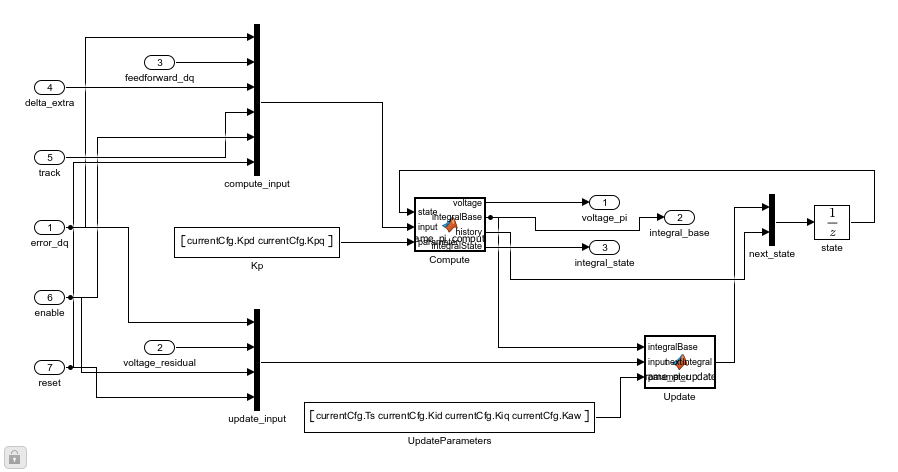
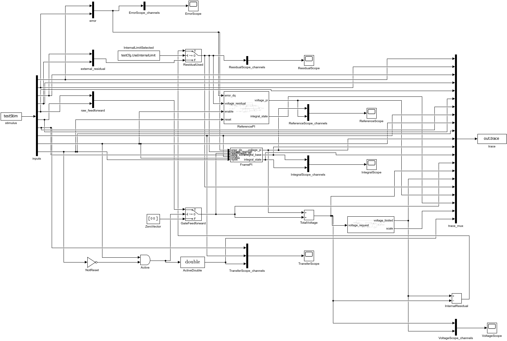

# 角度接管时的电流 PI 状态转换

本页对应 CurrentControl 库新增的 FrameTrackingPI。原 TrackingPI 和 VoltageLimit 保留。独立测试不包含电机；实际切换电流、转矩还要由 Sensorless App 验证。

## 搭建步骤与作用

1. 新增独立子系统，7个输入、3个输出。error_dq、voltage_residual、feedforward_dq 为 d/q 两元素列向量；delta_extra、track、enable、reset 为标量。每个实例的 Mask 参数 currentCfg 在调用模型工作区求值。
2. UnitDelay 保存8个状态，顺序是上一拍积分贡献 I(2)、电流误差 E(2)、比例贡献 P(2)、前馈 FF(2)，初值全部0。这里没有 persistent 状态。
3. Compute 块读取旧状态和当前输入，计算电压与转换后的积分基值。其源代码为 [frame_pi_compute.m](../src/frame_pi_compute.m)。它不消费最终电压残差，因此当前电压计算没有通过回算形成代数环。
4. 在同一控制坐标中把 PI 电压加上前馈，再经过最终电压限制。残差必须是最终可行电压减总请求电压，单位 V。若执行链另有延迟或死区，App应按实际执行点组织反馈。
5. Update 块使用本拍残差和误差执行前向欧拉积分，并把新积分、当前 E/P/FF 写回 UnitDelay。[frame_pi_update.m](../src/frame_pi_update.m) 只影响下一拍状态。
6. enable低或reset高时，PI输出、诊断积分及下一状态全部为0。外部前馈也必须由调用方禁能；测试台有明确的 GateFeedforward，不把PI禁能误当成外部前馈禁能。

## 为什么要保存 P 和 FF

只旋转积分状态，在 d/q 比例增益不相等时仍会产生电压跳变。定义 R 为旋转负 delta_extra 的矩阵，当前比例项为 Pnow=Kp.*Ecurrent。仅由坐标变化应产生的比例项为 Pexpected=Kp.*(R*Eprev)。track高时：

```matlab
Ibase = R*(Iprev + Pprev + FFprev) - Pexpected - FFnow;
Vpi   = Ibase + Pnow;
Inext = Ibase + Ts*(Ki.*Ecurrent + Kaw*voltage_residual);
```

这样，纯坐标变化时当前误差等于 R*Eprev，Vpi+FFnow 等于旋转后的上一拍总电压；真实电流误差变化时，Pnow-Pexpected 仍立即作用。不能直接减 Pnow，否则持续track期间会取消新的比例反馈。track低时 Ibase=Iprev，恢复普通离散PI。

App应给 delta_extra=wrap(theta_used[k]-theta_used[k-1]-omega_base[k-1]*Ts)，其中wrap使用atan2(sin(x),cos(x))。它表示额外的坐标纠正，不是完整的转子正常转角。正常同步旋转期间持续旋转积分，会改变普通dq PI的含义。进入/退出混合期间应按实际坐标纠正产生track，并验证离散时序。

## 运行、改参和观察

打开 [FrameTrackingPITest.slx](../src/FrameTrackingPITest.slx)，加载回调执行 [initialize_frame_pi_test.m](initialize_frame_pi_test.m)。直接Run运行0.06s的教学误差输入，默认不触发坐标变换。无需在base workspace手动定义参数。

```matlab
addpath('F:\Study\AI\AiCoding\CodingKit\modules\matlab\simulink\docs\scripts');
initialize_motor_paths;
open_system('FrameTrackingPITest');
module = fileparts(which('FrameTrackingPITest.slx'));
addpath(fullfile(module,'..','waveform_analysis'));
report = run_frame_pi_validation;
```

批量测试使用 SimulationInput 覆盖参数，执行后不会把最后一组工况写成模型默认值。默认参数见 [frame_pi_test_parameters.m](../parameter/frame_pi_test_parameters.m)：Ts=50µs，Kpd/Kpq沿用原模块不同增益，测试时按案例关闭Ki/Kaw或设置2V圆限制。修改模型工作区中的currentCfg、inverterCfg、testCfg后Run即可。若修改Ts，也应按新周期重建testStim.time；批量脚本演示了100µs覆盖。

Scope的实际通道和30列记录见 [参数页](../parameter/FRAME_TRACKING.md)。批量后Scope显示最后一例；比较应加载frame_pi_results.mat中指定records字段。原始ToWorkspace记录为30×1×N，验证脚本转换为N×30并逐点核对输入，MAT数据中的trace已经是按时间排列的表。

## 重建与保存

[build_frame_tracking_pi.m](build_frame_tracking_pi.m) 先把CurrentControl保存到调用者明确选择的独立目录，再通过model_edit扩展新块；已含FrameTrackingPI时刷新两段函数源代码并重建测试台，保留现有接口和连接。它拒绝覆盖已有候选文件、使用未保存库或在原测试台仍打开时重建。验证候选后再把库和测试台放回src。首次创建、后续刷新及正式路径重新加载均已实际运行验证；若改变函数接口，仍须同步修改结构及测试，不是任意改端口后自动重接线。





[模块入口](../README.md)
