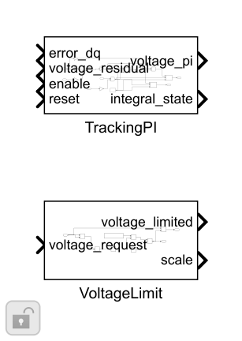
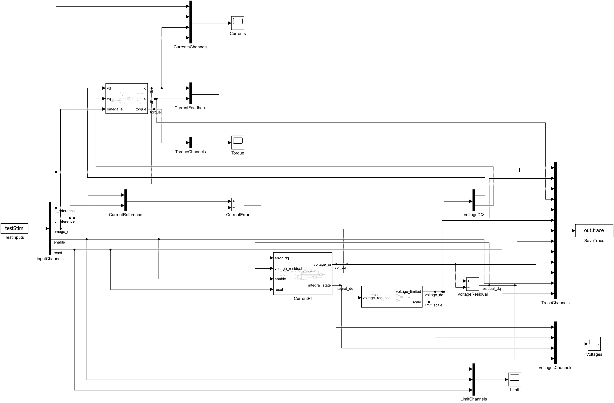
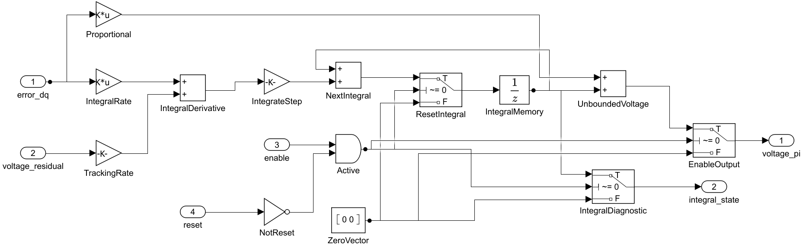

# dq 电流 PI 与电压限制：搭建步骤

两个轴使用独立增益与积分状态，组合为定长向量。现有 DiscretePID 只有内部限幅回算；本模块补充最终电压限制残差输入，未修改旧PID接口。PI与电压限制分开，前馈加在共同限制之前。

1. 给定和反馈分别 Mux 为[d;q]，相减得到误差。比例 Gain=diag([Kpd,Kpq])、积分 Gain=diag([Kid,Kiq])，Multiplication=Matrix(K*u)。

2. UnitDelay IntegralMemory 保存 x[k]，SampleTime=currentCfg.Ts、InitialCondition=[0;0]。当前电压 vPI=Kp·e+x，不直接依赖当前残差，所以外部回算不会形成代数环。

3. 积分更新 x[k+1]=x[k]+Ts·(Ki·e+Kaw·r)。Ki没有预乘Ts，积分状态单位V。残差为同拍可行端电压命令减总请求。

4. Active=enable AND NOT reset。inactive时Switch将当前输出和积分诊断置零，下一状态写零；reset是同步电平，优先于enable。

5. VoltageLimit 用 DotProduct、sqrt、安全分母和MinMax计算 scale=min(1,Vlimit/max(norm(v),1e−12))，将向量乘scale。默认圆半径48/√3·0.96=26.6043V。

6. 独立台架 limited−vPI 回算；整机叠加前馈后，回算 r=feasible−(vPI+vFF)。禁止把延迟后的旧电压直接与当前请求相减。

7. CurrentLoopTest 接PMSM电气方程，覆盖正负阶跃、饱和恢复、使能复位、Plant步长减半。CurrentPIProbeTest 是无Scope的端口探路模型。

搭建操作：使用Library Browser或双击画布查找上述基础块；参数填结构字段表达式。先更新图检查维度/采样周期，再运行本模块测试。修改库源时先在Library编辑器解锁，保存源库后重跑测试；不要无意断开测试实例的库链接。

[参数与Scope](../parameter/README.md) · [运行](USAGE.md) · [模块](../README.md)
