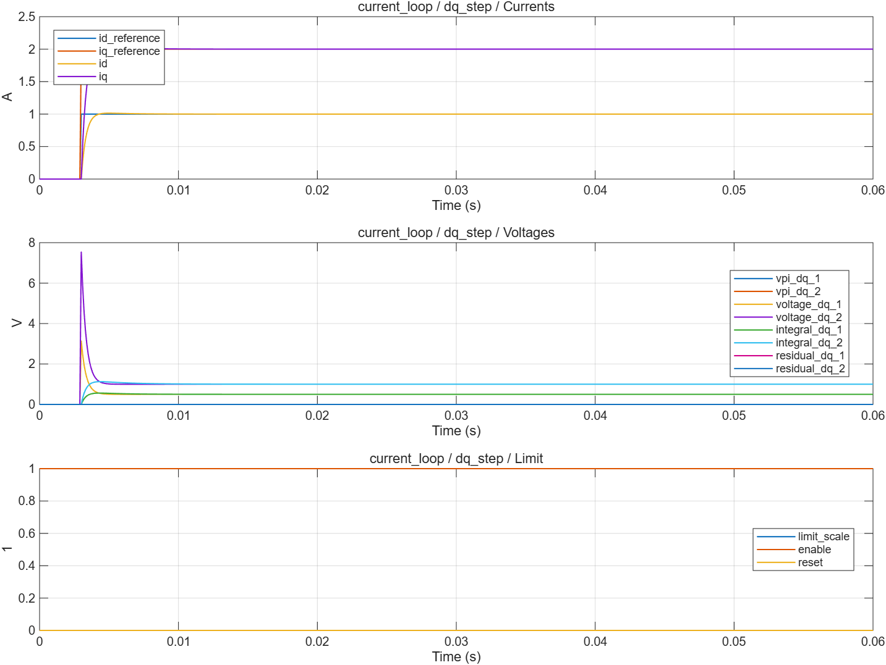

# dq 电流 PI 与电压限制：波形分析

- 模型文件：`src/CurrentLoopTest.slx`、`src/CurrentControl.slx`；系统对照使用`../experiment/src/MotorExperiment.slx`。
- 参数文件：`parameter/current_parameters.m`；每个case另保存实际跨模块parameters。
- 采样周期：电流/默认记录100µs，外环1ms；桥臂0.1µs；能量工况记录5µs。
- 求解器/步长：普通模型ode4/5µs；收敛工况2.5µs；桥臂FixedStepDiscrete/0.1µs。
- 工况：6项，见下表和实际断言脚本。
- 数据文件：`waveform_analysis/results.mat`、`waveform_analysis/metrics.json`。

## 结果

| 工况 | 结论 | 部分指标（键名含单位） |
|---|---|---|
| dq_step | 通过 | final_error_A=1.004086e-12；recovery_iae_A_s=0.000004007555 |
| negative_step | 通过 | final_error_A=1.004086e-12；recovery_iae_A_s=0.000003239026 |
| saturation_aw_on | 通过 | final_error_A=3.130524e-9；recovery_iae_A_s=0.03884335 |
| saturation_aw_off | 通过 | final_error_A=0.00000148014；recovery_iae_A_s=0.5453014 |
| enable_reset | 通过 | inactive_voltage_V=0 |
| solver_convergence | 通过 | half_step_difference_A=5.424976e-10 |

不适用于当前模式的指标以JSON null记录，例如电流模式不评价速度/位置跟踪。IAE为误差绝对值时间积分。tail_current_rms_A窗口起止在metrics中；短工况可能覆盖全程，不自动表示稳态。

## 波形说明

两个轴使用独立增益与积分状态，组合为定长向量。现有 DiscretePID 只有内部限幅回算；本模块补充最终电压限制残差输入，未修改旧PID接口。PI与电压限制分开，前馈加在共同限制之前。

[SVG图](summary.svg) · [完整指标](metrics.json) · `results.mat`（运行验证后生成）

0.012s开始的饱和恢复IAE：Kaw开启0.0388433 A·s，关闭0.545301 A·s。工况故意请求100A，验证26.6043V电压圆，不能当成实机给定。步长减半的最大电流差约5.42e−10A。[代码探路记录](codegen_probe.json)为失败，独立于MIL通过结果。

## 范围与复现

double、100µs MIL。500Hz是教学整定起点，延迟变化后需重新检查。直接电流模式允许故意超量给定做电压饱和测试，不是实机电流保护器。代码生成探路被配置工具内部API错误阻断，没有生成C或构建。

验证依据为解析解、能量关系、边界/精确时序断言和同工况开关对照，没有运行原始chensha/MBD或官方工具箱块做逐点等价验证。当前为double MIL，不代表single、C2000构建、PIL或实机已经验证。

[验证脚本](run_current_loop_validation.m) · [运行方法](../build_process/USAGE.md) · [Scope表](../parameter/README.md)
