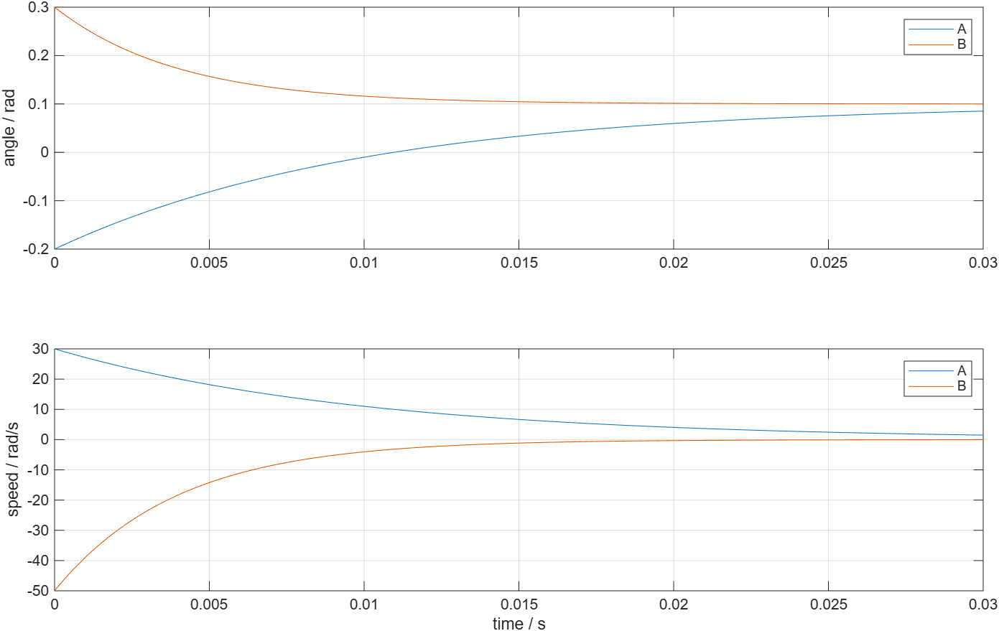

# PLL 实例参数隔离验证

- 模型文件：src/AngleTrackingInstancesTest.slx
- 参数文件：parameter/angle_tracking_parameters.m；build_process/initialize_pll_instances.m提供本测试的覆盖值
- 采样周期：50e-6 s
- 求解器/步长：FixedStepDiscrete，50e-6 s
- 工况：不同增益和初值、交换两实例配置、只修改A实例初值，共3项
- 数据文件：waveform_analysis/instances.mat；waveform_analysis/instance_metrics.json

三个工况全部通过。每个库块的Mask将调用方配置表达式解析为本实例的pllCfg，库内算法和Unit Delay状态继续复用；无需复制库文件。另已重跑原12项PLL和14项SMO，全部通过。

为单独检查配置解析，本测试把Ki和Kaw设为0，phase固定0.1 rad、magnitude=1、enable=1、reset=0。A为Kp=100 1/s、Theta0=-0.2 rad；B为Kp=250 1/s、Theta0=0.3 rad。这些是参数隔离测试值，不是新的PLL通用默认值。

此时未触发限幅，解析响应为theta[k]=0.1+(Theta0-0.1)(1-Kp·Ts)^k，omega[k]=Kp(0.1-theta[k])。分别核对角度和速度，容差为1e-12 rad、1e-10 rad/s；实际误差分别写入指标文件，不混合单位。交换配置后响应跟随配置交换；只改A时，B的角度和速度逐点一致。

AngleScope的两个通道依次为A、B电角度，SpeedScope依次为A、B电角速度；trace四列依次为theta_A、omega_A、theta_B、omega_B。完整来源和单位见[参数页](../parameter/README.md)。

复现：在waveform_analysis中运行[run_pll_instance_validation](run_pll_instance_validation.m)。它使用SimulationInput覆盖本次配置，保留SLX默认值；保存三组实际参数、时间、波形和解析对照。该结果是MIL参数隔离验证，未执行SIL或C2000板测。
