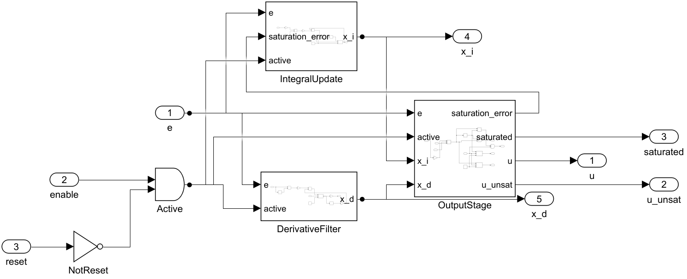
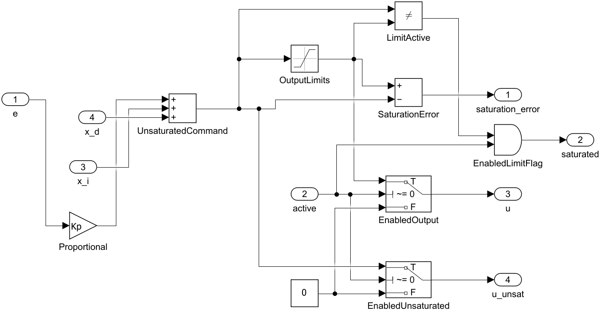
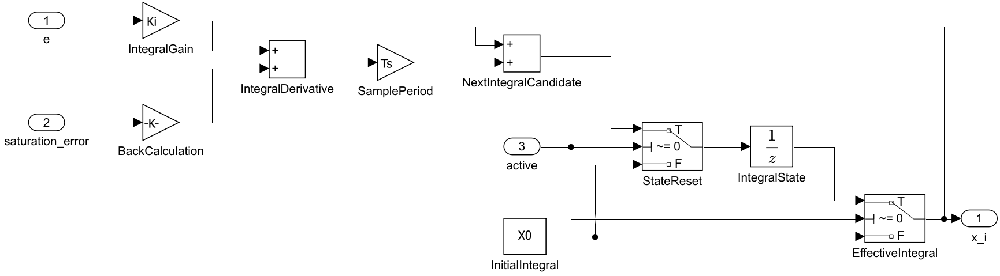
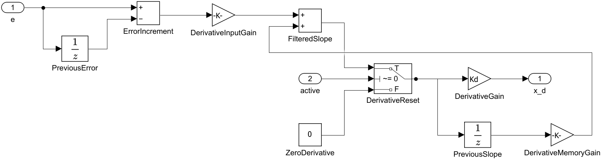
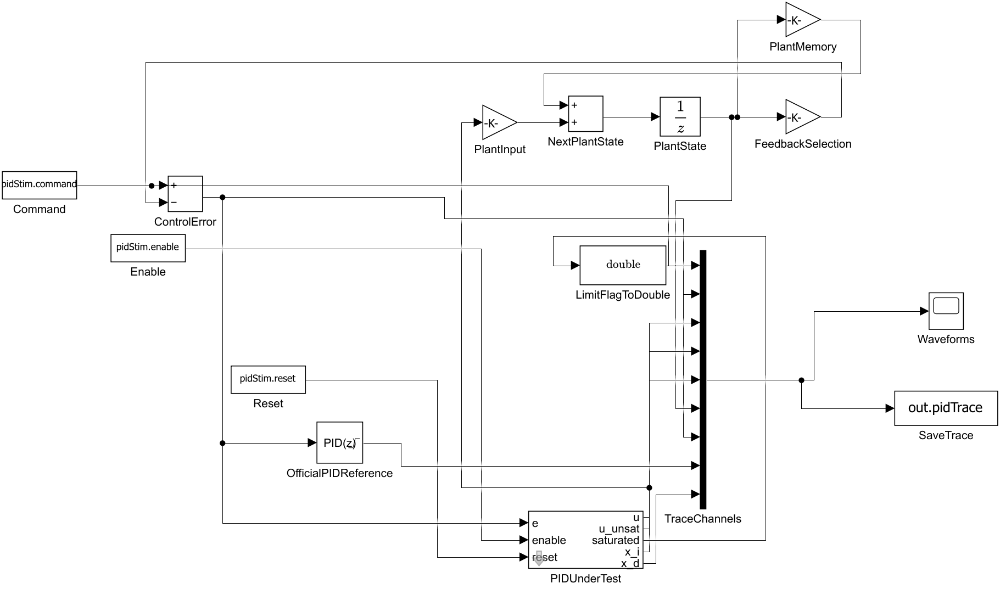

# DiscretePID 首版搭建记录

执行日期：2026-11-07。MATLAB/Simulink：R2026a Update 3。最终文件：`src/DiscretePID.slx`、`src/DiscretePIDTest.slx`，路径相对于本模块。

## 1. 先写单拍计算顺序

按 [DESIGN.md](DESIGN.md) 定义输出与状态更新。积分器保存的是对输出的积分贡献 x，单位与 u 相同；Unit Delay 的输出是本拍状态 x[k]，输入才是 x[k+1]。active 的第一拍使用 X0，未限幅请求为 `Kp*e+X0+x_d`；默认 Kd=0 时 x_d=0，不会提前使用本拍新积分。

这份记录按现有模型的搭建顺序写，可打开模型对照。运行和调参步骤在 [USAGE.md](USAGE.md)，所有信号含义在 [parameter/README.md](../parameter/README.md)。

## 2. 建立可复用库与掩码

新建 Library DiscretePID，添加 Controller，端口依次为 e、enable、reset → u、u_unsat、saturated、x_i、x_d。掩码公开 Kp、Ki、Kd、Tf、Ts、UMin、UMax、X0、Kaw，默认表达式为对应的 pidCfg 字段。

库保存算法和参数表达式。测试模型保存自己的模型工作区，不依赖 base workspace 的同名变量。复制到未来电流环时，保留库链接，分别将 d/q 参数绑定到各自掩码。

在 Simulink Library Browser 中使用标准 Inport、Outport、Gain、Sum、Saturation、Unit Delay、Switch、Logical Operator 和 Relational Operator 块。新建 Library 后添加 Controller 子系统；双击子系统内部放入三输入和五输出，按端口顺序编号。enable/reset 的 Inport 数据类型设为 boolean，数值输入使用 double。

在 Controller 的 Mask Editor 中添加九个 edit 参数，表达式分别填 pidCfg.Kp、pidCfg.Ki 等；内部块只引用 Kp、Ki 等掩码变量。之后按下面的连接搭建三个普通子系统，测试模型引用整个 Controller。

## 3. 搭建输出计算与积分更新

OutputStage 内：

1. Gain(Kp)、x_i 与 x_d 经 Sum 相加，得到未限幅量 v。
2. Saturation(UMin, UMax) 得到受限输出；Sum 计算 `u-v`，送回积分更新。
3. Relational Operator 比较限幅前后；结合 active 输出 saturated。
4. Switch 在 inactive 时将 u、u_unsat 强制为零。

| 块 | 参数 | 连接/作用 |
|---|---|---|
| Proportional / Gain | Gain=Kp | e → Kp*e |
| UnsaturatedCommand / Sum | Inputs=+++ | 比例贡献、x_i、x_d → v |
| OutputLimits / Saturation | LowerLimit=UMin，UpperLimit=UMax | v → u_lim |
| SaturationError / Sum | Inputs=+- | 第 1 输入 u_lim，第 2 输入 v，输出 u_lim−v |
| LimitActive / Relational Operator | Operator=~= | 比较 v 与 u_lim |
| EnabledLimitFlag / Logical Operator | AND | active 与 LimitActive → saturated |
| EnabledOutput、EnabledUnsaturated / Switch | Criteria=u2 ~= 0 | 上输入是待输出数值，中输入 active，下输入 0 |

IntegralUpdate 内：

1. Gain(Ki) 计算 `Ki*e`，Gain(Kaw) 计算 `Kaw*(u-v)`。
2. 两者相加，经 Gain(Ts) 得到每拍积分增量，再加当前积分贡献。
3. StateReset Switch 在 inactive 时选择 X0，送入 Unit Delay。
4. EffectiveIntegral Switch 同步选择当前可见积分贡献：active 用 Delay 输出，否则用 X0。

积分连接为 `Ki*e + Kaw*(u_lim-v) → 乘 Ts → 加 x_i → StateReset → IntegralState`。IntegralState 的 SampleTime=Ts、InitialCondition=X0。其输出经过 EffectiveIntegral 再返回输出求和及积分增量求和。

这里使用前向欧拉：先用 x[k] 计算本拍输出，之后写 x[k+1]。例如 e=0.2、Ki=8、Ts=0.001，未饱和时每拍增加 0.0016；第一拍尚未加这个增量。将 Gain 中 Ki 改成 Ki*Ts 会重复乘采样周期。

抗积分饱和采用回算。上饱和时 u_lim−v<0，Kaw 项减小积分变化率；下饱和时符号相反；未限幅时残差为 0。限幅器约束 u，回算调整积分变化，不是把 x_i 裁剪到 ±1。以 e=2 为例，关闭回算时积分按 16/s 增长；Kaw=20 时，当前工况稳态 x_i=-0.6。Kaw=0 可单独观察没有回算的行为。本模块当前只回算自身标量限幅。

DerivativeFilter 内：先用 Unit Delay 保存上一误差，求当前差分；通过 1/(Tf+Ts) 与 Tf/(Tf+Ts) 两条增益计算后向欧拉滤波斜率。另一 Unit Delay 保存上一斜率，inactive 时清零；最后经过 Gain(Kd) 得到 x_d。上一误差每拍更新为当前输入，使禁能期间的误差不被累计成差分。

它对应连续原型的滤波微分，用以下离散递推实现：

```text
delta_e = e[k] - e_prev[k]
s_candidate = Tf/(Tf+Ts)*s_prev[k] + delta_e/(Tf+Ts)
s_current = active ? s_candidate : 0
x_d[k] = Kd*s_current
s_prev[k+1] = s_current
e_prev[k+1] = e[k]
```

PreviousError 与 PreviousSlope 的 SampleTime 都是 Ts、InitialCondition 都是 0。增益 Kd 放在滤波后面，所以 Kd=0 时微分贡献立即为零。对恒定误差，滤波斜率逐渐归零；对阶跃，先出现短暂峰值再衰减。默认 Tf=0.01、Ts=0.001，对应衰减系数 10/11。微分作用在 e 上，启动时非零误差或后续误差跳变都会影响它。

Controller 顶层用 NOT(reset) 与 AND(enable) 产生 active。原 PI 扩为 PID，保留原有积分与限幅定义，Kd 默认为 0。三个子系统分别对应输出、积分和微分。

| enable | reset | 本拍行为 |
|---|---|---|
| true | false | 正常输出，更新积分、滤波斜率与上一误差 |
| false | false | u/u_unsat/x_d=0，saturated=false，x_i=X0，积分下一状态=X0，斜率状态清零 |
| 任意 | true | 同样执行复位，reset 优先；保持 true 的每一拍都复位，不是只检测上升沿 |

复位由普通 Switch 与 Unit Delay 实现，没有使用 Enabled Subsystem 的冻结状态语义。本拍 Switch 已把外部输出切为零、把可见积分切为 X0；Delay 内保存值到下一拍才成为刚写入的 X0。禁能期间上一误差仍然逐拍更新，重新使能后的微分由相邻两拍实际误差变化决定。









## 4. 建独立测试模型

PIDUnderTest 的库链接为 DiscretePID/Controller。三路 From Workspace 读取 pidStim 的 command、enable、reset。ClosedLoop=0 时 command 直接作为误差；ClosedLoop=1 时减去对象输出。

测试对象为单位静态增益的一阶离散对象：

```text
a = exp(-Ts / PlantTau)
y[k+1] = a*y[k] + (1-a)*u[k]
```

对象有自己的 Unit Delay，与 PI 积分状态分开。它用于观察 PI 闭环，不是 PMSM。

官方 Discrete PID Controller 默认配为 PID、Parallel、Discrete-time、积分 Forward Euler、滤波 Backward Euler、内部输出限幅和 back-calculation；P/I/D/N/Ts/限幅/Kb/初值绑定相同参数，N=1/Tf。验证脚本在 Kd=0 工况中将官方参考临时切为 PI，显式检查等价性。官方块接收同一误差，不另建闭环。禁能/复位不比较其输出。

TraceChannels 顺序为 command、error、u、u_unsat、x_i、plant_y、saturated（转 double 后记录）、official_reference、x_d。Scope 与 To Workspace 共用九通道。保存格式为 Structure With Time，输出为 SimulationOutput 的 pidTrace。



## 5. 固定离散时序与默认入口

求解器 FixedStepDiscrete，固定步长 pidCfg.Ts，默认 Ts=0.001 s；控制状态、对象状态和三路输入都按 Ts 更新。PostLoadFcn 调用本目录的初始化函数，添加 src/parameter 路径并设置模型工作区。批量运行用 SimulationInput 覆盖模型工作区变量，不改写默认参数。

首轮仿真发现 From Workspace 默认末尾行为为 Extrapolation，与关闭插值不兼容，已改为 Holding final value。复位断言随后发现 timeseries 时间戳在 0.3 s 边界晚一拍；最终输入使用无时间字段的 Structure（time=[]），每 Ts 读取一行。results.mat 中的 timeseries 仅用于还原工况和作图。

## 6. 验证与保存

当前环境没有 Simulink Test，采用 SimulationInput 仿真与断言。检查解析积分、正负对称、限幅、标志、复位、官方对照、线性跟踪和饱和恢复，详见 [waveform_analysis](../waveform_analysis/README.md)。缓存写入新建系统临时目录，运行结束恢复原配置并清理本次缓存。

最终连接检查覆盖 Controller 内部、三个子系统和测试模型。库根的 Controller 是待复用接口，不在库根接测试信号。保存后重新加载模型再验证，12 个工况通过。Kd=0 的原有 9 个 PI 工况与更改前数据逐点比较，前八通道最大差值为 0；对照在模型更名时完成，旧 PI 模型及旧命名文件已移除。
