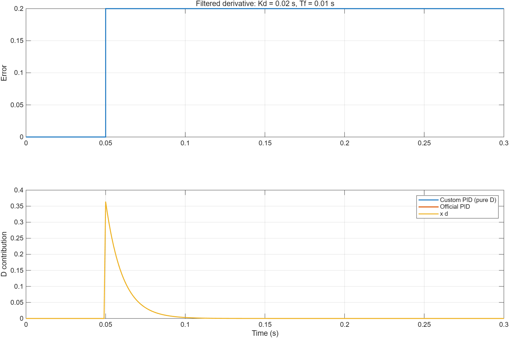
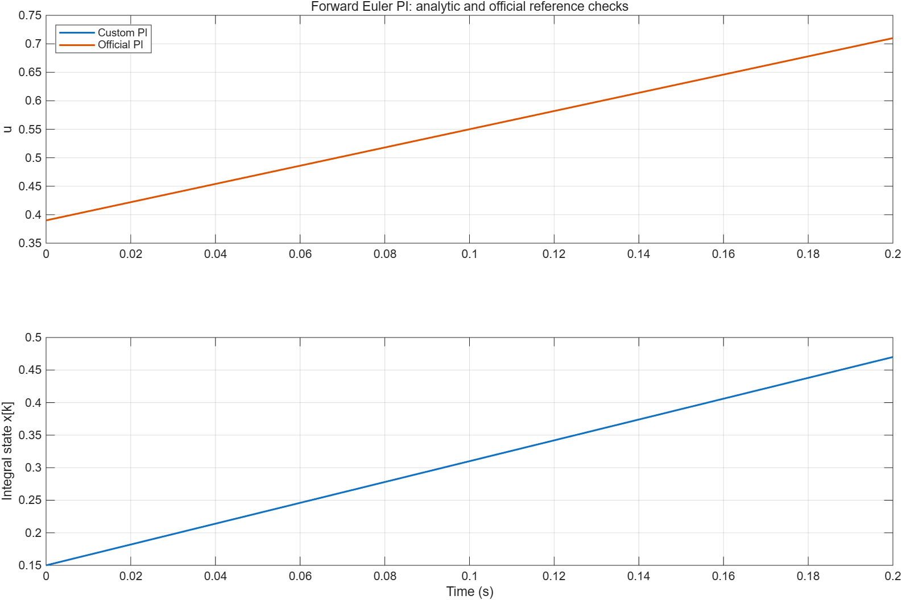
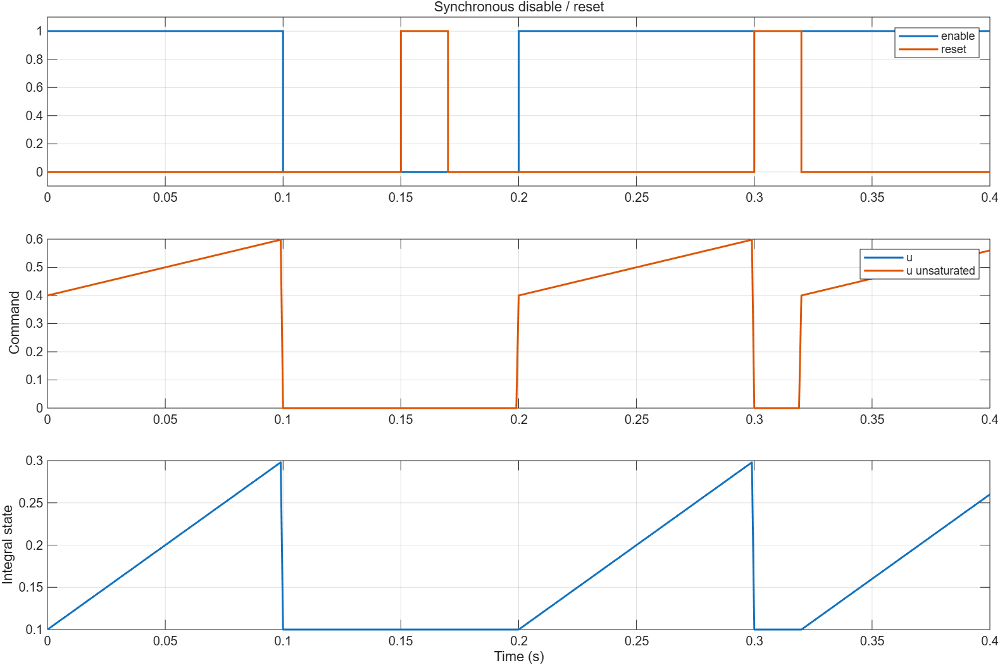
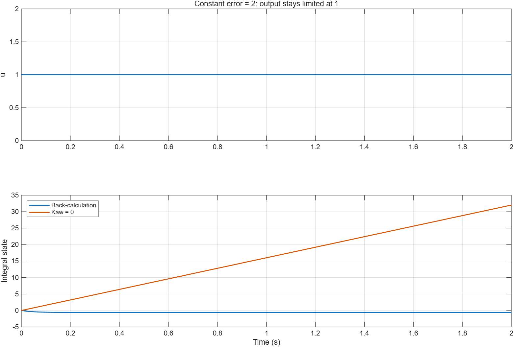
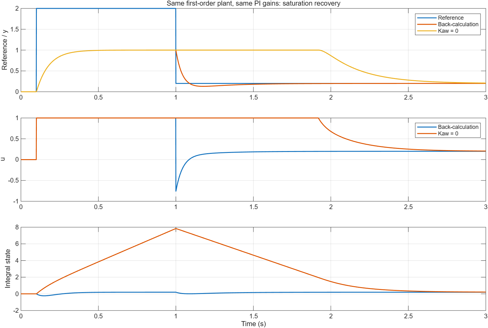

# DiscretePID 首版 MIL 波形分析

| 字段 | 内容 |
|---|---|
| 模型文件 | `src/DiscretePID.slx`、`src/DiscretePIDTest.slx` |
| 参数文件 | `parameter/discrete_pid_parameters.m`；覆盖值见数据文件 cases 中的 cfg |
| 采样周期 | 0.001 s |
| 求解器/步长 | FixedStepDiscrete / 0.001 s；Normal 仿真 |
| 工况 | 下表十二项；输入及开关序列见 cases 中的 stim |
| 数据文件 | `waveform_analysis/results.mat`、`waveform_analysis/metrics.json` |

路径相对于模块目录。复现入口为 [run_discrete_pid_validation.m](run_discrete_pid_validation.m)。环境：R2026a Update 3。一般数值容差 1e-10，回算稳态容差 1e-8，线性闭环末值误差门限 1e-4。

## 工况与结果

| cases 字段 | 工况 | 验证结果 |
|---|---|---|
| linear_positive | e=0.2，X0=0.15，限幅 ±100，0.2 s | 符合 Kp*e+X0+Ki*e*t，最大误差约 2.0e-15 |
| linear_negative | e=-0.2，X0=-0.15，其余相同 | 与正向工况对称，通过 |
| limit_positive_aw | e=2，限幅 ±1，Kaw=20，2 s | u=1，saturated=true，积分贡献收敛到 -0.6 |
| limit_negative_aw | e=-2，其余相同 | u=-1，状态与正向工况对称，通过 |
| limit_positive_no_aw | e=2，Kaw=0，2 s | u=1，但积分贡献累积到 32 |
| enable_reset | e=0.25，X0=0.1，0.4 s | 禁能、复位、同时出现、恢复使能均通过 |
| closed_loop_linear | 0.1 s 参考 0→0.2，tau=0.08 s，2 s | 未饱和，末值误差小于 1e-4 |
| recovery_aw | 0.1 s 参考 0→2，1 s 降至 0.2，Kaw=20，3 s | 降阶跃后 0.514 s 持续进入 ±0.02 误差带 |
| recovery_no_aw | 相同对象、增益与输入，仅 Kaw=0 | 降阶跃后 1.820 s 持续进入相同误差带 |
| derivative_step | Kp=Ki=0，Kd=0.02 s，Tf=0.01 s，0.05 s 误差 0→0.2 | 微分首拍为 0.363636，随后按 10/11 衰减，解析误差约 5.55e-17 |
| pid_ramp | Kp=1.2，Ki=8，Kd=0.02，误差 e=0.5*t | P/I/D 同时工作，官方 PID 对照通过 |
| pid_enable_reset | Kd=0.02，禁能期间改变误差，随后恢复、复位 | inactive 的 u/x_d 为零，清除滤波斜率，恢复行为通过 |

12 个工况全部通过。Kd=0 的 8 项与官方 PI 比较，Kd>0 的 2 项与官方 PID 比较，10 项 u 的最大绝对差值约 7.91e-16。两个复位/禁能工况按本模块约定验证。所有 Kd=0 工况的 x_d 严格为零；模型更名时与更改前保存的 9 项 PI 数据逐点比较，前八通道最大差值为 0。

## 滤波微分

微分支路先计算后向欧拉一阶滤波斜率，再乘 Kd。阶跃只产生短暂的微分贡献，恒定误差时逐渐归零。这里微分作用在误差上，因此误差阶跃产生瞬态是预期行为；图中的三条输出曲线重合。默认 Kd=0，保留原 PI 行为。

## 积分顺序与复位

第一拍使用 X0，之后每拍增加 Ts*Ki*e。该检查能发现“先积分再输出”的一拍偏差。官方曲线与自建曲线重合。

0.1–0.2 s 禁能；0.15–0.17 s 同时复位；0.3–0.32 s 使能状态复位。inactive 同拍输出归零，可见积分贡献为 X0；0.2 s 和 0.32 s 恢复后的第一拍均为 Kp*0.25+0.1=0.4。

## 饱和与回算

限幅能限制 u，不能单独阻止积分增长。e=2 时比例项为 2.4，关闭回算的积分仍按 16/s 增长。启用回算后，稳态满足 `Ki*e+Kaw*(1-2.4-x)=0`，所以 x=-0.6；负积分贡献在这里是正确结果。

1 s 前参考 2 超出此对象和限幅能达到的稳态值。降至 0.2 后，没有回算的积分仍大，输出继续顶在上限；启用回算时能立即降低输出。

恢复指标从 1 s 起计，找最后一次超出绝对误差 ±0.02 的采样点，再取下一点开始的持续入带时间。±0.02 是固定无量纲误差带，不是目标的 2%。

当前验证一阶对象下的 PI 行为，未包含电机、逆变器、采样延迟、量化和下游电压矢量限制。后续 d/q 电流环需要反馈最终执行限幅；当前只回算模块自身标量限幅。
