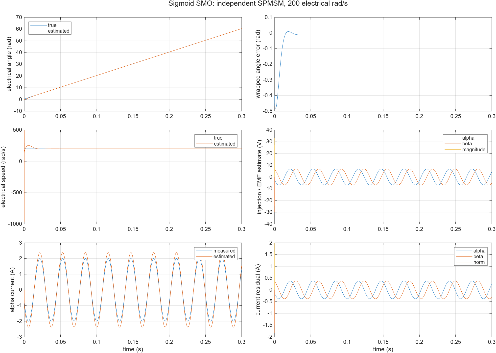
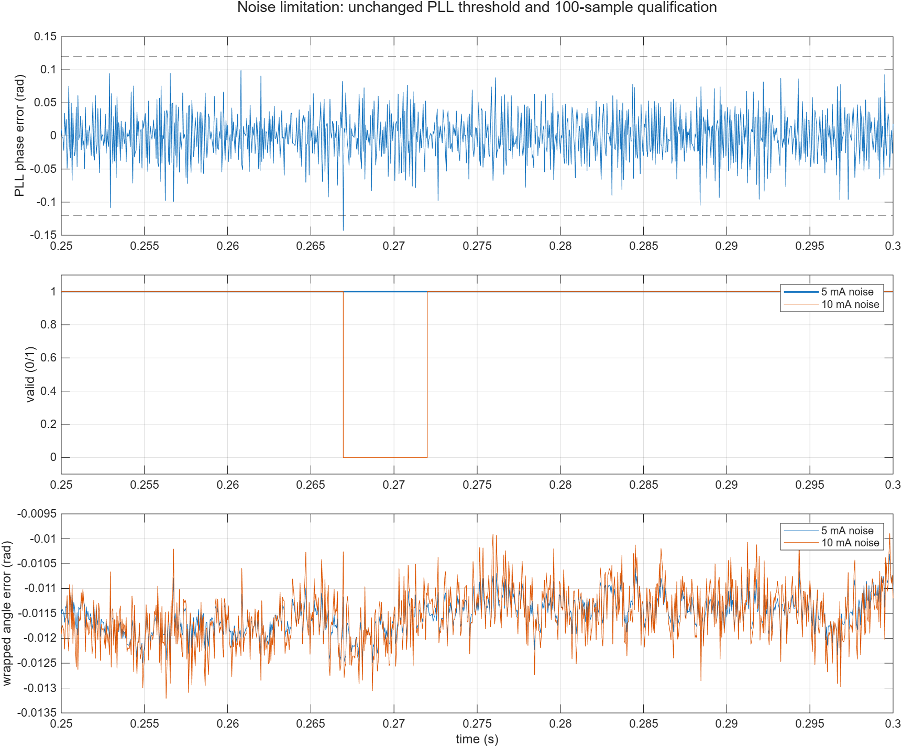
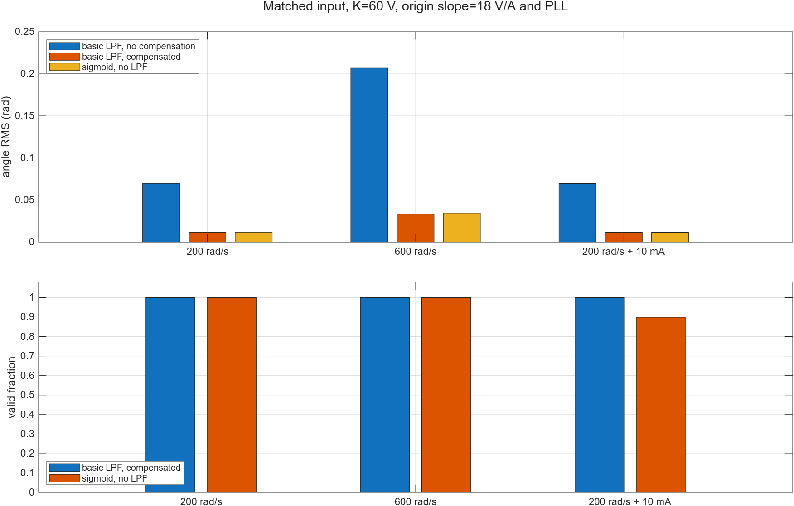

# Sigmoid SMO独立波形与限制

模型文件：src/SigmoidSlidingModeObserverTest.slx。参数文件：parameter/sigmoid_smo_parameters.m、sigmoid_smo_pll_parameters.m、sigmoid_smo_test_parameters.m。采样周期：50µs。求解器/步长：FixedStepDiscrete/50µs。工况：独立连续SPMSM解析电压/电流，已知方向先验；正常、失配、使能/复位、拒绝及输入故障。数据文件：waveform_analysis/sigmoid_results.mat及sigmoid_metrics.json。以上路径均相对于本模块。

R2026b Update1执行22项：11个正常跟踪、10个应拒绝/故障、1个高噪声资格限制诊断。重复默认全部24列差值0。另有10项纯M、1项不同参数实例隔离和6次同输入对照，不重复累计成22个新跟踪工况。

## 默认与动态结果

| 工况 | 电角误差RMS | 速度误差RMS | 说明 |
|---|---|---|---|
| +200rad/s | 0.011696rad | 0.011688rad/s | 0.25–0.3s资格覆盖1 |
| -200rad/s | 约0.010265rad | 约0.011683rad/s | 反向相位及方向门限通过 |
| +600rad/s | 0.034530rad | 约0.2613rad/s | 有限斜率及离散动态误差保留 |
| -600rad/s | 0.033107rad | 约0.2604rad/s | 保留速度符号 |

精确数值、加速、Rs/L偏差、5mA噪声、复位/禁能和反向轨迹见metrics。验收未放宽：正常末段最大角误差<0.08rad、速度RMS<15rad/s、资格覆盖>0.95。1000rad/s超出声明的800rad/s资格范围，按拒绝验收。

最初几拍PLL估速有明显瞬态，此时valid未取得资格；电流估计与实测值也不严格重合。K有限时的残差是该平滑注入的实际结果，不能因为没有显式EMF低通就称为零相移。

## 原10mA失败如何处理

原10mA电流噪声、20mV电压噪声工况，角RMS约0.011561rad、峰值0.013207rad，末段资格覆盖只有0.8991，未达到原定0.95。PLL误差在1001个评价样本中有1拍超过0.12rad，重置连续100拍计数，产生约5ms资格中断；不是电流越限、幅值不足或数值故障。

原始失败保存为sigmoid_noise10mA_development.mat/json。没有放宽PLL门限或验收标准；新增5mA正常噪声覆盖，10mA保留为noise_10mA_qualification_drop限制案例。22项通过包含该限制被正确记录，不代表此噪声水平满足连续闭环要求。

## 与基础SMO的公平对照范围

保持输入、时间轴、PLL、K=60V和零误差注入斜率18V/A一致，基础SMO的Boundary=2/Slope；只改变分段/非线性注入及显式600Hz低通/相移补偿。3个共同工况各跑补偿开/关，共6次，保存sigmoid_comparison_results.mat和sigmoid_comparison_metrics.json。

| 工况 | 基础低通不补偿角RMS | 基础低通加补偿 | sigmoid无显式低通 |
|---|---|---|---|
| 200rad/s | 0.069822 | 0.011663 | 0.011696 |
| 600rad/s | 0.20685 | 0.033547 | 0.034530 |
| 200rad/s、10mA噪声 | 0.069679 | 0.011521 | 0.011561 |

单位均为电角rad。此噪声工况基础SMO资格覆盖1，sigmoid为0.8991。可见取消低通减少未经补偿的附加滞后，但并未在这些数据上全面优于已补偿基础方案。

## 其他验证证据

纯M检查包含书中logistic与tanh等价、极端输入有限、RL解析解、expm1小电阻极限、局部极点拒绝、方向清状态、故障锁存/清除、非法设置/状态及single测量核冒烟。single最大绝对差约4.234e-6；它不是完整single模型或SIL。

实例B使用K45、Slope0.8、PLL初角1.1。并行A的14输出与默认单独运行逐点相同，B与其单独配置运行逐点相同；Mask实际工作区配置回读一致。实例模型不落第三份SLX。

源码重建、正式路径、内嵌代码、PLL库链接、6组Scope、静态检查和文件校验值由sigmoid_verification.json记录。这里是独立轨迹MIL，不包含电机机械起转/接管、PWM器件开关、完整single/SIL、C2000构建或实机耗时。
