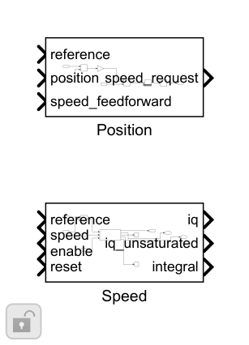
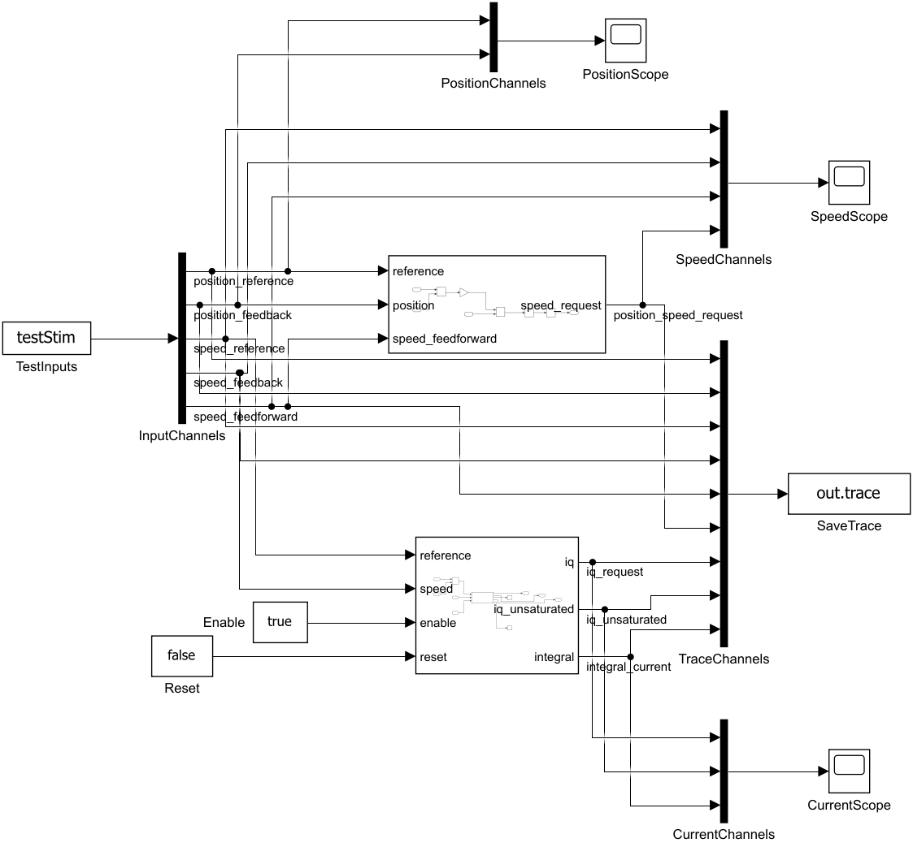

# 速度 PI 与位置 P：搭建步骤

位置P把位置误差变为速度，叠加速度前馈后统一限速并限制速度斜率。速度PI复用原DiscretePID/Controller，Kd=0，输出q轴电流请求。整定基线为id=0的刚性单惯量。

1. Position 中计算 reference−position，乘PositionKp，再加speed_feedforward。

2. Saturation统一限制±SpeedLimit，然后RateLimiter限制上升/下降速度斜率。它不是完整jerk受限位置轨迹。

3. Speed误差接已有DiscretePID/Controller，掩码绑定motionCfg的Kp、Ki、Ts、Kaw；Kd=0，UMin/UMax=±CurrentLimit，X0=0。

4. Kt=1.5·p·Flux；使用自然频率20rad/s和阻尼0.9整定刚性速度环。Kp单位A/(rad/s)，Ki单位A/rad。

5. 整机MotionStage在外环前增加1ms采样。Mode=0/1/2分别选择直接电流、速度、位置模式，模式在实验开始前选定。

6. 独立台架检查限流和速度斜率；整机验证加载速度阶跃与加载位置阶跃。默认位置实验1.5s，观察位置误差、速度收敛和负载下iq。

搭建操作：使用Library Browser或双击画布查找上述基础块；参数填结构字段表达式。先更新图检查维度/采样周期，再运行本模块测试。修改库源时先在Library编辑器解锁，保存源库后重跑测试；不要无意断开测试实例的库链接。

[参数与Scope](../parameter/README.md) · [运行](USAGE.md) · [模块](../README.md)
