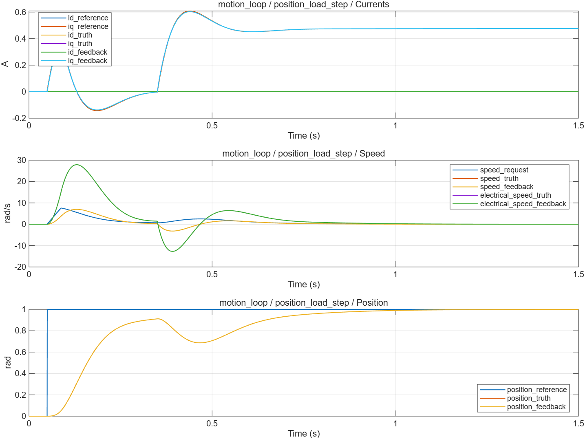

# 速度 PI 与位置 P：波形分析

- 模型文件：`src/MotionLoopTest.slx`、`src/MotionControl.slx`；系统对照使用`../experiment/src/MotorExperiment.slx`。
- 参数文件：`parameter/motion_parameters.m`；每个case另保存实际跨模块parameters。
- 采样周期：电流/默认记录100µs，外环1ms；桥臂0.1µs；能量工况记录5µs。
- 求解器/步长：普通模型ode4/5µs；收敛工况2.5µs；桥臂FixedStepDiscrete/0.1µs。
- 工况：3项，见下表和实际断言脚本。
- 数据文件：`waveform_analysis/results.mat`、`waveform_analysis/metrics.json`。

## 结果

| 工况 | 结论 | 部分指标（键名含单位） |
|---|---|---|
| controller_limits | 通过 | maximum_acceleration_rad_s2=200 |
| speed_load_step | 通过 | final_speed_error_rad_s=0.00002524379；final_current_error_A=1.066155e-8；current_iae_A_s=0.005298921；tail_current_rms_A=4.116305e-7 |
| position_load_step | 通过 | final_speed_error_rad_s=0.0006358744；final_position_error_rad=0.0004049586；final_current_error_A=0.000001284654；current_iae_A_s=0.002171492 |

不适用于当前模式的指标以JSON null记录，例如电流模式不评价速度/位置跟踪。IAE为误差绝对值时间积分。tail_current_rms_A窗口起止在metrics中；短工况可能覆盖全程，不自动表示稳态。

## 波形说明

位置P把位置误差变为速度，叠加速度前馈后统一限速并限制速度斜率。速度PI复用原DiscretePID/Controller，Kd=0，输出q轴电流请求。整定基线为id=0的刚性单惯量。

[SVG图](summary.svg) · [完整指标](metrics.json) · `results.mat`（运行验证后生成）

1rad加载位置工况1.5s末位置约0.999595rad、速度约0.002606rad/s。速度与位置基线使用同一个刚性对象；结果不外推到真实机械共振和反馈噪声。

0.35s加载0.1N·m后，位置最低回退到约0.686633rad，再由积分和位置环恢复。这个基线的速度环自然频率只有20rad/s，最终误差小不代表抗扰过程已达到高性能伺服要求。后续应在明确指标下整定带宽或增加机械前馈。Speed图同时画机械与电角速度，本例电角速度是机械速度的4倍。

## 范围与复现

未实现完整位置轨迹和在线无扰模式切换。速度PI跟踪自身±8A限制；电压受限时可达转矩尚未反馈外环，将在步骤15与电流分配/弱磁协调。

验证依据为解析解、能量关系、边界/精确时序断言和同工况开关对照，没有运行原始chensha/MBD或官方工具箱块做逐点等价验证。当前为double MIL，不代表single、C2000构建、PIL或实机已经验证。

[验证脚本](run_motion_loop_validation.m) · [运行方法](../build_process/USAGE.md) · [Scope表](../parameter/README.md)
