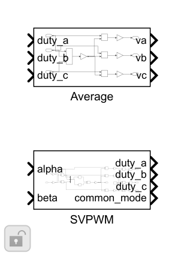
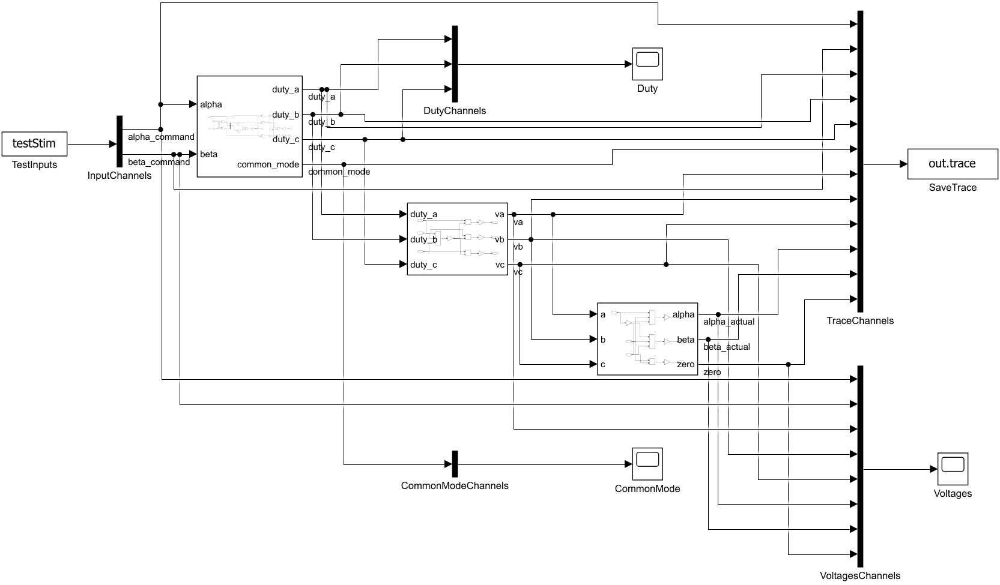

# SVPWM 与平均逆变器：搭建步骤

采用最大/最小相参考注入共同分量的居中SVPWM等价实现。平均逆变器用占空比扣除均值后乘母线电压。调制命令duty和执行后的duty分别记录。

1. 从αβ得到 va=alpha，vb=−alpha/2+√3·beta/2，vc=−alpha/2−√3·beta/2。

2. Mux 三相后，单输入 MinMax 分别取向量最大/最小元素，common_mode=−(vmax+vmin)/2。

3. 每相 duty=0.5+(vphase+common_mode)/Vdc，以 Saturation 钳位到[MinDuty,1−MinDuty]。超范围钳位会造成电压失真，不能继续当作线性重建。

4. Average 计算 Vdc·(duty−mean_duty)，相电压三相和为0。

5. 测试将输出送已有Clarke，与请求αβ对照。0V、20V旋转电压和24V母线工况验证线性区；60V工况验证最终duty边界和失真。

6. 整机先做dq圆限制，补偿后仍有最终duty钳位；同拍duty重建电压用于限制残差。

搭建操作：使用Library Browser或双击画布查找上述基础块；参数填结构字段表达式。先更新图检查维度/采样周期，再运行本模块测试。修改库源时先在Library编辑器解锁，保存源库后重跑测试；不要无意断开测试实例的库链接。

[参数与Scope](../parameter/README.md) · [运行](USAGE.md) · [模块](../README.md)
