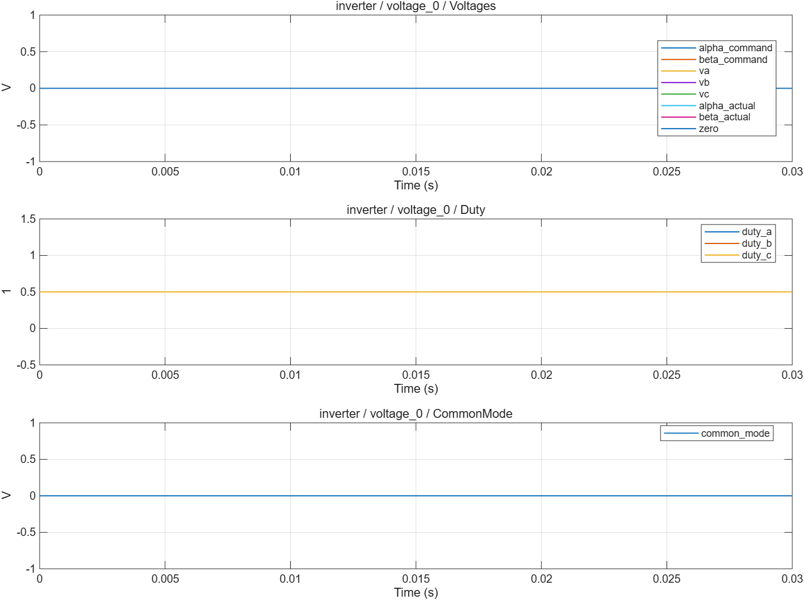

# SVPWM 与平均逆变器：波形分析

- 模型文件：`src/InverterTest.slx`、`src/Inverter.slx`；系统对照使用`../experiment/src/MotorExperiment.slx`。
- 参数文件：`parameter/inverter_parameters.m`；每个case另保存实际跨模块parameters。
- 采样周期：电流/默认记录100µs，外环1ms；桥臂0.1µs；能量工况记录5µs。
- 求解器/步长：普通模型ode4/5µs；收敛工况2.5µs；桥臂FixedStepDiscrete/0.1µs。
- 工况：4项，见下表和实际断言脚本。
- 数据文件：`waveform_analysis/results.mat`、`waveform_analysis/metrics.json`。

## 结果

| 工况 | 结论 | 部分指标（键名含单位） |
|---|---|---|
| voltage_0 | 通过 | voltage_error_V=0；neutral_error_V=0 |
| voltage_20 | 通过 | voltage_error_V=7.105427e-15；neutral_error_V=1.953993e-14 |
| voltage_60 | 通过 | voltage_error_V=33.3957；neutral_error_V=1.776357e-14 |
| bus_24V | 通过 | voltage_error_V=3.552714e-15 |

不适用于当前模式的指标以JSON null记录，例如电流模式不评价速度/位置跟踪。IAE为误差绝对值时间积分。tail_current_rms_A窗口起止在metrics中；短工况可能覆盖全程，不自动表示稳态。

## 波形说明

采用最大/最小相参考注入共同分量的居中SVPWM等价实现。平均逆变器用占空比扣除均值后乘母线电压。调制命令duty和执行后的duty分别记录。

[SVG图](summary.svg) · [完整指标](metrics.json) · `results.mat`（运行验证后生成）

## 范围与复现

每轮实验内母线恒定；平均模型没有三相开关纹波、器件动态和采样窗口。超范围输入采用钳位，未实现专门过调制策略。

验证依据为解析解、能量关系、边界/精确时序断言和同工况开关对照，没有运行原始chensha/MBD或官方工具箱块做逐点等价验证。当前为double MIL，不代表single、C2000构建、PIL或实机已经验证。

[验证脚本](run_inverter_validation.m) · [运行方法](../build_process/USAGE.md) · [Scope表](../parameter/README.md)
