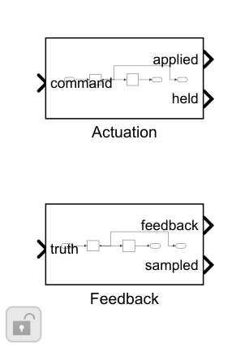
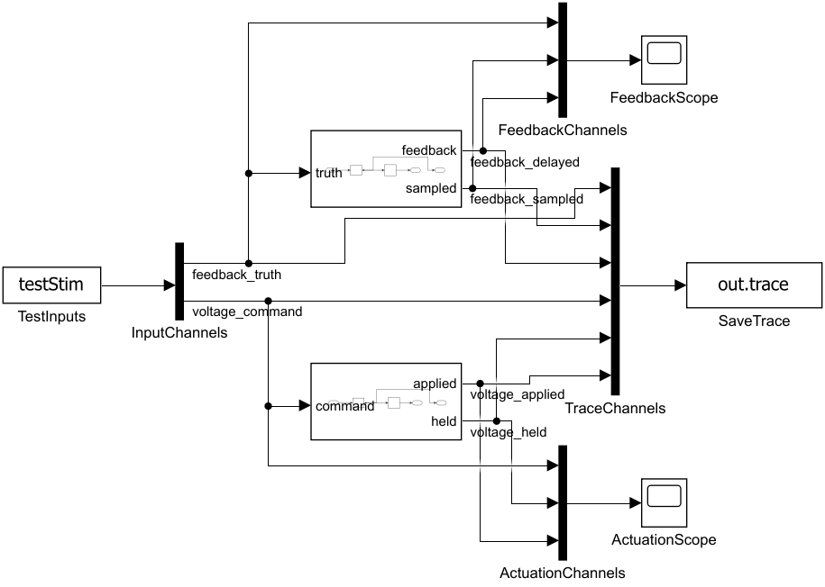

# 控制采样与执行时序：搭建步骤

Feedback和Actuation均先采样保持，再配置整数拍延迟。UseTiming=0选择保持值，仍保留离散采样；UseTiming=1选择延迟值。整机使用共同的电流/角度反馈帧。

1. ZeroOrderHold 的 SampleTime=timingCfg.Ts，保持值直接输出 sampled/held。

2. 保持值再接 Delay，SampleTime=timingCfg.Ts，DelayLength分别为FeedbackTicks/ActuationTicks，InitialCondition=0。

3. FeedbackTicks=1对应附加100µs反馈延迟；ActuationTicks=1对应附加100µs执行延迟。

4. 整机反馈帧固定为[ia,ib,ic,theta_e,omega_m,theta_m,omega_e]；共同采样延迟后再Clarke/Park，不把不同拍角度与电流混用。

5. 外环另加1ms保持；Plant步长5µs。运行入口检查外环周期整数倍、电流周期可被Plant步长整除，timingCfg.Ts必须等于currentCfg.Ts。

6. 独立测试逐点核对0/0、1/1、2/3拍阶跃；整机检查无附加延迟、1+1拍、2+1拍的超调差异。

搭建操作：使用Library Browser或双击画布查找上述基础块；参数填结构字段表达式。先更新图检查维度/采样周期，再运行本模块测试。修改库源时先在Library编辑器解锁，保存源库后重跑测试；不要无意断开测试实例的库链接。

[参数与Scope](../parameter/README.md) · [运行](USAGE.md) · [模块](../README.md)
