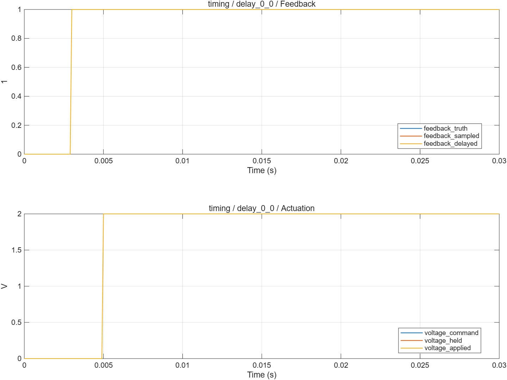

# 控制采样与执行时序：波形分析

- 模型文件：`src/TimingTest.slx`、`src/ControlTiming.slx`；系统对照使用`../experiment/src/MotorExperiment.slx`。
- 参数文件：`parameter/timing_parameters.m`；每个case另保存实际跨模块parameters。
- 采样周期：电流/默认记录100µs，外环1ms；桥臂0.1µs；能量工况记录5µs。
- 求解器/步长：普通模型ode4/5µs；收敛工况2.5µs；桥臂FixedStepDiscrete/0.1µs。
- 工况：3项，见下表和实际断言脚本。
- 数据文件：`waveform_analysis/results.mat`、`waveform_analysis/metrics.json`。

## 结果

| 工况 | 结论 | 部分指标（键名含单位） |
|---|---|---|
| delay_0_0 | 通过 | feedback_delay_s=0；actuation_delay_s=0 |
| delay_1_1 | 通过 | feedback_delay_s=0.0001；actuation_delay_s=0.0001 |
| delay_2_3 | 通过 | feedback_delay_s=0.0002；actuation_delay_s=0.0003 |

不适用于当前模式的指标以JSON null记录，例如电流模式不评价速度/位置跟踪。IAE为误差绝对值时间积分。tail_current_rms_A窗口起止在metrics中；短工况可能覆盖全程，不自动表示稳态。

## 波形说明

Feedback和Actuation均先采样保持，再配置整数拍延迟。UseTiming=0选择保持值，仍保留离散采样；UseTiming=1选择延迟值。整机使用共同的电流/角度反馈帧。

[SVG图](summary.svg) · [完整指标](metrics.json) · `results.mat`（运行验证后生成）

1拍为100µs。独立台架要求逐点完全相等；整机延迟增加会使超调增加，即使最终仍能收敛，也不能继续把原带宽视为对任意延迟成立。

## 范围与复现

没有ADC量化、采样窗口、PWM载波相位、通信抖动与真实ISR；不同传感器年龄尚未分开配置。不能用整数拍仿真证明C2000的真实截止时间。

验证依据为解析解、能量关系、边界/精确时序断言和同工况开关对照，没有运行原始chensha/MBD或官方工具箱块做逐点等价验证。当前为double MIL，不代表single、C2000构建、PIL或实机已经验证。

[验证脚本](run_timing_validation.m) · [运行方法](../build_process/USAGE.md) · [Scope表](../parameter/README.md)
